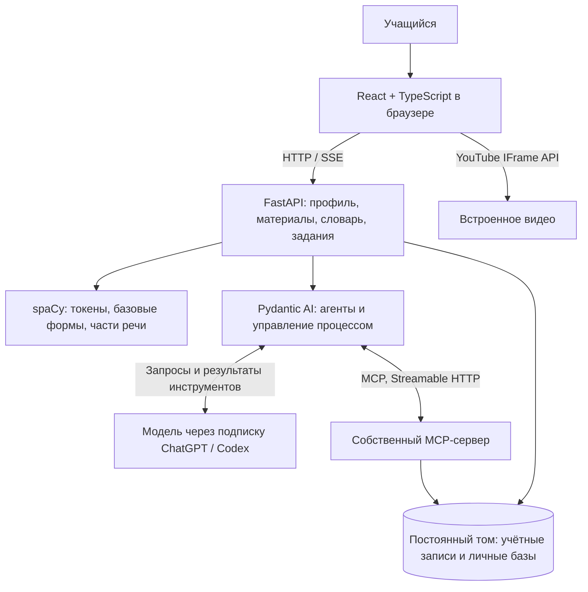
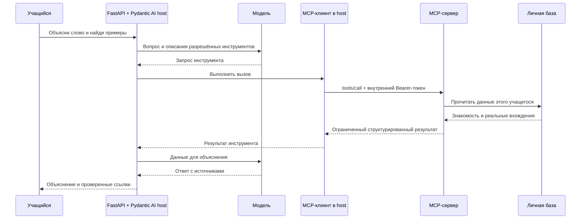
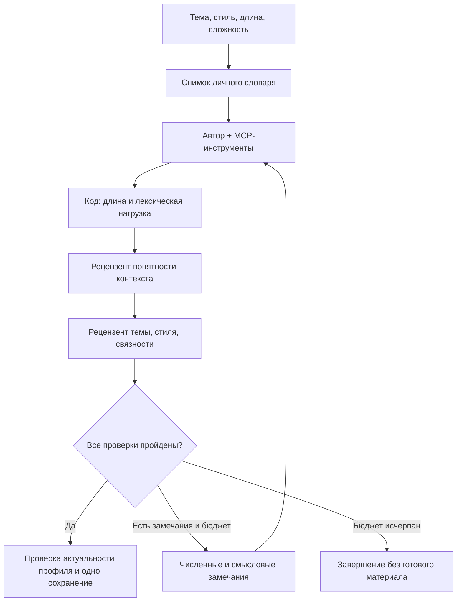

# Language Tutor

**Изучение английского через ежедневное чтение и просмотр интересных материалов с личным словарём и AI.** Человек уже имеет некоторую языковую базу и постепенно расширяет её: встречает слова в контексте, разбирает непонятное и продолжает занятие.

Проект опирается на **Comprehensible Input**: выбирать преимущественно понятный материал с посильным количеством новой лексики. Приложение помогает организовать такое погружение. Долгосрочный эффект обучения в MVP ещё не измерялся.

Вдохновение: [LingQ](https://www.lingq.com/how-to-use-lingq/), [Lute v3](https://luteorg.github.io/lute-manual/intro.html) и [LinguaCafe](https://github.com/simjanos-dev/LinguaCafe/wiki/3.-Usage-and-features). Акцент проекта — AI с доступом к личному словарю и материалам через MCP, контекстные объяснения, детектор выражений и генерация текста под словарный профиль. Импорт YouTube уже есть у [LingQ](https://www.lingq.com/blog/youtube-videos-into-lingq/) и LinguaCafe; он не является уникальным отличием.

## Пользователь и сценарий

Пользователь изучает английский, уже немного его понимает и хочет регулярно заниматься на интересном ему содержании. Интерфейс и объяснения MVP русские.

1. Добавить видео YouTube с английскими субтитрами, импортировать SRT/VTT либо открыть подготовленный пример. Для чтения можно вставить текст или загрузить TXT.
2. Посмотреть оценку знакомой лексики по своему словарю, начать просмотр или чтение.
3. Нажать на слово, получить перевод в текущем контексте и изменить знакомость. Оценка сохраняется между материалами.
4. Разобрать выражение целиком. Значение `devolve into` важнее суммы переводов частей; знакомость слова и значения выражения хранится отдельно.
5. Обсудить материал с агентом. Через MCP он читает профиль, находит реальные употребления и возвращает проверяемые цитаты.
6. Создать следующий текст с заданной лексической нагрузкой и продолжить чтение. Это экспериментальный сценарий, качество и задержка зависят от модели.

**Пример использования:** Celeste Headlee, *10 ways to have a better conversation*. В текущей библиотеке уже есть слово `plumbers` на 2:46 и выражение `devolve into` на 0:53 с сохранёнными разборами. В чистой установке сразу доступен *Elephants Dream*; для примера Celeste нужно добавить [ссылку](https://www.youtube.com/watch?v=R1vskiVDwl4) и получить английскую дорожку. Подготовка описана в [порядке показа](docs/demo/README.md).

## Границы и готовность MVP

Текущий продукт — самостоятельное веб-приложение для английского. У каждого пользователя своя учётная запись, материалы, словарь, разговоры, прогресс и настройки AI. Данные сохраняются в Docker-томе.

| Входит в MVP | Результат |
| --- | --- |
| Видео и тексты | Библиотека, импорт, плеер, синхронные кликабельные субтитры, чтение |
| Личный словарь | Знакомость 0–3 и «Пока не оценено», словоформы, ручные исправления, предварительная диагностика |
| Выражения | Фразовые глаголы, идиомы, устойчивые сочетания, отдельные значения и вхождения |
| Учебный AI и MCP | Карточки, разговорная практика, поиск источников, история слов |
| Генерация текста | Автор, численные проверки, два рецензента, исправление по замечаниям |
| Сохранение и воспроизводимость | Compose, частные профили, постоянные данные, проверки и документы |

Расширение Chrome отложено до отдельного решения. Несколько языков, гарантированный импорт любого видео YouTube, сертифицированный CEFR и доказанная эффективность обучения выходят за проверенный объём. Импорт зависит от доступности субтитров и ограничений YouTube; доступны SRT/VTT и подготовленный пример.

Критерии готовности определяет [SPEC §2.1](SPEC.md#21-текущая-работа-только-web), фактический статус — [приёмка](docs/acceptance.md). Основные условия: пройти сценарий просмотра и разбора, сохранить словарь после пересоздания контейнеров, получить ответ с реальным MCP-вызовом и проверить изоляцию пользователей. Генерация сохраняет только версию, прошедшую обязательные проверки. Наличие демонстрации не означает прохождения всех критериев. Согласование с преподавателем отдельно в репозитории не подтверждено.

Результаты полной генерации восстановлены из отдельной рабочей копии `codex/text-materials-integration`, ревизия `ce54ecc`. В этой ветке документации исходники генерации могут отставать от исследованной реализации. Точное происхождение и условия повторения указаны в [отчёте Eval](docs/demo/evaluation.md); исторические измерения не выдаются за новый прогон текущего checkout.

## Архитектура системы



Compose запускает `app` и `mcp`. FastAPI отдаёт собранный интерфейс и API на одном origin. MCP находится во внутренней сети. Оба сервиса используют постоянный том; MCP выбирает базу учащегося по внутреннему токену. Языковая обработка и вычисление процентов выполняются кодом.

Закреплены Python 3.12, Pydantic AI **2.57.0**, MCP SDK **1.30.0**, FastAPI **0.148.0**, spaCy **3.8.11**, `en_core_web_sm` **3.8.0**. Версии находятся в [pyproject.toml](pyproject.toml), [uv.lock](uv.lock) и [package-lock.json](apps/web/package-lock.json).

## Схема MCP-интеграции



Host управляет диалогом, MCP-клиент исполняет обращения модели, сервер предоставляет предметные операции над учебными данными. Модель сама не подключается к SQLite. Цитаты проверяются по сохранённым идентификаторам и исходному тексту.

| Инструменты | Назначение |
| --- | --- |
| `get_learning_profile`, `get_word_knowledge` | Профиль и знакомость базовых форм |
| `get_subtitle_context`, `find_word_occurrences` | Текущий контекст и реальные примеры |
| `get_recent_activity`, `get_practice_context` | История действий и контекст разговора |
| `get_expression_context` | Значение и контекст выражения |
| `get_frequency_words` | Частотные слова для диагностики |
| `get_generation_profile`, `list_generation_vocabulary` | Снимок профиля и выборки слов для автора |
| `get_generation_word_knowledge`, `check_text_difficulty` | Оценка кандидатов на том же снимке словаря |
| `find_texts_with_word`, `get_text` | Поиск прежнего текстового контекста и чтение по страницам |

Инструменты ограничены по объёму и принадлежности пользователю. Они не открывают произвольный SQL и не меняют знакомость. Предварительная оценка черновика через MCP не заменяет финальные проверки. Базовый сервер находится в [backend/mcp_server](backend/mcp_server/), состав расширений генерации привязан к ревизии из [отчёта Eval](docs/demo/evaluation.md).

## AI-логика

Карточки, диагностика, детектор выражений и беседы используют именованные агенты Pydantic AI со структурированными результатами. В основном режиме модель доступна через личную подписку учащегося. Модель и reasoning выбираются в настройках. Временный режим Ollama Cloud описан в [подробной инструкции](docs/setup.md).

Главный технический пример — процесс **«автор → проверяющие → исправление»**. Переходами управляет приложение. Это [evaluator–optimizer](https://www.anthropic.com/research/building-effective-agents) с несколькими ролями. Автор и рецензенты могут использовать одну модель, поэтому независимость их ошибок не гарантируется.



Автор выбирает лексику, проверяет кандидатов через MCP и получает историю своих версий. Код считает вхождения по словарю: **K** — знакомые слова с оценкой 2–3, **L** — изучаемые с оценкой 1, **U** — неизвестные с оценкой 0 или без оценки. Повторы учитываются. Имена, шум и исключённые элементы обрабатываются правилами отбора. Знакомость не равна объективной проверке знания.

| Настройка | Целевая U | Допустимая U | Максимальная L с допуском |
| --- | ---: | ---: | ---: |
| Бережная | 1% | 0–2% | 5% |
| Обычная | 3% | 2–4% | 8% |
| Насыщенная | 5% | 4–6% | 11% |

Предпочтительная длина — 150–200, 250–350 или 450–550 слов, с техническим допуском 50 слов с каждой стороны. Диапазоны — рабочие настройки продукта. Они не гарантируют понимание: [исследование лексического покрытия](https://onlinelibrary.wiley.com/doi/full/10.1111/lang.12622) показывает зависимость результата и от других свойств текста.

Первый рецензент проверяет, помогает ли контекст понять каждое недостаточно знакомое употребление. Второй оценивает связность, тему и стиль. Код проверяет полноту отчётов и свидетельства. После изменения текста прежние рецензии теряют силу. Перед сохранением проверяются актуальность профиля и защита от повторного добавления.

В исследованной реализации предел задания — **10 версий, 600 секунд, 60 запросов модели, 100 инструментальных попыток**. Это пределы, а не средняя длительность. При сравнении моделей действовали более ранние пределы: 5 версий и 300 секунд.

## Запуск и обновление

Нужны Git, доступ к приватному репозиторию, работающий Docker Engine с Compose v2 и современный браузер. Для первой сборки нужен доступ к Docker Hub, GHCR, PyPI и GitHub. Для видео и AI нужен интернет. [Dockerfile](Dockerfile) собирает frontend и закреплённое Python-окружение.

```sh
git clone https://github.com/GlebNM/language_tutor.git
cd language_tutor
cp .env.example .env
docker compose up --build -d --wait
docker compose ps
curl -fsS http://localhost:8765/api/health
```

Откройте [http://localhost:8765](http://localhost:8765), создайте имя пользователя и пароль от 12 символов. В «Настройках» подключите ChatGPT и проверьте подключение. Если автоматический возврат не сработал, вставьте полный одноразовый адрес возврата в поле «Адрес после входа в ChatGPT» и завершите подключение. Для автоматического локального возврата доступен `compose.oauth.yaml`.

Порт по умолчанию — 8765. При конфликте измените `APP_PORT` и оба origin в `ALLOWED_ORIGINS` в `.env`. `YOUTUBE_API_KEY` нужен для поиска YouTube; импорт готовой ссылки и SRT/VTT — отдельные сценарии. Настройка сети, учётные записи, смена модели и типовые проблемы описаны в [docs/setup.md](docs/setup.md).

Том `learning-data` хранит `/data/accounts.sqlite3` и личные базы, настройки и credentials в `/data/users/<id>/`. Обычный `docker compose down` сохраняет данные. Для резервной копии остановите сервисы и скопируйте содержимое тома; копия содержит частные данные и не должна попадать в Git.

Обновляйте только выбранную отправленную ревизию. Перед обновлением сохраните резервную копию и убедитесь, что нужный commit доступен на remote:

```sh
git fetch origin
git switch --detach <проверенный-commit-на-remote>
docker compose up --build -d --wait
docker compose ps
curl -fsS http://localhost:8765/api/health
```

Презентацию можно открыть как локальный `docs/demo/index.html` или запустить из корня репозитория:

```sh
python3 -m http.server 8877 --bind 127.0.0.1
```

Адрес: [http://127.0.0.1:8877/docs/demo/index.html](http://127.0.0.1:8877/docs/demo/index.html).

## Результаты Eval и разбор ошибок

27 октября 2026 года сравнили **весь процесс генерации** на `gpt-6-luna / medium` и `gpt-6.1-sol / medium`: одинаковые задачи, синтетический профиль и обязательные проверки. Модель работала автором и обоими рецензентами. Измеряли исход, число законченных версий, внутренних кандидатов, предварительных проверок и время. Это небольшие разработческие эксперименты без статистического вывода о моделях вообще.

| Серия | Luna / medium | SOL / medium |
| --- | --- | --- |
| Один сюжет, обычная U=2–4% | Успех за 3 версии | Успех за 1 версию |
| Тот же сюжет, насыщенная U=4–6% | Неуспех за 5 версий | Успех за 2 версии |
| Ещё 6 контрольных заданий на новых темах | Не запускалась в этой серии | 6/6 успехов за 1–2 версии |

**Отдельный трудный запуск Luna:** 7 версий за **409,79 с**, 13 внутренних кандидатов и 18 предварительных численных проверок. Итоговая U=3,03%, смысловые проверки пройдены, но автор вставил прямое определение `umbrella`. Автоматическая приёмка не доказывает естественность учебного рассказа. После пробы уточнили инструкции автора и рецензента; улучшение не подтверждено отдельным сравнением.

**Отдельный запуск в настоящем профиле:** Luna создала 350 слов за 2 версии и 129,19 с, U=11/341=3,23%. До исправления ограничений времени два запуска завершились по тайм-ауту. Эти случаи учитываются отдельно от сравнения на синтетическом профиле.

| Ошибка или ограничение | Что сделали и что ещё проверить |
| --- | --- |
| Соблюдены проценты, но текст похож на определения из словаря | Рекомендуем косвенные подсказки через действия и последствия, повтор слова в разных контекстах. Нужна отдельная оценка естественности |
| Много исправлений и превышение времени | Сохраняем историю автора и конкретные замечания. Различаем версии и реальные запросы. Нужны более широкие испытания |
| Повторяются темы и слова | Перемешиваем выборку между заданиями, сохраняем порядок внутри задания. Разнообразие текста ещё нужно измерить |
| Рецензенты повторяют ошибки автора | Проверяем полноту и свидетельства кодом. Согласие ролей одной модели не заменяет человеческую оценку |
| «Знакомое» основано на предварительных оценках | Показываем происхождение оценок и допускаем ручное исправление. Знание и учебный прогресс требуют отдельной проверки |

Полные данные и происхождение: [отчёт Eval](docs/demo/evaluation.md), [сравнение](docs/acceptance/text-generation-model-comparison-2026-10-27.md), [серии экспериментов](docs/acceptance/text-generation-target-and-dialogue-2026-10-27.json), [трудный запуск](docs/acceptance/text-generation-context-2026-10-27.json). Исторические проверки API, браузера, Compose и MCP находятся в [приёмке](docs/acceptance.md). Они не доказывают качество языка или пользу обучения.

Автоматические проверки из корня репозитория:

```sh
uv sync --frozen
uv run pytest
npm ci --prefix apps/web
npm test --prefix apps/web
npm run build --prefix apps/web
```

## Что улучшать

Генерацию сложно стабилизировать на более лёгких моделях; даже Luna часто требовала нескольких исправлений. Нужны существенно более широкие эксперименты, ручная работа над промптами и отдельная оценка естественности. Значительную часть исходных промптов подготовили с помощью LLM. Опыт проекта показал: наличие документации у LLM само по себе не обеспечивает хороший агентский сценарий, качество приходится проверять на реальных заданиях.

Следующее направление — удешевление отдельных шагов агентов, в том числе через **Decisions API, Jev и Laya**. Выбор шагов, качество и стоимость такого варианта ещё предстоит измерить. Текущие токенизация и лемматизация выполняются spaCy; альтернативная схема в MVP не реализована.

## Источники

- Идея продукта: [LingQ](https://www.lingq.com/how-to-use-lingq/), [импорт YouTube в LingQ](https://www.lingq.com/blog/youtube-videos-into-lingq/), [Lute v3](https://luteorg.github.io/lute-manual/intro.html), [LinguaCafe](https://github.com/simjanos-dev/LinguaCafe/wiki/3.-Usage-and-features).
- Понимание и лексическое покрытие: [Kremmel et al., 2023](https://doi.org/10.1111/lang.12622). Пороги приложения — рабочие ограничения нагрузки.
- Агентский процесс: [Anthropic, Building effective agents](https://www.anthropic.com/research/building-effective-agents), [Self-Refine](https://arxiv.org/abs/2303.17651), [Pydantic AI: multi-agent applications](https://pydantic.dev/docs/ai/guides/multi-agent-applications/), [структурированный результат](https://pydantic.dev/docs/ai/core-concepts/output/).
- Интеграции: [архитектура MCP](https://modelcontextprotocol.io/docs/learn/architecture), [spaCy](https://spacy.io/usage/linguistic-features), [YouTube IFrame API](https://developers.google.com/youtube/iframe_api_reference).
- Свои требования и измерения: [SPEC](SPEC.md), [глоссарий](GLOSSARY.md), [приёмка](docs/acceptance.md), [Eval](docs/demo/evaluation.md). Связанная задача поставки: [GitHub #15](https://github.com/GlebNM/language_tutor/issues/15).
- Материалы: [Celeste Headlee, TED](https://www.youtube.com/watch?v=R1vskiVDwl4). Источник и лицензии *Elephants Dream*: [data/demo/README.md](data/demo/README.md). Атрибуция частотного словаря: [data/diagnostics/README.md](data/diagnostics/README.md).
