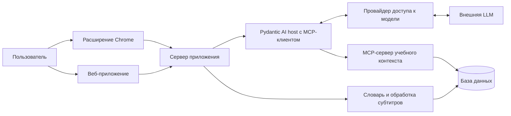

# Интерактивные субтитры для изучения английского — ТЗ MVP

Версия: 0.7 · Дата: 20 октября 2026 года · Статус: принята для разработки, включая F10–F11 и приватную поставку.

20 октября 2026 года — контрольная точка демонстрации. На ней показывается работающий на тот момент сценарий и явно перечисляются непройденные критерии. Завершение полного MVP допускается после этой даты; его готовность определяется актуальными критериями приёмки A1–A19. Итоговая поставка — локальный запуск через Docker Compose. Текущее состояние реализации и фактические результаты проверок записаны в [docs/acceptance.md](docs/acceptance.md).

## 1. Идея и задача

Веб-приложение и расширение для Chrome помогают изучать английский во время просмотра YouTube. Они превращают субтитры в кликабельный текст: пользователь получает перевод слова в контексте, уточняет его знакомость и обсуждает лексику с AI-агентом. Личный словарь позволяет оценить, насколько трудным окажется открытое видео. Веб-приложение работает самостоятельно, без установки расширения.

Основной пользователь первой версии — русскоязычный человек, который смотрит англоязычные видео и хочет понимать их с минимальным количеством переключений между сервисами. Продукт поддерживает подход comprehensible input: помогает выбрать посильный материал и разобраться с отдельными препятствиями пониманию. Эффективность обучения за длительный период предстоит проверить после MVP.

Главная ценность: посмотреть видео, разобраться с непонятной репликой и продолжить просмотр в том же окне.

## 2. Принятые продуктовые решения

| Вопрос | Решение |
| --- | --- |
| Площадки | Самостоятельное веб-приложение в браузере на компьютере и обычные страницы видео YouTube в расширении Chrome |
| Первый изучаемый язык | Английский |
| Язык интерфейса и объяснений | Русский; примеры употребления — на английском |
| Интерфейсы | Веб-приложение с плеером, субтитрами, словарём и чатом; расширение с субтитрами поверх YouTube и боковой панелью Chrome |
| Главный сценарий | Просмотр видео и быстрый разбор незнакомых слов |
| Другие обязательные сценарии | Оценка сложности открытого видео и обсуждение лексики с агентом |
| Начальный словарь | Короткая диагностика с агентом и автоматическая предварительная оценка знакомости |
| Поведение после диагностики | Предположительно знакомые слова сразу отображаются без подсветки; пользователь может исправить оценку |
| Общий профиль | Один учащийся на локальную установку; веб-приложение и расширение используют один учебный профиль, словарь, материалы и диагностику |
| Вход в приложение | Оба интерфейса открывают единственный локальный профиль; регистрации, входа и переключения профилей в MVP нет |
| Доступ к AI | Только личная подписка Codex/ChatGPT в локальном приложении; конкретная интеграция проверяется по разделу 12.2 |
| Настройки AI | Одна сохраняемая пара «модель + reasoning» для карточек, диагностики и чата; выбор доступен в обоих интерфейсах |
| Слова видео | Все уникальные слова дорожки с фильтрами по каждому уровню шкалы, редактированием знакомости и переходом к вхождениям |
| Поставка | Docker Compose на компьютере пользователя; веб-приложение открывается по локальному адресу |
| Репозиторий | Приватный GitHub-репозиторий; публичная публикация не требуется для MVP |
| Агентские пайплайны | Pydantic AI для диагностики, контекстной карточки, чата и работы с MCP |
| Добавление языков | Язык хранится в профиле, словаре и материалах; обработка текста вынесена в языковой адаптер |

Архитектура, численные пороги, ограничения и способ демонстрации ниже предложены для реализации к указанному сроку. Их можно уточнять по результатам первого прототипа с записью причины изменения в этом документе.

## 3. Объём первой версии

| ID | Обязательная возможность | Результат для пользователя |
| --- | --- | --- |
| F1 | Начальная диагностика | Стартовый словарный профиль без необходимости вручную отмечать сотни слов |
| F2 | Субтитры поверх YouTube | Английские реплики синхронизированы с воспроизведением, каждое слово кликабельно |
| F3 | Контекстный перевод | Карточка объясняет выбранное слово именно в текущей реплике |
| F4 | Личный словарь | Знакомость можно изменить; изменения сохраняются между просмотрами и перезапусками браузера |
| F5 | Сложность открытого видео | Доля слов, которые профиль считает знакомыми, и понятная предварительная оценка |
| F6 | Учебный AI-агент с MCP | Обязательный для полного MVP диалог о словах с доступом к субтитрам, личному словарю и предыдущим учебным материалам |
| F7 | Локальная поставка и документация | Воспроизводимый запуск через Docker Compose, приватный репозиторий, README, ZIP расширения и результаты приёмки |
| F8 | Самостоятельный веб-интерфейс | Без расширения доступны диагностика, добавление материала, просмотр с кликабельными субтитрами, личный словарь и чат |
| F9 | Подключение подписки Codex | Пользователь подключает свою подписку в локальном приложении и получает живые AI-ответы; видит статус подключения и может отключить подписку |
| F10 | Выбор модели и reasoning | В веб-приложении и расширении доступен общий сохранённый выбор модели и reasoning для карточек, диагностики и чата |
| F11 | Слова видео | Все уникальные слова текущей дорожки доступны с фильтрами по каждому уровню знакомости и ручным изменением оценок личного словаря |

Все F1–F11 входят в готовый MVP и проверяются в локальной поставке. Публичный размещённый сервис, публичное онлайн-демо и учёт денежных расходов AI находятся вне объёма MVP. Последовательность этапов в разделе 15 задаёт порядок реализации.

После MVP: несколько учащихся и переключение профилей, доступ к AI по API-ключу, поиск и рекомендации новых видео, другие видеоплатформы, поддержка расширением других браузеров, мобильные устройства, голосовой диалог, собственное распознавание речи, Anki/SRS, автоматический учёт забывания, полноценная библиотека выражений и синхронизация между устройствами. Поддержка Shorts, прямых эфиров и полноэкранного режима также относится к следующей версии.

## 4. Основной пользовательский сценарий

### 4.1. Просмотр на YouTube через расширение

1. Пользователь устанавливает расширение по инструкции и открывает боковую панель на YouTube.
2. Расширение обращается к локальному backend и использует единственный учебный профиль. При первом использовании пользователь проходит диагностику или выбирает «Начать без оценки».
3. Открывает англоязычное видео и включает учебный режим. Расширение получает полную дорожку субтитров, показывает результат анализа словаря и список слов видео в боковой панели.
4. Во время просмотра видит текущую английскую реплику. Слова, которые профиль считает знакомыми, отображаются без подсветки.
5. Нажимает на слово. Видео ставится на паузу, в боковой панели открывается карточка с переводом, объяснением и исходной репликой.
6. При необходимости меняет знакомость слова. Все его вхождения в материале и показатель сложности обновляются.
7. Нажимает «Обсудить с агентом», например: «Почему здесь используется это слово?», «Чем оно отличается от …?» или «Покажи его в моих предыдущих материалах».
8. Агент обращается к инструментам MCP и отвечает с опорой на найденный контекст. Пользователь нажимает «Продолжить просмотр».
9. В следующем видео используются уже сохранённые оценки знакомости.

Если автоматическое получение субтитров недоступно, пользователь загружает SRT/VTT, соответствующий этому видео. Дальнейший сценарий остаётся тем же.

### 4.2. Работа в веб-приложении

1. Пользователь запускает приложение через Docker Compose и открывает локальный веб-интерфейс. Единственный учебный профиль доступен сразу. Для AI пользователь подключает подписку через браузерный OAuth.
2. Проходит диагностику или пропускает её; открывает свою библиотеку материалов.
3. Добавляет ссылку YouTube и соответствующий файл SRT/VTT либо выбирает подготовленный пример. Уже добавленные материалы доступны повторно.
4. Смотрит видео во встроенном плеере, нажимает на слова в синхронных субтитрах, получает карточки и меняет знакомость. Под видео просматривает слова дорожки по уровням знакомости, редактирует оценки и переходит к выбранным вхождениям.
5. Обсуждает лексику с агентом, открывает словарь и возвращается к материалу с сохранёнными оценками.
6. При желании устанавливает расширение, указывает тот же локальный backend и продолжает обучение на странице YouTube с теми же данными.

Для веб-приложения импорт SRT/VTT — обязательный путь добавления собственной дорожки. Автоматическое извлечение в расширении проверяется отдельно. Если владелец запретил встраивание видео, приложение объясняет причину, сохраняет материал для чтения и предлагает открыть ролик на YouTube; синхронный просмотр такого ролика внутри веб-приложения недоступен.

## 5. Интерфейс и получение субтитров

### 5.1. Учебный режим

Расширение активируется пользователем на странице `youtube.com/watch`. Поверх области плеера выводятся одна или две текущие реплики. Боковая панель содержит показатель сложности, слова текущего видео, карточку выбранного слова, чат, раздел «Мои слова» с поиском и фильтром по знакомости и настройки модели и reasoning.

Клик по слову фиксирует выбранную реплику и её время. Карточка остаётся привязанной к этому контексту, даже если воспроизведение затем продолжилось. Повторный быстрый клик отменяет предыдущий запрос или исключает показ устаревшего ответа. Если видео уже было на паузе, открытие карточки не запускает его. Закрытие карточки также не запускает видео автоматически.

При переходе между роликами без перезагрузки страницы расширение сбрасывает текущую реплику и загружает материал нового видео. Ответы от предыдущего ролика не появляются в новом. Одновременно активен один учебный материал на вкладку; интерфейс панели всегда указывает, к какому видео относится.

Штатные субтитры визуально скрываются на время работы собственного слоя и восстанавливаются при его выключении. Обычный и театральный режимы проверяются в MVP. Подсветка сопровождается текстовым статусом в карточке; её смысл не зависит только от цвета.

Для панели используется [Chrome Side Panel API](https://developer.chrome.com/docs/extensions/reference/api/sidePanel), для взаимодействия со страницей — [content scripts](https://developer.chrome.com/docs/extensions/develop/concepts/content-scripts). Конкретная интеграция с плеером проверяется первым прототипом.

### 5.2. Источники субтитров

Основной путь — получить доступную английскую дорожку средствами расширения на открытой пользователем странице. Предпочтение отдаётся авторским субтитрам; при их отсутствии используются автоматические. Интерфейс сообщает источник дорожки. Автоматически переведённые дорожки не выбираются вместо английского оригинала.

Автоматическое извлечение — главный технический риск. Официальный метод [YouTube captions.download](https://developers.google.com/youtube/data/reference/rest/v3/captions/download) требует права редактирования видео. Доступ к субтитрам произвольного чужого ролика через этот метод закладывать в реализацию нельзя. Доступность дорожек на странице нужно проверить на реальных видео до разработки остальных возможностей.

В расширении резервный путь — загрузка SRT/VTT в боковой панели с привязкой к текущему `video_id`; в веб-приложении тот же импорт доступен при добавлении материала по ссылке. Оба интерфейса используют общую серверную обработку. Проверяются формат, размер, порядок временных меток и непустой текст. Пользователь может заменить неверный файл. Полный текст и метаданные дорожки сохраняются как отдельная версия материала.

Адаптер возвращает `video_id`, `language`, `source`, `is_complete`, `transcript_hash` и список реплик `{id, start_ms, end_ms, text}`. Общие границы для первой версии: файл до 2 МБ, до 10 000 реплик и до 200 000 символов текста; превышение показывает понятное сообщение. В приёмочных проверках используются ролики до 30 минут.

Повторяющиеся фрагменты автоматических субтитров нормализуются с учётом временного перекрытия. Одинаковая фраза, произнесённая позднее, сохраняется как новое вхождение. Один только перехват текущей видимой реплики не даёт данных для оценки всего ролика: до получения полной дорожки показатель сложности видео недоступен.

### 5.3. Состояния интерфейса

Обязательные состояния: загрузка, готовность, отсутствие английской дорожки, ошибка извлечения, предложение импорта, неверный файл, отсутствие интернета, ожидание AI, ошибка/лимит AI и повторный запрос. При недоступности AI субтитры и уже сохранённый словарь продолжают работать после загрузки материала. Несохранённое изменение знакомости отмечается явно и допускает повторную отправку.

### 5.4. Самостоятельный веб-интерфейс

Обязательные разделы: «Материалы», «Просмотр», «Мои слова», «Диагностика» и «Настройки AI». В библиотеке можно добавить материал по ссылке YouTube с SRT/VTT и повторно открыть сохранённый. В просмотре рядом с плеером находятся кликабельные субтитры, показатель сложности, карточка слова и чат. Словарь поддерживает поиск, фильтр по знакомости и изменение score/ignored.

Плеер использует [YouTube IFrame Player API](https://developers.google.com/youtube/iframe_api_reference). В веб-приложении субтитры выводятся отдельным слоем рядом с плеером или под ним; вставка своего содержимого внутрь YouTube iframe не требуется. Пауза, перемотка, выбранное вхождение и защита от устаревших ответов работают по тем же правилам, что в расширении. Нажатие на найденную цитату текущего материала переводит встроенный плеер к её времени.

Настройки показывают состояние подключения подписки, выбор модели и reasoning, адрес локального backend для расширения и действие удаления данных. Подготовленный пример доступен внутри этого приложения. Все основные разделы работают без установленного расширения. Подключение подписки требуется для AI-сценариев; библиотека, субтитры и словарь доступны сразу после запуска приложения.

### 5.5. Слова видео

В веб-приложении под видео доступен список «Слова видео»; в расширении тот же список находится в боковой панели текущего видео. Он содержит все уникальные слова полной дорожки, включая слова, знакомость которых ещё не оценивалась. Словоформы объединяются по базовой форме и части речи согласно разделу 6.2.

Фильтры соответствуют каждому уровню шкалы отдельно: «Пока не оценено», 0, 1, 2 и 3 с подписями из раздела 6.1. Из списка пользователь может изменить знакомость и признак ignored. Изменения сохраняются в личном словаре, действуют на связанные словоформы во всех материалах и пересчитывают подсветку и сложность открытого видео.

По умолчанию весь набор слов показан компактными плитками, сгруппированными в порядке «Пока не оценено», 0, 1, 2, 3. Каждый уровень имеет свой цвет, число и текстовую подпись; рядом видна легенда. Внутри уровня сначала идут слова с наибольшим числом вхождений. Плитка показывает базовую форму, часть речи, число вхождений и знакомость; предварительная оценка помечается явно. Исключённые слова также видны по умолчанию и имеют отдельную пометку. Поиск и фильтры по уровню и ignored помогают сузить список.

Нажатие на слово раскрывает его словоформы, редактор знакомости и вхождения; одновременно раскрыто одно слово. Компактный обзор всех слов доступен сразу, без поискового запроса и переключения страниц.

При раскрытии слова показываются реплики с временными метками. Выбор конкретного вхождения перематывает видео к соответствующей реплике, ставит его на паузу и открывает контекстную карточку с переводом и объяснением. Просмотр списка, поиск, фильтры и изменение знакомости доступны без обращения к AI. Пауза, перемотка и защита от устаревшей карточки следуют правилам раздела 5.1.

## 6. Знакомость слов

### 6.1. Шкала

| Значение | Значение для пользователя | Отображение |
| --- | --- | --- |
| `null` | Пока не оценено | Нейтральное подчёркивание |
| `0` | Не знаю | Выраженная подсветка |
| `1` | Учу; обычно нужна подсказка | Мягкая подсветка |
| `2` | Узнаю в контексте | Без подсветки |
| `3` | Уверенно знаю | Без подсветки |

Дополнительно есть признак `ignored`: пользователь может исключить имя или нерелевантное слово из подсветки и расчёта сложности. Его можно вернуть обратно.

Каждая оценка имеет источник: `manual` — выбранная пользователем, `diagnostic` — полученная из ответов диагностики, `prior` — предположение для непроверенного слова. Для двух последних карточка показывает «Предварительная оценка». Это рабочая шкала продукта; она не является вероятностью знания слова.

Открытие перевода и число встреч записываются отдельно от знакомости, если такие события собираются. Сами по себе они не повышают и не понижают score. В MVP изменения после начала просмотра делает пользователь; агент может предложить новую оценку текстом.

Ручная оценка имеет приоритет над диагностикой и стартовыми предположениями. Повторная диагностика обновляет только предварительные оценки. Пользователь может сбросить конкретное слово в «Пока не оценено»; автоматическое правило больше не переопределяет это ручное решение.

### 6.2. Словоформы и значения

Единица словаря — базовая форма слова с языком и частью речи. Например, `watch`, `watched`, `watching` как глаголы используют общую оценку. Исходная форма в реплике сохраняется. При сомнительном разборе используется нормализованная исходная форма с признаком неопределённости; исправление базовой формы доступно в карточке и перепривязывает соответствующее вхождение.

Контекстный перевод хранится для конкретной реплики и выбранного вхождения. Значение `bank` в одном видео не заменяет перевод во всех других контекстах. Знакомость в MVP общая для слова и части речи: знание отдельных значений отдельно не моделируется. Для такой ситуации пользователь может понизить общую оценку.

Если выбранное слово входит в выражение вроде `give up`, AI объясняет выражение целиком и указывает его в карточке. Отдельное сохранение знакомости многословных выражений относится к следующей версии.

Для английского предлагается [spaCy](https://spacy.io/usage/linguistic-features#lemmatization): токенизация, определение части речи и базовой формы. Версия модели и правила нормализации фиксируются вместе с версией обработки материала.

## 7. Начальная диагностика

Цель — быстро создать полезное стартовое предположение о словаре. Пользователь может пропустить диагностику и пройти её позднее.

Минимальная диагностика: 12 слов из трёх частотных групп и две короткие фразы на понимание. Ориентир длительности — 3–5 минут. Агент ведёт диалог по-русски, просит объяснить значение или смысл и оценивает ответы по заранее заданным допустимым значениям. Пользователь может ответить «не знаю» или «пропустить».

Слова и фразы выбираются из небольшой проверенной подборки. LLM не создаёт весь экзамен заново. Её задача — понять свободный ответ, объяснить ошибки и сформулировать приблизительный словарный профиль. Результат содержит структурированные оценки по ID заданий; сервер проверяет их по схеме и допустимым ID.

Предложенное стартовое правило: частотная группа с минимум тремя верными ответами из четырёх получает предварительный score `2` для входящих в неё непроверенных слов. Остальные непроверенные слова остаются неоценёнными. Для непосредственно проверенных слов верный ответ даёт предварительный score `2`, неверный или «не знаю» — `0`, пропуск — `null`; источник — `diagnostic`. Такие результаты имеют приоритет над правилом группы. Понимание двух фраз уточняет описание уровня; в первой версии оно не переводится в дополнительные массовые изменения словаря.

Это эвристика с малым числом примеров. Она не подтверждает знание каждого слова группы и не даёт сертифицированный уровень CEFR. Пороги, состав групп и подборка заданий версионируются. Слова без записи в выбранном частотном списке автоматически знакомыми не становятся.

Стартовые группы задаются по нормализованному частотному списку: ранги 1–1000, 1001–3000 и 3001–6000. Источник-кандидат — [wordfreq](https://github.com/rspeer/wordfreq): при подготовке списка необходимо сохранить сведения об источнике и лицензии данных. Частотность не трактуется как готовая разметка CEFR.

После диагностики предварительные оценки применяются сразу, а соответствующие слова теряют подсветку. В сводке видно, что было проверено, а что предположено. Начальный профиль хранится как версия правил для частотных групп; тысячи отдельных записей можно создавать по мере появления слов. Любая ручная оценка перекрывает эти правила.

Если диагностика прервана или AI недоступен, пользователь может продолжить просмотр. Незавершённая диагностика не применяет массовые предположения.

## 8. Оценка сложности видео

Система оценивает лексическую доступность текста по личному профилю. Она не измеряет темп речи, акцент, грамматику, качество звука и понимание темы.

Расчёт выполняется по всем вхождениям слов полной нормализованной дорожки. Повторы, реально произнесённые в видео, учитываются: часто повторяющееся слово сильнее влияет на просмотр. Пунктуация, числа без слов и служебные метки вроде `[Music]` исключаются; обычные служебные слова языка учитываются. Слова с `ignored=true` исключаются из числителя и знаменателя. Счётчик уникальных незнакомых слов показывается отдельно.

Обозначения: `N` — число учитываемых вхождений; `K` — вхождения со score `2` или `3`; `L` — вхождения со score `0` или `1`; `A` — неоценённые. `N = K + L + A`.

```text
Знакомо по профилю, % = 100 × K / N
Незнакомо по профилю, % = 100 × L / N
Пока не оценено, % = 100 × A / N
```

Предварительные оценки участвуют в расчёте, но их доля показывается отдельно. Пример: «По профилю знакомо 92% слов; 35 процентных пунктов основаны на предположении агента. Ещё 3% пока не оценены». Остальные 5% в этом примере имеют score `0` или `1`.

Когда `A > 0`, система показывает диапазон возможного лексического покрытия: от `K/N` до `(K+A)/N`. Он условен относительно предварительных оценок и не является статистическим доверительным интервалом.

При `N >= 50` и `A/N <= 0.20` можно показать ориентир по нижней границе покрытия: от 95% — «Мало новой лексики», от 90% до 95% — «Понадобятся подсказки», ниже 90% — «Много новой лексики». Эти пороги — настраиваемая продуктовая эвристика. Если более 20% вхождений имеют предварительные оценки, рядом обязательно стоит пометка «Предварительно».

При большой доле неоценённых слов, коротком тексте, пустой или неполной дорожке категоричная метка не показывается. Интерфейс объясняет причину и предлагает диагностику или уточнение словаря. При `N = 0` проценты отсутствуют.

Изменение score и `ignored` немедленно пересчитывает показатели открытого материала. Для оценки достаточно обычного кода: LLM занимается переводом, объяснением, диагностикой и диалогом.

## 9. AI-логика и MCP

### 9.1. Ответственность AI

LLM выполняет основную учебную работу: понимает ответы диагностики, выбирает контекстное значение слова, объясняет выражения и отвечает на вопросы пользователя с учётом его профиля. Для короткой карточки возвращает структурированные поля `translation`, `explanation`, `expression`, `example`. Языки полей определяются настройками профиля; в MVP перевод и объяснение русские, пример английский. Сервер проверяет схему ответа.

Карточка содержит перевод, объяснение в 1–3 предложениях, исходную реплику и один короткий английский пример. Агент может раскрыть тему подробнее в чате. При недостатке контекста он сообщает о неоднозначности. Предположение о смысле отделяется от найденной цитаты.

### 9.2. Собственный MCP-сервер учебного контекста

Предлагается один собственный MCP-сервер, который открывает агенту личный словарь и учебные материалы. Это самостоятельная полезная интеграция: стандартный клиент может получить те же данные без знания внутренней схемы базы. Роли host, client и server соответствуют [официальной архитектуре MCP](https://modelcontextprotocol.io/docs/learn/architecture).

| Инструмент | Входные данные | Результат |
| --- | --- | --- |
| `get_learning_profile` | `language` | Язык объяснений, сводка диагностики, версия начального профиля |
| `get_word_knowledge` | `language`, список базовых форм и частей речи, до 30 | Знакомость, источник и наличие ручного исправления |
| `get_subtitle_context` | `material_id`, `cue_id`, число соседних реплик | Выбранная реплика, до двух соседних с каждой стороны, временные метки |
| `find_word_occurrences` | `language`, базовая форма, часть речи, `limit <= 5` | Цитаты и время из собственных материалов пользователя |
| `get_diagnostic_items` | `language`, `kind=word\|sentence`, частотная группа для слов, `limit <= 4` | Проверенные задания с ID и данными для оценки ответа |

Результаты ограничены по объёму: текстовый контекст одного инструмента — до 6000 символов. Поиск использует точные базовые формы и индексы базы; векторная база для MVP не требуется. В «предыдущих материалах» ищутся ролики, которые пользователь добавил в учебном режиме. Наличие субтитров в базе не считается доказательством фактического просмотра каждой реплики.

Инструменты читают данные. Изменения знакомости поступают через действия пользователя в интерфейсе; результаты диагностики применяет сервер по правилам раздела 7. Произвольный SQL, выполнение кода и загрузка произвольных URL агенту не предоставляются.

### 9.3. Сквозной сценарий через MCP

Пользователь спрашивает: «Объясни это слово в текущей реплике и покажи, где оно встречалось в моих материалах».

1. Веб-приложение или расширение передаёт запрос и ID выбранного вхождения серверу.
2. Host на Pydantic AI предоставляет модели описания доступных инструментов, полученные от MCP-сервера.
3. Модель запрашивает контекст, знакомость и предыдущие вхождения. Host проверяет параметры и выполняет реальные вызовы MCP.
4. MCP-сервер получает записи из базы и возвращает структурированные результаты.
5. Host передаёт результаты модели. Она формирует объяснение и ссылки на найденные реплики.
6. Пользователь видит ответ. Ссылки ведут на YouTube с временной меткой; для текущего ролика интерфейс может выполнить переход внутри плеера.

При открытии карточки обязательный контекст можно заранее получить через MCP и передать в первый запрос модели. В чате поддерживается выбор инструментов самой моделью. В живом сценарии диагностики задания также поступают через MCP. Число последовательных раундов инструментов ограничено тремя; превышение возвращает объяснение о недоступности полного ответа.

Цитаты и ссылки собираются из результатов инструментов и проверяются сервером. Если вхождений нет, агент сообщает об этом. Примеры, созданные моделью, подписываются как учебные и не выдаются за цитаты.

В журнале с единым `request_id` сохраняются названия инструментов, их успешность и длительность. На защите нужно показать реальный вызов MCP. Использование MCP только внутри среды разработки не выполняет требование интеграции в сам продукт.

### 9.4. Реализация пайплайнов на Pydantic AI

Pydantic AI — обязательный фреймворк агентской логики. Диагностика, контекстная карточка и учебный чат реализуются через именованные `pydantic_ai.Agent`; последовательность шагов задаётся обычными async-функциями Python, а `pydantic-graph` используется при необходимости явного графа состояний. Цикл вызовов модели и инструментов выполняет Pydantic AI.

Карточка и результаты диагностики задаются Pydantic-моделями через `output_type`; проверка допустимых ID заданий, связи материала с выбранным вхождением и применения оценок остаётся на сервере. `deps`/`RunContext` передают единственный учебный профиль, выбранное вхождение, `request_id` и доступ к сервисам. История сообщений привязана к разговору и материалу.

Учебный MCP подключается средствами Pydantic AI как capability/toolset через Streamable HTTP. MCP-клиент работает на нашем backend, чтобы внутренний MCP-сервер оставался доступен только ему. Контекст материала, вхождения и разговора передаётся на каждый запуск; параллельные запросы не меняют общий «текущий материал». Таймауты, ограничение числа запросов модели и трёх раундов инструментов применяются ко всему запуску; повторные попытки учитываются в тех же ограничениях.

Версии `pydantic-ai`, MCP-библиотек и провайдера фиксируются в зависимостях. Приёмка проверяет локальную конфигурацию доступа к AI на одном наборе схем и инструментов. Документация: [Pydantic AI](https://pydantic.dev/docs/ai/), [MCP](https://pydantic.dev/docs/ai/capabilities/mcp/) и [провайдер Codex](https://pydantic.dev/docs/ai/models/openai-codex/).

### 9.5. Выбор модели и reasoning

В «Настройках AI» веб-приложения и расширения пользователь выбирает одну общую пару «модель + reasoning» для контекстных карточек, диагностики и учебного чата. Выбор сохраняется между запусками локальной установки; оба интерфейса используют одинаковые настройки.

Каталог показывает все доступные модели подключённой подписки, совместимые с карточками, диагностикой и чатом. Для выбранной модели предлагаются поддерживаемые ею уровни reasoning. Совместимость вариантов проверяется на используемой интеграции; общий перечень значений SDK сам по себе не считается подтверждением поддержки конкретной моделью.

Изменение применяется к следующим запросам. Уже выполняющийся запрос завершается с прежними настройками; параллельные запросы сохраняют собственную пару параметров. Сохранённые ответы показывают модель и reasoning, с которыми были получены. Действие «Сгенерировать заново» у карточки запрашивает новый ответ с текущими настройками.

Если выбранная модель недоступна, используется обычное отображение ошибки AI из раздела 5.3. Общий предел ожидания AI с инструментами составляет 30 секунд согласно разделу 12.3.

## 10. Предлагаемая архитектура



| Компонент | Выбор для MVP |
| --- | --- |
| Расширение и общие компоненты интерфейса | TypeScript, React, Manifest V3 |
| Самостоятельное веб-приложение | TypeScript, React; библиотека, просмотр, словарь, диагностика и настройки; общие компоненты с расширением |
| Сервер приложения | Python, FastAPI |
| Обработка английского | spaCy и версионированный частотный список |
| Хранение | SQLite на постоянном диске, один экземпляр приложения, миграции схемы |
| MCP | Официальный Python SDK; отдельный внутренний процесс с Streamable HTTP |
| Агентские пайплайны | Pydantic AI; async Agent, структурированные результаты и MCP capability/toolset |
| Доступ к AI | Личная подписка пользователя через проверенную OAuth-интеграцию с Pydantic AI; модель и reasoning выбираются в интерфейсе и сохраняются для локальной установки |
| Развёртывание | Локальный Docker Compose; веб-приложение и API на одном локальном origin; постоянные тома для данных; MCP во внутренней сети Compose |

[FastAPI](https://fastapi.tiangolo.com/) используется для API. [SQLite](https://docs.python.org/3/library/sqlite3.html) позволяет начать с одного серверного экземпляра без отдельной СУБД. MCP реализуется через [официальный SDK](https://modelcontextprotocol.io/docs/sdk); совместимые версии клиента, сервера и протокола фиксируются при первом сквозном запуске.

MCP работает во внутренней сети Docker Compose и не публикует порт на хост. Его инструменты читают единственный локальный профиль и проверяют связь переданных ID материала, реплики и вхождения. Модель получает только учебные данные; credentials подписки остаются на backend. Параллельные разговоры и вкладки используют собственный контекст запуска.

Чтобы добавить второй изучаемый язык, потребуется его обработчик текста, частотный список и задания диагностики. Интерфейс языкового адаптера: `tokenize`, `lemmatize`, `get_frequency_band`, `get_diagnostic_items`. Профили и ключи слов всегда содержат `language`; совпадающие написания разных языков не объединяются. Для языков с другим устройством письма потребуется собственная реализация адаптера.

## 11. Данные и минимальные контракты

| Сущность | Основные поля |
| --- | --- |
| `LearningProfile` | Единственная запись: target_language, explanation_language, diagnostic_version, правила начальной знакомости |
| `AIConnection` | Единственное активное подключение: provider_account_id, статус, ссылка на защищённое хранилище credentials, expires_at |
| `AISettings` | Общие сохраняемые настройки локальной установки: выбранная модель и reasoning |
| `Lexeme` | ID, language, lemma, part_of_speech, версия обработки |
| `WordKnowledge` | lexeme_id, score с поддержкой null, source, ignored, updated_at |
| `Material` | ID, youtube_video_id, language, source, transcript_hash, is_complete |
| `Cue` / `TokenOccurrence` | material_id, время, текст, смещения слова и ссылка на lexeme_id |
| `DiagnosticSession` | Задания, ответы, результаты, статус завершения |
| `Conversation` / `Message` | material_id, выбранное вхождение, сообщения |

Уникальность базового слова задаётся сочетанием `language + lemma + part_of_speech`, а оценки знакомости — `lexeme_id` в единственном личном словаре. Версия модели обработки сама по себе не создаёт дубликат базового слова. Запись `WordKnowledge` с `source=manual` и `score=null` означает ручной сброс; она блокирует наследование предварительного score. Исходный текст реплик сохраняется отдельно от нормализованного представления.

Минимальные операции API: получить единственный учебный профиль; начать/завершить/отменить подключение подписки, получить его статус и отключить; получить каталог доступных моделей и поддерживаемых уровней reasoning, прочитать и сохранить общие настройки AI; добавить/перечислить материалы, импортировать дорожку, получить обработанный материал и его сложность, изменить оценку слова, запустить/завершить диагностику, получить карточку, отправить сообщение агенту. Конкретные маршруты фиксируются в OpenAPI при реализации. Для карточки клиент передаёт `material_id + cue_id + token_id`; сервер проверяет связь этих ID и извлекает исходный текст сам.

`AIConnection` даёт доступ к модели для единственного учащегося. Credentials не возвращаются клиенту в ответах API и не сохраняются в учебных таблицах или истории сообщений. Отключение и повторное подключение подписки сохраняют учебный профиль, материалы и словарь.

Повторный импорт одинаковой дорожки переиспользует результат по хешу. Замена дорожки создаёт новую версию и не меняет личные оценки слов. Кэш перевода учитывает модель, reasoning, язык объяснения, версию промпта, контекст и выбранное вхождение; кэш персонального ответа дополнительно связан с версией учебного профиля. Действие «Сгенерировать заново» запрашивает свежий ответ для выбранного контекста. Каждый сохранённый AI-ответ содержит использованные модель и reasoning.

## 12. Доступ, данные и устойчивость

### 12.1. Единственный локальный учебный профиль

Веб-приложение сразу открывает учебные данные единственного учащегося. Расширение использует тот же backend и тот же профиль, без отдельного входа и кодов подключения. Новая установка начинает с пустого словаря; существующая установка использует данные постоянного тома. Несколько учащихся, переключение профилей и синхронизация между компьютерами относятся к следующей версии.

Порты приложения на хосте доступны только через loopback. Backend принимает запросы локального веб-интерфейса и установленного расширения с проверкой origin и host; произвольная внешняя страница не получает доступ к локальным данным и операциям. Проверяются формат запросов и связи ID. Эти проверки не вводят пользовательскую аутентификацию.

Подключение подписки требуется для карточки, диагностики и чата с AI. До подключения доступны библиотека, субтитры, словарь и ручные оценки. Разрешение на вызов модели не создаёт дополнительного учебного профиля; отключение подписки сохраняет учебные данные.

### 12.2. Подключение подписки Codex

Под «подпиской Codex» понимается доступ к AI через учётную запись ChatGPT с доступным планом. Пользователь нажимает кнопку подключения в локальном приложении, проходит браузерный OAuth-вход и возвращается в приложение. Обязательный результат F9 — живые карточка, диагностика и чат через личную подписку без отдельного API-ключа. Пайплайны остаются на Pydantic AI.

Конкретная OAuth-интеграция, совместимые версии библиотеки и доступная модель проверяются до основной разработки. Исходное предложение использовать `OpenAICodexOAuthFlow`, `OpenAICodexProvider` и `OpenAICodexModel` требует проверки: документированный провайдер Pydantic AI и актуальный Sign in with ChatGPT описывают разные контракты подключения. Прототип должен подтвердить выбранный путь, структурированный ответ и настоящий вызов MCP. Источники и выявленные различия фиксируются в [исследовании доступа к модели](docs/research/model-access-feasibility.md); до проверки наличие классов не считается подтверждением работоспособности F9. Документация: [Pydantic AI Codex](https://pydantic.dev/docs/ai/models/openai-codex/), [Sign in with ChatGPT для локальных приложений](https://developers.openai.com/siwc/token-sharing-open-source).

OAuth проходит в браузере пользователя на том же компьютере, где работает Docker Compose. Доступ к приложению с хоста публикуется только на loopback; разрешённые origin проверяются. Callback, его порт и доставка запроса из браузера в контейнер проверяются первым прототипом вместе с выбранным OAuth-контрактом. Проверяются state и PKCE; занятый callback-порт, отказ пользователя и истечение ожидания дают понятный результат.

Приложение хранит credentials отдельно от данных обучения, в защищённом локальном хранилище, и сохраняет обновлённые refresh tokens атомарно. Данные подключения переживают перезапуск контейнеров. Параллельные запросы одного подключения согласуют refresh, чтобы не использовать одноразовый refresh token повторно. Пользователь может отключить подписку; локальные credentials удаляются, последующие AI-запросы через это подключение прекращаются. Интерфейс показывает состояния «Не подключён», «Вход», «Подключён», «Требуется повторный вход» и «Лимит подписки». Ошибки и лимиты провайдера показываются пользователю без собственного учёта денежных расходов.

Личная подписка — единственный режим доступа к AI в MVP. При ошибке подключения или исчерпании лимита интерфейс предлагает повторить запрос или подключить подписку заново. Доступ по API-ключу относится к следующей версии. Приложение открывается без входа; OAuth даёт только разрешение использовать подписку для AI.

### 12.3. Данные и устойчивость

Учёт денежных расходов AI, денежные бюджеты и их автоматические ограничения находятся вне объёма MVP. Для устойчивости задаются ограничения размера сообщений, времени ожидания и числа раундов инструментов. Размер сообщения — до 4000 символов, общий срок ожидания AI с инструментами — до 30 секунд; число последовательных раундов инструментов ограничено тремя. В режиме подписки действуют лимиты учётной записи пользователя. Разрешения расширения ограничиваются YouTube, выбранным локальным адресом API, локальным хранилищем и необходимыми возможностями панели.

Субтитры, страницы и сообщения считаются внешними данными. Содержащиеся в них команды не меняют инструкции агента. Ответы проходят безопасное отображение; ссылки на видео формируются сервером из проверенных ID. Каждый запрос к материалам и каждому инструменту проверяет существование и связи материала, реплики и выбранного вхождения.

На сервер передаются субтитры только после включения учебного режима в расширении либо явного импорта в веб-приложении. Внешняя LLM получает нужный фрагмент, сведения о выбранных словах и ограниченную историю диалога. Полная дорожка не отправляется при каждом клике. Журналы по умолчанию не содержат токенов, полных субтитров и текста личного диалога; те же ограничения действуют для трассировки Pydantic AI. Для MVP достаточно локальных журналов с request_id, именами инструментов и длительностью; внешний сервис телеметрии подключается отдельным решением. У пользователя есть действие «Удалить мои данные» для профиля, материалов, чатов и связанных credentials.

База переживает перезапуск и пересоздание контейнеров благодаря постоянному тому Docker Compose. Перед изменением схемы сохраняется резервная копия. Для MCP и провайдера задаются таймауты; повторный запрос не создаёт дубликатов оценок или сообщений.

## 13. Критерии приёмки

| ID | Проверка | Условие прохождения |
| --- | --- | --- |
| A1 / F2 | Получение дорожек | Автоматический путь проверен минимум на двух роликах с авторскими и двух с автоматическими английскими субтитрами; список и дата проверки записаны |
| A2 / F2, F8 | Импорт дорожки | SRT и VTT работают в расширении и веб-приложении на том же видео; неверный файл даёт понятную ошибку; неполная дорожка не выдаётся за полную |
| A3 / F2, F8 | Синхронизация | Воспроизведение, пауза и перемотка выбирают правильную реплику в обоих интерфейсах; ориентир задержки смены субтитра — не более 0,5 секунды |
| A4 / F3 | Контекстное значение | На наборе из 10 вручную проверенных случаев не менее 8 дают подходящий перевод; набор включает многозначное слово и выражение |
| A5 / F4 | Сохранение словаря | Изменение score переживает перезапуск браузера и сервера, действует на связанные словоформы; ручная оценка сохраняется после диагностики |
| A6 / F1 | Начальная диагностика | Завершённая сессия применяет предварительный профиль и убирает подсветку; источник виден; прерывание не применяет массовые правила |
| A7 / F5 | Расчёт сложности | На фиксированной дорожке проценты совпадают с ручным расчётом; проверены повторы, ignored, null, пустой текст и пересчёт после правки |
| A8 / F6 | Настоящий MCP | Диалог вызывает инструменты через MCP; ответ содержит существующую цитату и время, либо сообщает, что совпадений нет |
| A9 / F3, F6 | Сбои AI | Ошибка, таймаут и лимит показываются в интерфейсе; доступен повтор; устаревший ответ не заменяет новую карточку |
| A10 / F4, F6, F8 | Локальный доступ | Оба интерфейса работают без регистрации и входа; приложение публикуется только на loopback, MCP остаётся во внутренней сети; запросы с постороннего origin и несогласованные ID материала, реплики и вхождения отклоняются |
| A11 / F2 | Навигация YouTube | Переход между двумя роликами без перезагрузки не оставляет старые субтитры, карточку и контекст чата |
| A12 / F7, F8 | Локальный запуск | Пользователь по README запускает `docker compose up --build`, открывает веб-приложение по локальному адресу без расширения, подключает подписку и получает живую карточку через LLM и MCP; данные сохраняются после пересоздания контейнеров |
| A13 / F7 | Комплект поставки | Репозиторий остается приватным; README воспроизводит запуск приложения и установку расширения; доступен ZIP расширения и записаны результаты A1–A19 |
| A14 / F8 | Самостоятельная работа в вебе | В доступном современном браузере без расширения пользователь проходит диагностику, добавляет свою ссылку с SRT/VTT, смотрит встроенное видео, получает карточку, меняет score, общается с агентом и повторно открывает материал; запрет встраивания объясняется |
| A15 / F4, F8 | Общий профиль | Веб-приложение и расширение на одном backend сразу используют один словарь, материалы и результат диагностики; изменение score видно в другом интерфейсе после обновления данных и сохраняется после перезапуска |
| A16 / F9 | Подписка Codex | Подключение подписки из UI в Docker Compose даёт живые карточку, диагностику и чат с MCP; проверены отказ OAuth, занятый callback-порт, refresh, повторное подключение, лимит и отключение; отключение сохраняет учебные данные и прекращает новые обращения к AI |
| A17 / F1, F3, F6 | Пайплайны Pydantic AI | Все три AI-сценария используют Agent; карточка и диагностика проверяются через output_type; реальный MCP вызывается средствами Pydantic AI; параллельные запросы разных вкладок и разговоров сохраняют свой контекст, credentials остаются на backend |
| A18 / F10 | Общий выбор AI | Каталог моделей и поддерживаемых уровней reasoning доступен в обоих интерфейсах; одна сохранённая пара применяется ко всем трём AI-сценариям и переживает перезапуск; параллельные запросы сохраняют свои параметры; сохранённые ответы подписаны; повторная генерация карточки использует текущие настройки; недоступность модели даёт обычную ошибку; предел ожидания — 30 секунд |
| A19 / F11 | Слова текущего видео | В вебе список находится под видео, в расширении — в боковой панели; охватывает полную дорожку и объединяет словоформы с одной базовой формой и частью речи; уровни показаны по порядку и фильтруются отдельно; работают поиск, редактирование знакомости и переход к вхождению; список доступен без AI; проверки подробно описаны в разделе 13.2 |

Для A4 фиксируются проверяемые ожидаемые смыслы и фактические ответы выбранной модели. Это малая проверка работоспособности, а не общая оценка качества перевода. Для карточки целевой обычный отклик — до 5 секунд, для чата — до 15 секунд; фактическое время измеряется на выбранном провайдере и публикуется с моделью и reasoning.

### 13.1. Согласованные границы проверок

Автоматические проверки обращаются к публичным операциям backend: импорт субтитров, изменение знакомости, применение диагностики, расчёт сложности и проверка связей ID. Проверяются наблюдаемые результаты через API, с ожидаемыми значениями из фиксированных примеров и критериев приёмки. Внутренние методы и устройство таблиц не становятся контрактом тестов.

20 октября 2026 года пользователь также подтвердил существующие границы сообщений расширения для регрессионных проверок. Тесты отправляют сообщения production content script и проверяют ответы и доступное через `lt:get` состояние: импорт, выбор вхождения, смену backend и отклонение устаревших данных. Такие проверки не заменяют приемку установленного расширения в Chrome.

Отдельная интеграционная проверка использует настоящий MCP-клиент и MCP-сервер через Streamable HTTP. Она проверяет обнаружение инструментов, вызов и возвращаемые данные. Обработчик, вызванный напрямую внутри процесса вместо MCP, не заменяет эту проверку.

Для агентской логики применяются управляемые TestModel/FunctionModel Pydantic AI; OAuth-сбои и refresh проверяются без реальных credentials. Живые запросы через подписку проверяются отдельно при приёмке и записываются с условиями запуска. Контролируемые ответы модели относятся только к тестам; продуктовые AI-сценарии используют подключённую подписку.

Веб-приложение проходит сквозной сценарий в любом доступном современном браузере, включая встроенный браузер среды. Расширение проходит тот же сценарий в Chrome. Проверяются воспроизведение, пауза, перемотка, выбор слова, сохранение оценки и переход между роликами; в результатах указываются браузер и окружение проверки. Эти сценарии проверяют поведение браузера, которое тест backend API не покрывает. A16 включает реальную подписку и воспроизводимые проверки ошибок.

### 13.2. Проверка настроек AI и слов видео

Для A18 проверяются доступные пары параметров из каталога, сохранение выбора из обоих интерфейсов и после пересоздания контейнеров, применение выбора в карточке, диагностике и чате. Смена настроек во время запроса сохраняет прежние параметры этого запроса и применяет новые к следующему; ответы и кэш соответствуют своим параметрам. Повторная генерация карточки получает свежий ответ с текущим выбором. Недоступная модель отображается как обычная ошибка AI; запрос с любым reasoning подчиняется пределу 30 секунд. Поддержка уровней конкретной моделью подтверждается отдельно от общего enum SDK.

Для A19 используется фиксированная дорожка с повторами, несколькими словоформами, одинаковым написанием разных частей речи, каждым уровнем шкалы, неоценённым словом, предварительной оценкой и исключённым словом. Проверяются показ всех слов сразу в компактном обзоре, состав и количество плиток, цвета с числовыми и текстовыми подписями, словоформы при раскрытии, число вхождений, порядок уровней и частот внутри уровня, поиск и каждый фильтр. Изменение оценки или ignored обновляет связанные словоформы, подсветку и сложность, видно в другом интерфейсе после обновления и сохраняется после перезапуска. Раскрытие слова показывает реальные реплики с временными метками; выбор вхождения перематывает и останавливает соответствующее видео, а карточка относится к выбранному контексту. Без подключения подписки список и ручное редактирование продолжают работать. При переходе к другому видео показываются слова нового материала.

## 14. Локальная поставка и защита проекта

Итоговая поставка запускается на компьютере пользователя через Docker Compose. После настройки и запуска веб-приложение доступно по локальному адресу в современном браузере, включая встроенный браузер среды; расширение устанавливается в Chrome. Инструкция установки расширения и результаты приёмки входят в репозиторий. Веб-приложение использует общие компоненты карточки и чата, тот же сервер, личный словарь и реальный MCP. Для работы с YouTube и внешней LLM требуется интернет.

Помимо добавления своих материалов, пользователь может выбрать подготовленный YouTube-ролик с уже загруженными английскими субтитрами; видео воспроизводится через [YouTube IFrame Player API](https://developers.google.com/youtube/iframe_api_reference), субтитры синхронизируются по его времени. Подготовленный материал позволяет быстро проверить веб-приложение без установки расширения. Заранее проверяются возможность встраивания и доступность ролика из окружения защиты. Автоматическое извлечение субтитров демонстрируется в расширении. Подключение личной подписки и все AI-сценарии демонстрируются в этой же локальной поставке.

Для распространения первой версии публикуется ZIP со сборкой расширения и инструкцией установки через режим разработчика Chrome. Публикация в магазине расширений может состояться после MVP.

Сценарий защиты на 7–10 минут: задача и основной пользователь; запуск Docker Compose; краткая архитектура с Pydantic AI; просмотр в веб-приложении; тот же профиль в расширении; перевод и исправление знакомости; изменение сложности; диалог с цитатой и показ вызова MCP; подключение подписки; ограничения и дальнейшее развитие. На контрольной точке 20 октября показывается готовая часть сценария и перечисляются оставшиеся критерии.

README содержит описание задачи, скриншоты, архитектуру и роль Pydantic AI/MCP, установку расширения и выбор локального backend, требования к Docker и браузеру, воспроизводимый запуск через Docker Compose, настройку подключения подписки, переменные окружения без секретов, настройки модели и reasoning, расположение постоянных данных, результаты приёмки и известные ограничения.

Репозиторий остается приватным по решению пользователя от 20 октября 2026 года; публичная публикация исключена из F7 и A13. Распространяемые примеры содержат подходящие для распространения материалы и необходимые сведения об источниках. Разрешения на повторную публикацию тестовых материалов проверяются при их выборе. Требование публичного размещения из исходного варианта ТЗ также исключено решением пользователя; организационные требования курса сверяются отдельно. Посещение обязательного воркшопа и согласование темы с преподавателями остаются организационными условиями допуска из задания курса.

## 15. Порядок реализации и первая демонстрация

После начальных технических проверок приоритет контрольной точки 20 октября — полный веб-сценарий: запустить Docker Compose, подключить подписку, открыть подготовленное видео с субтитрами, нажать слово и получить контекстный перевод, изменить знакомость, перезапустить приложение и проверить сохранение оценки. Этот сценарий работает без расширения и допускает импорт подготовленной дорожки.

Учебный AI-агент F6 остаётся обязательной частью полного MVP: пользователь ведёт диалог о лексике, а агент вызывает MCP, находит вхождения в материалах и даёт проверяемые цитаты со временем либо сообщает об отсутствии совпадений. Его готовность подтверждается A8, A14 и A17.

| Этап | Работа | Проверяемый выход |
| --- | --- | --- |
| 0. Субтитры | Минимальное расширение; получить английскую дорожку, вывести кликабельную реплику, проверить связь с панелью | Записан результат на четырёх видео; выявлен способ извлечения и проверен импорт SRT/VTT |
| 0б. Доступ к модели | Проверить локальную OAuth-интеграцию с Pydantic AI в Docker Compose, хранение и refresh | Живой структурированный ответ и вызов MCP через подписку; подтверждены версии и работа callback из браузера хоста |
| 1. Первая демонстрация | Веб-плеер с подготовленной дорожкой, Pydantic AI Agent и настоящий MCP, карточка, изменение знакомости и постоянное хранение | Веб-сценарий из первого абзаца выполнен; выбранное слово сохраняет оценку после перезапуска |
| 2. Расширение | Общая карточка, слой субтитров, панель, синхронизация и единый учебный профиль | На YouTube работают пауза, перемотка и переход между роликами; A3, A11 и A15 выполнены для обоих интерфейсов |
| 3. Персонализация | Диагностика, предварительные оценки, подсветка, расчёт сложности и слова видео | Выполнены A5–A7 и A19; второе видео использует сохранённые оценки первого |
| 4. Учебный агент | История диалога, поиск вхождений, проверенные цитаты и временные ссылки | Выполнен A8 на двух материалах, включая запрос без совпадений; чат доступен в обоих интерфейсах |
| 5. Доставка | Полный веб-интерфейс, настройки модели и reasoning, Docker Compose, README, ZIP расширения и результаты приёмки | Воспроизводимая локальная поставка с работающими веб-сценарием и расширением; выполнен A18 |
| 6. Проверка | Приёмочные сценарии обоих интерфейсов с одним учебным профилем, подписка, пересоздание контейнеров, параллельные вкладки, ошибки | Таблица результатов A1–A19 с известными ограничениями |

Первый прототип извлечения ограничивается примерно 60–90 минутами. Если автоматический путь не заработал, разработка веб-сценария продолжается на импорте файлов, а извлечение остаётся отдельной незавершённой задачей A1. Демонстрацию с импортом следует явно описывать как такую версию. Полная готовность MVP требует прохождения актуальных A1–A19.

Контрольная точка 20 октября не обязывает объявлять MVP готовым. На ней фиксируются работающие сценарии, непройденные критерии и следующий порядок работы. Срок завершения уточняется после этапов 0 и 0б. Для первой поставки используются одна выбранная пользователем пара «модель + reasoning» для всех AI-сценариев, один экземпляр backend, один язык и общие компоненты расширения/веб-приложения. F10 и F11 входят в MVP; результат интервью подтверждён пользователем 19 октября 2026 года.

Для F9 потребуется доступная подписка пользователя; отдельный API-ключ для этого сценария не требуется. Для итоговой приёмки нужны Docker Compose, современный браузер для веб-приложения, Chrome для проверки расширения, доступ к YouTube и возможность пройти OAuth из браузера на хосте. Публичный хостинг, публичное онлайн-демо, презентация и учёт расходов AI не входят в поставку. API-ключи, учётные записи приложения и переключение учебных профилей относятся к следующей версии.

## 16. Начальная структура репозитория и работа со спецификацией

```text
README.md                 описание и воспроизводимый запуск
SPEC.md                   этот документ
AGENTS.md                 правила проекта и подключение локального скилла
.agents/skills/building-pydantic-ai-agents/  локальный скилл Pydantic AI и справочники
apps/extension/           расширение Chrome
apps/web/                 самостоятельное веб-приложение и демонстрационный материал
packages/ui/              общие компоненты панели, карточки и чата
backend/app/              API, словарь, языковые адаптеры
backend/app/agents/       Pydantic AI: карточка, диагностика и чат
backend/app/ai_connection/ подключение подписки, хранение credentials и refresh
backend/mcp_server/       MCP-инструменты учебного контекста
backend/tests/            проверки правил и интеграций
data/diagnostics/         проверенные задания и описание источников
data/demo/                разрешённые примеры субтитров
docs/adr/                 принятые архитектурные решения и границы объёма
docs/acceptance.md        результаты A1–A19
.env.example              имена настроек без секретов
compose.yaml              итоговый локальный запуск
```

Каждая задача разработки ссылается на F- и A-идентификаторы. Перед реализацией фиксируется ожидаемое поведение; после неё — результат соответствующей проверки. Изменение пользовательского сценария отражается в SPEC.md. Сведения о ходе работы, подсказки агентам и журналы проверок не подменяют критерии готовности.

Локально установлен официальный скилл [building-pydantic-ai-agents](https://github.com/pydantic/skills/tree/98f591c0886eb11df0bdd57804419e11439efc93/skills/building-pydantic-ai-agents) версии 1.1.2 из `pydantic/skills`, commit `98f591c0886eb11df0bdd57804419e11439efc93`, вместе с его справочниками. Скилл находится в `.agents/skills/` данного проекта. Поле compatibility перенесено в metadata для совместимости с валидатором Codex. При разработке используются требования этого ТЗ и API закреплённой версии библиотеки; ограничения журналирования из раздела 12.3 распространяются на рекомендации скилла о телеметрии.

## 17. Источники вдохновения

- [LinguaCafe: обзор](https://simjanos-dev.github.io/LinguaCafeHome/) и [описание возможностей](https://github.com/simjanos-dev/LinguaCafe/wiki/3.-Usage-and-features): подсветка слов, знакомость и оценка сложности материала.
- [Lute v3](https://github.com/LuteOrg/lute-v3) и [введение в руководство](https://luteorg.github.io/lute-manual/intro.html): связь словоформ с базовым термином и работа с выражениями.
- [LingQ](https://www.lingq.com/en/): обучение на собственном интересном контенте и накопление личного словаря.

Референсы помогают выбрать продуктовые решения. Реализация, интерфейс и модель данных описаны для собственного учебного проекта; использование чужого кода требует отдельного решения с учётом его лицензии.
