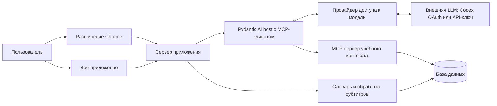

# Интерактивные субтитры для изучения английского — ТЗ MVP

Версия: 0.2 · Дата: 19 октября 2026 года · Статус: спецификация для начала разработки.

Целевой срок первой работающей версии: 20 октября 2026 года. Это ограничение объёма и ориентир для проверки готовности; фактическая готовность определяется критериями приёмки. На момент составления документа реализация и развёртывание ещё не выполнены.

## 1. Идея и задача

Веб-приложение и расширение для Chrome помогают изучать английский во время просмотра YouTube. Они превращают субтитры в кликабельный текст: пользователь получает перевод слова в контексте, уточняет его знакомость и обсуждает лексику с AI-агентом. Личный словарь позволяет оценить, насколько трудным окажется открытое видео. Веб-приложение работает самостоятельно, без установки расширения.

Основной пользователь первой версии — русскоязычный человек, который смотрит англоязычные видео и хочет понимать их с минимальным количеством переключений между сервисами. Продукт поддерживает подход comprehensible input: помогает выбрать посильный материал и разобраться с отдельными препятствиями пониманию. Эффективность обучения за длительный период предстоит проверить после MVP.

Главная ценность: посмотреть видео, разобраться с непонятной репликой и продолжить просмотр в том же окне.

## 2. Принятые продуктовые решения

| Вопрос | Решение |
| --- | --- |
| Площадки | Самостоятельное веб-приложение в браузере на компьютере и обычные страницы видео YouTube в расширении Chrome |
| Первый изучаемый язык | Английский |
| Язык интерфейса и объяснений | Русский; примеры употребления — на английском |
| Интерфейсы | Веб-приложение с плеером, субтитрами, словарём и чатом; расширение с субтитрами поверх YouTube и боковой панелью Chrome |
| Главный сценарий | Просмотр видео и быстрый разбор незнакомых слов |
| Другие обязательные сценарии | Оценка сложности открытого видео и обсуждение лексики с агентом |
| Начальный словарь | Короткая диагностика с агентом и автоматическая предварительная оценка знакомости |
| Поведение после диагностики | Предположительно знакомые слова сразу отображаются без подсветки; пользователь может исправить оценку |
| Общий профиль | Веб-приложение и расширение используют один словарь, материалы и диагностику после подключения расширения к профилю |
| Доступ к AI | Подключение личной подписки Codex/ChatGPT в локальном режиме; серверный API-ключ для публичного демо; условия публичного OAuth описаны в разделе 12.2 |
| Агентские пайплайны | Pydantic AI для диагностики, контекстной карточки, чата и работы с MCP |
| Добавление языков | Язык хранится в профиле, словаре и материалах; обработка текста вынесена в языковой адаптер |

Архитектура, численные пороги, ограничения и способ демонстрации ниже предложены для реализации к указанному сроку. Их можно уточнять по результатам первого прототипа с записью причины изменения в этом документе.

## 3. Объём первой версии

| ID | Обязательная возможность | Результат для пользователя |
| --- | --- | --- |
| F1 | Начальная диагностика | Стартовый словарный профиль без необходимости вручную отмечать сотни слов |
| F2 | Субтитры поверх YouTube | Английские реплики синхронизированы с воспроизведением, каждое слово кликабельно |
| F3 | Контекстный перевод | Карточка объясняет выбранное слово именно в текущей реплике |
| F4 | Личный словарь | Знакомость можно изменить; изменения сохраняются между просмотрами и перезапусками браузера |
| F5 | Сложность открытого видео | Доля слов, которые профиль считает знакомыми, и понятная предварительная оценка |
| F6 | AI-агент с MCP | Диалог о словах с доступом к субтитрам, личному словарю и предыдущим учебным материалам |
| F7 | Работающий сервис и материалы защиты | Сервер на хостинге, демо по HTTPS-ссылке, публичный репозиторий, README и интерактивная HTML-презентация |
| F8 | Самостоятельный веб-интерфейс | Без расширения доступны диагностика, добавление материала, просмотр с кликабельными субтитрами, личный словарь и чат |
| F9 | Авторизация через подписку Codex | Пользователь подключает свою подписку в локальном приложении и получает живые AI-ответы без отдельного API-ключа; видит статус подключения и может выйти |

Все F1–F9 входят в готовый MVP. F9 проверяется в локальном режиме; использование личных подписок на публичном хостинге имеет внешнюю зависимость, описанную в разделе 12.2. Последовательность этапов в разделе 15 задаёт порядок реализации.

После MVP: поиск и рекомендации новых видео, другие видеоплатформы и браузеры, мобильные устройства, голосовой диалог, собственное распознавание речи, Anki/SRS, автоматический учёт забывания, полноценная библиотека выражений и синхронизация между устройствами. Поддержка Shorts, прямых эфиров и полноэкранного режима также относится к следующей версии.

## 4. Основной пользовательский сценарий

### 4.1. Просмотр на YouTube через расширение

1. Пользователь устанавливает расширение по инструкции и открывает боковую панель на YouTube.
2. Подключает расширение к профилю веб-приложения либо начинает с нового профиля. При первом использовании проходит диагностику или выбирает «Начать без оценки».
3. Открывает англоязычное видео и включает учебный режим. Расширение получает полную дорожку субтитров и показывает результат анализа словаря.
4. Во время просмотра видит текущую английскую реплику. Слова, которые профиль считает знакомыми, отображаются без подсветки.
5. Нажимает на слово. Видео ставится на паузу, в боковой панели открывается карточка с переводом, объяснением и исходной репликой.
6. При необходимости меняет знакомость слова. Все его вхождения в материале и показатель сложности обновляются.
7. Нажимает «Обсудить с агентом», например: «Почему здесь используется это слово?», «Чем оно отличается от …?» или «Покажи его в моих предыдущих материалах».
8. Агент обращается к инструментам MCP и отвечает с опорой на найденный контекст. Пользователь нажимает «Продолжить просмотр».
9. В следующем видео используются уже сохранённые оценки знакомости.

Если автоматическое получение субтитров недоступно, пользователь загружает SRT/VTT, соответствующий этому видео. Дальнейший сценарий остаётся тем же.

### 4.2. Работа в веб-приложении

1. Пользователь открывает веб-приложение и начинает с гостевого профиля. В локальном режиме может выбрать «Подключить Codex» и пройти авторизацию в браузере.
2. Проходит диагностику или пропускает её; открывает свою библиотеку материалов.
3. Добавляет ссылку YouTube и соответствующий файл SRT/VTT либо выбирает подготовленный пример. Уже добавленные материалы доступны повторно.
4. Смотрит видео во встроенном плеере, нажимает на слова в синхронных субтитрах, получает карточки и меняет знакомость.
5. Обсуждает лексику с агентом, открывает словарь и возвращается к материалу с сохранёнными оценками.
6. При желании подключает расширение к тому же профилю и продолжает обучение на странице YouTube.

Для веб-приложения импорт SRT/VTT — обязательный путь добавления собственной дорожки. Автоматическое извлечение в расширении проверяется отдельно. Если владелец запретил встраивание видео, приложение объясняет причину, сохраняет материал для чтения и предлагает открыть ролик на YouTube; синхронный просмотр такого ролика внутри веб-приложения недоступен.

## 5. Интерфейс и получение субтитров

### 5.1. Учебный режим

Расширение активируется пользователем на странице `youtube.com/watch`. Поверх области плеера выводятся одна или две текущие реплики. Боковая панель содержит показатель сложности, карточку выбранного слова, чат и раздел «Мои слова» с поиском и фильтром по знакомости.

Клик по слову фиксирует выбранную реплику и её время. Карточка остаётся привязанной к этому контексту, даже если воспроизведение затем продолжилось. Повторный быстрый клик отменяет предыдущий запрос или исключает показ устаревшего ответа. Если видео уже было на паузе, открытие карточки не запускает его. Закрытие карточки также не запускает видео автоматически.

При переходе между роликами без перезагрузки страницы расширение сбрасывает текущую реплику и загружает материал нового видео. Ответы от предыдущего ролика не появляются в новом. Одновременно активен один учебный материал на вкладку; интерфейс панели всегда указывает, к какому видео относится.

Штатные субтитры визуально скрываются на время работы собственного слоя и восстанавливаются при его выключении. Обычный и театральный режимы проверяются в MVP. Подсветка сопровождается текстовым статусом в карточке; её смысл не зависит только от цвета.

Для панели используется [Chrome Side Panel API](https://developer.chrome.com/docs/extensions/reference/api/sidePanel), для взаимодействия со страницей — [content scripts](https://developer.chrome.com/docs/extensions/develop/concepts/content-scripts). Конкретная интеграция с плеером проверяется первым прототипом.

### 5.2. Источники субтитров

Основной путь — получить доступную английскую дорожку средствами расширения на открытой пользователем странице. Предпочтение отдаётся авторским субтитрам; при их отсутствии используются автоматические. Интерфейс сообщает источник дорожки. Автоматически переведённые дорожки не выбираются вместо английского оригинала.

Автоматическое извлечение — главный технический риск. Официальный метод [YouTube captions.download](https://developers.google.com/youtube/data/reference/rest/v3/captions/download) требует права редактирования видео. Доступ к субтитрам произвольного чужого ролика через этот метод закладывать в реализацию нельзя. Доступность дорожек на странице нужно проверить на реальных видео до разработки остальных возможностей.

В расширении резервный путь — загрузка SRT/VTT в боковой панели с привязкой к текущему `video_id`; в веб-приложении тот же импорт доступен при добавлении материала по ссылке. Оба интерфейса используют общую серверную обработку. Проверяются формат, размер, порядок временных меток и непустой текст. Пользователь может заменить неверный файл. Полный текст и метаданные дорожки сохраняются как отдельная версия материала.

Адаптер возвращает `video_id`, `language`, `source`, `is_complete`, `transcript_hash` и список реплик `{id, start_ms, end_ms, text}`. Общие границы для первой версии: файл до 2 МБ, до 10 000 реплик и до 200 000 символов текста; превышение показывает понятное сообщение. В приёмочных проверках используются ролики до 30 минут.

Повторяющиеся фрагменты автоматических субтитров нормализуются с учётом временного перекрытия. Одинаковая фраза, произнесённая позднее, сохраняется как новое вхождение. Один только перехват текущей видимой реплики не даёт данных для оценки всего ролика: до получения полной дорожки показатель сложности видео недоступен.

### 5.3. Состояния интерфейса

Обязательные состояния: загрузка, готовность, отсутствие английской дорожки, ошибка извлечения, предложение импорта, неверный файл, отсутствие интернета, ожидание AI, ошибка/лимит AI и повторный запрос. При недоступности AI субтитры и уже сохранённый словарь продолжают работать после загрузки материала. Несохранённое изменение знакомости отмечается явно и допускает повторную отправку.

### 5.4. Самостоятельный веб-интерфейс

Обязательные разделы: «Материалы», «Просмотр», «Мои слова», «Диагностика» и «Настройки AI». В библиотеке можно добавить материал по ссылке YouTube с SRT/VTT и повторно открыть сохранённый. В просмотре рядом с плеером находятся кликабельные субтитры, показатель сложности, карточка слова и чат. Словарь поддерживает поиск, фильтр по знакомости и изменение score/ignored.

Плеер использует [YouTube IFrame Player API](https://developers.google.com/youtube/iframe_api_reference). В веб-приложении субтитры выводятся отдельным слоем рядом с плеером или под ним; вставка своего содержимого внутрь YouTube iframe не требуется. Пауза, перемотка, выбранное вхождение и защита от устаревших ответов работают по тем же правилам, что в расширении. Нажатие на найденную цитату текущего материала переводит встроенный плеер к её времени.

Настройки показывают активный способ доступа к AI, состояние авторизации, подключение расширения и действие удаления данных. Подготовленный пример доступен внутри этого приложения. Все основные разделы работают без установленного расширения.

## 6. Знакомость слов

### 6.1. Шкала

| Значение | Значение для пользователя | Отображение |
| --- | --- | --- |
| `null` | Пока не оценено | Нейтральное подчёркивание |
| `0` | Не знаю | Выраженная подсветка |
| `1` | Учу; обычно нужна подсказка | Мягкая подсветка |
| `2` | Узнаю в контексте | Без подсветки |
| `3` | Уверенно знаю | Без подсветки |

Дополнительно есть признак `ignored`: пользователь может исключить имя или нерелевантное слово из подсветки и расчёта сложности. Его можно вернуть обратно.

Каждая оценка имеет источник: `manual` — выбранная пользователем, `diagnostic` — полученная из ответов диагностики, `prior` — предположение для непроверенного слова. Для двух последних карточка показывает «Предварительная оценка». Это рабочая шкала продукта; она не является вероятностью знания слова.

Открытие перевода и число встреч записываются отдельно от знакомости, если такие события собираются. Сами по себе они не повышают и не понижают score. В MVP изменения после начала просмотра делает пользователь; агент может предложить новую оценку текстом.

Ручная оценка имеет приоритет над диагностикой и стартовыми предположениями. Повторная диагностика обновляет только предварительные оценки. Пользователь может сбросить конкретное слово в «Пока не оценено»; автоматическое правило больше не переопределяет это ручное решение.

### 6.2. Словоформы и значения

Единица словаря — базовая форма слова с языком и частью речи. Например, `watch`, `watched`, `watching` как глаголы используют общую оценку. Исходная форма в реплике сохраняется. При сомнительном разборе используется нормализованная исходная форма с признаком неопределённости; исправление базовой формы доступно в карточке и перепривязывает соответствующее вхождение.

Контекстный перевод хранится для конкретной реплики и выбранного вхождения. Значение `bank` в одном видео не заменяет перевод во всех других контекстах. Знакомость в MVP общая для слова и части речи: знание отдельных значений отдельно не моделируется. Для такой ситуации пользователь может понизить общую оценку.

Если выбранное слово входит в выражение вроде `give up`, AI объясняет выражение целиком и указывает его в карточке. Отдельное сохранение знакомости многословных выражений относится к следующей версии.

Для английского предлагается [spaCy](https://spacy.io/usage/linguistic-features#lemmatization): токенизация, определение части речи и базовой формы. Версия модели и правила нормализации фиксируются вместе с версией обработки материала.

## 7. Начальная диагностика

Цель — быстро создать полезное стартовое предположение о словаре. Пользователь может пропустить диагностику и пройти её позднее.

Минимальная диагностика: 12 слов из трёх частотных групп и две короткие фразы на понимание. Ориентир длительности — 3–5 минут. Агент ведёт диалог по-русски, просит объяснить значение или смысл и оценивает ответы по заранее заданным допустимым значениям. Пользователь может ответить «не знаю» или «пропустить».

Слова и фразы выбираются из небольшой проверенной подборки. LLM не создаёт весь экзамен заново. Её задача — понять свободный ответ, объяснить ошибки и сформулировать приблизительный словарный профиль. Результат содержит структурированные оценки по ID заданий; сервер проверяет их по схеме и допустимым ID.

Предложенное стартовое правило: частотная группа с минимум тремя верными ответами из четырёх получает предварительный score `2` для входящих в неё непроверенных слов. Остальные непроверенные слова остаются неоценёнными. Для непосредственно проверенных слов верный ответ даёт предварительный score `2`, неверный или «не знаю» — `0`, пропуск — `null`; источник — `diagnostic`. Такие результаты имеют приоритет над правилом группы. Понимание двух фраз уточняет описание уровня; в первой версии оно не переводится в дополнительные массовые изменения словаря.

Это эвристика с малым числом примеров. Она не подтверждает знание каждого слова группы и не даёт сертифицированный уровень CEFR. Пороги, состав групп и подборка заданий версионируются. Слова без записи в выбранном частотном списке автоматически знакомыми не становятся.

Стартовые группы задаются по нормализованному частотному списку: ранги 1–1000, 1001–3000 и 3001–6000. Источник-кандидат — [wordfreq](https://github.com/rspeer/wordfreq): при подготовке списка необходимо сохранить сведения об источнике и лицензии данных. Частотность не трактуется как готовая разметка CEFR.

После диагностики предварительные оценки применяются сразу, а соответствующие слова теряют подсветку. В сводке видно, что было проверено, а что предположено. Начальный профиль хранится как версия правил для частотных групп; тысячи отдельных записей можно создавать по мере появления слов. Любая ручная оценка перекрывает эти правила.

Если диагностика прервана или AI недоступен, пользователь может продолжить просмотр. Незавершённая диагностика не применяет массовые предположения.

## 8. Оценка сложности видео

Система оценивает лексическую доступность текста по личному профилю. Она не измеряет темп речи, акцент, грамматику, качество звука и понимание темы.

Расчёт выполняется по всем вхождениям слов полной нормализованной дорожки. Повторы, реально произнесённые в видео, учитываются: часто повторяющееся слово сильнее влияет на просмотр. Пунктуация, числа без слов и служебные метки вроде `[Music]` исключаются; обычные служебные слова языка учитываются. Слова с `ignored=true` исключаются из числителя и знаменателя. Счётчик уникальных незнакомых слов показывается отдельно.

Обозначения: `N` — число учитываемых вхождений; `K` — вхождения со score `2` или `3`; `L` — вхождения со score `0` или `1`; `A` — неоценённые. `N = K + L + A`.

```text
Знакомо по профилю, % = 100 × K / N
Незнакомо по профилю, % = 100 × L / N
Пока не оценено, % = 100 × A / N
```

Предварительные оценки участвуют в расчёте, но их доля показывается отдельно. Пример: «По профилю знакомо 92% слов; 35 процентных пунктов основаны на предположении агента. Ещё 3% пока не оценены». Остальные 5% в этом примере имеют score `0` или `1`.

Когда `A > 0`, система показывает диапазон возможного лексического покрытия: от `K/N` до `(K+A)/N`. Он условен относительно предварительных оценок и не является статистическим доверительным интервалом.

При `N >= 50` и `A/N <= 0.20` можно показать ориентир по нижней границе покрытия: от 95% — «Мало новой лексики», от 90% до 95% — «Понадобятся подсказки», ниже 90% — «Много новой лексики». Эти пороги — настраиваемая продуктовая эвристика. Если более 20% вхождений имеют предварительные оценки, рядом обязательно стоит пометка «Предварительно».

При большой доле неоценённых слов, коротком тексте, пустой или неполной дорожке категоричная метка не показывается. Интерфейс объясняет причину и предлагает диагностику или уточнение словаря. При `N = 0` проценты отсутствуют.

Изменение score и `ignored` немедленно пересчитывает показатели открытого материала. Для оценки достаточно обычного кода: LLM занимается переводом, объяснением, диагностикой и диалогом.

## 9. AI-логика и MCP

### 9.1. Ответственность AI

LLM выполняет основную учебную работу: понимает ответы диагностики, выбирает контекстное значение слова, объясняет выражения и отвечает на вопросы пользователя с учётом его профиля. Для короткой карточки возвращает структурированные поля `translation`, `explanation`, `expression`, `example`. Языки полей определяются настройками профиля; в MVP перевод и объяснение русские, пример английский. Сервер проверяет схему ответа.

Карточка содержит перевод, объяснение в 1–3 предложениях, исходную реплику и один короткий английский пример. Агент может раскрыть тему подробнее в чате. При недостатке контекста он сообщает о неоднозначности. Предположение о смысле отделяется от найденной цитаты.

### 9.2. Собственный MCP-сервер учебного контекста

Предлагается один собственный MCP-сервер, который открывает агенту личный словарь и учебные материалы. Это самостоятельная полезная интеграция: стандартный клиент может получить те же данные без знания внутренней схемы базы. Роли host, client и server соответствуют [официальной архитектуре MCP](https://modelcontextprotocol.io/docs/learn/architecture).

| Инструмент | Входные данные | Результат |
| --- | --- | --- |
| `get_learning_profile` | `language` | Язык объяснений, сводка диагностики, версия начального профиля |
| `get_word_knowledge` | `language`, список базовых форм и частей речи, до 30 | Знакомость, источник и наличие ручного исправления |
| `get_subtitle_context` | `material_id`, `cue_id`, число соседних реплик | Выбранная реплика, до двух соседних с каждой стороны, временные метки |
| `find_word_occurrences` | `language`, базовая форма, часть речи, `limit <= 5` | Цитаты и время из собственных материалов пользователя |
| `get_diagnostic_items` | `language`, `kind=word\|sentence`, частотная группа для слов, `limit <= 4` | Проверенные задания с ID и данными для оценки ответа |

Результаты ограничены по объёму: текстовый контекст одного инструмента — до 6000 символов. Поиск использует точные базовые формы и индексы базы; векторная база для MVP не требуется. В «предыдущих материалах» ищутся ролики, которые пользователь добавил в учебном режиме. Наличие субтитров в базе не считается доказательством фактического просмотра каждой реплики.

Инструменты читают данные. Изменения знакомости поступают через действия пользователя в интерфейсе; результаты диагностики применяет сервер по правилам раздела 7. Произвольный SQL, выполнение кода и загрузка произвольных URL агенту не предоставляются.

### 9.3. Сквозной сценарий через MCP

Пользователь спрашивает: «Объясни это слово в текущей реплике и покажи, где оно встречалось в моих материалах».

1. Веб-приложение или расширение передаёт запрос и ID выбранного вхождения серверу.
2. Host на Pydantic AI предоставляет модели описания доступных инструментов, полученные от MCP-сервера.
3. Модель запрашивает контекст, знакомость и предыдущие вхождения. Host проверяет параметры и выполняет реальные вызовы MCP.
4. MCP-сервер получает записи из базы и возвращает структурированные результаты.
5. Host передаёт результаты модели. Она формирует объяснение и ссылки на найденные реплики.
6. Пользователь видит ответ. Ссылки ведут на YouTube с временной меткой; для текущего ролика интерфейс может выполнить переход внутри плеера.

При открытии карточки обязательный контекст можно заранее получить через MCP и передать в первый запрос модели. В чате поддерживается выбор инструментов самой моделью. В живом сценарии диагностики задания также поступают через MCP. Число последовательных раундов инструментов ограничено тремя; превышение возвращает объяснение о недоступности полного ответа.

Цитаты и ссылки собираются из результатов инструментов и проверяются сервером. Если вхождений нет, агент сообщает об этом. Примеры, созданные моделью, подписываются как учебные и не выдаются за цитаты.

В журнале с единым `request_id` сохраняются названия инструментов, их успешность и длительность. На защите нужно показать реальный вызов MCP. Использование MCP только внутри среды разработки не выполняет требование интеграции в сам продукт.

### 9.4. Реализация пайплайнов на Pydantic AI

Pydantic AI — обязательный фреймворк агентской логики. Диагностика, контекстная карточка и учебный чат реализуются через именованные `pydantic_ai.Agent`; последовательность шагов задаётся обычными async-функциями Python, а `pydantic-graph` используется при необходимости явного графа состояний. Цикл вызовов модели и инструментов выполняет Pydantic AI.

Карточка и результаты диагностики задаются Pydantic-моделями через `output_type`; проверка допустимых ID заданий, принадлежности материалов и применения оценок остаётся на сервере. `deps`/`RunContext` передают профиль пользователя, выбранное вхождение, `request_id` и доступ к сервисам. История сообщений привязана к владельцу и разговору.

Учебный MCP подключается средствами Pydantic AI как capability/toolset через Streamable HTTP. MCP-клиент работает на нашем backend, чтобы внутренний MCP-сервер оставался доступен только ему. Контекст авторизации задаётся на запрос; общий клиент не хранит изменяемый ID пользователя. Таймауты, бюджет запросов модели и ограничение трёх раундов инструментов применяются ко всему запуску; повторные попытки учитываются в том же бюджете.

Версии `pydantic-ai`, MCP-библиотек и провайдера фиксируются в зависимостях. Приёмка проверяет обе конфигурации доступа к AI на одном наборе схем и инструментов. Документация: [Pydantic AI](https://pydantic.dev/docs/ai/), [MCP](https://pydantic.dev/docs/ai/capabilities/mcp/) и [провайдер Codex](https://pydantic.dev/docs/ai/models/openai-codex/).

## 10. Предлагаемая архитектура



| Компонент | Выбор для MVP |
| --- | --- |
| Расширение и общие компоненты интерфейса | TypeScript, React, Manifest V3 |
| Самостоятельное веб-приложение | TypeScript, React; библиотека, просмотр, словарь, диагностика и настройки; общие компоненты с расширением |
| Сервер приложения | Python, FastAPI |
| Обработка английского | spaCy и версионированный частотный список |
| Хранение | SQLite на постоянном диске, один экземпляр приложения, миграции схемы |
| MCP | Официальный Python SDK; отдельный внутренний процесс с Streamable HTTP |
| Агентские пайплайны | Pydantic AI; async Agent, структурированные результаты и MCP capability/toolset |
| Доступ к AI | Адаптер `codex_oauth` для локальной подписки и `server_api_key` для публичного демо; модель задаётся конфигурацией |
| Развёртывание | Контейнер на хостинге с постоянным диском и HTTPS; веб-приложение и API на одном домене; локальный запуск того же приложения для Codex OAuth |

[FastAPI](https://fastapi.tiangolo.com/) используется для API. [SQLite](https://docs.python.org/3/library/sqlite3.html) позволяет начать с одного серверного экземпляра без отдельной СУБД. MCP реализуется через [официальный SDK](https://modelcontextprotocol.io/docs/sdk); совместимые версии клиента, сервера и протокола фиксируются при первом сквозном запуске.

MCP доступен только внутри серверного окружения. Backend подписывает короткоживущий служебный токен с ID текущего профиля, MCP-сервер проверяет его для каждого запроса. Модель не задаёт пользователя и не получает этот токен. Параллельные запросы не используют общую изменяемую переменную «текущий пользователь».

Чтобы добавить второй изучаемый язык, потребуется его обработчик текста, частотный список и задания диагностики. Интерфейс языкового адаптера: `tokenize`, `lemmatize`, `get_frequency_band`, `get_diagnostic_items`. Профили и ключи слов всегда содержат `language`; совпадающие написания разных языков не объединяются. Для языков с другим устройством письма потребуется собственная реализация адаптера.

## 11. Данные и минимальные контракты

| Сущность | Основные поля |
| --- | --- |
| `User` | ID, дата создания, гостевой или подключённый профиль |
| `AppSession` / `ExtensionCredential` | user_id, хеш токена, срок действия, признак отзыва |
| `AIConnection` | owner_id, mode, provider_account_id, статус, ссылка на защищённое хранилище credentials, expires_at |
| `PairingCode` | owner_id, хеш одноразового кода, expires_at, used_at |
| `LearningProfile` | user_id, target_language, explanation_language, diagnostic_version, правила начальной знакомости |
| `Lexeme` | ID, language, lemma, part_of_speech, версия обработки |
| `UserWord` | user_id, lexeme_id, score с поддержкой null, source, ignored, updated_at |
| `Material` | ID, owner_id, youtube_video_id, language, source, transcript_hash, is_complete |
| `Cue` / `TokenOccurrence` | material_id, время, текст, смещения слова и ссылка на lexeme_id |
| `DiagnosticSession` | owner_id, задания, ответы, результаты, статус завершения |
| `Conversation` / `Message` | owner_id, material_id, выбранное вхождение, сообщения |

Уникальность базового слова задаётся сочетанием `language + lemma + part_of_speech`, а слова пользователя — парой `user_id + lexeme_id`. Версия модели обработки сама по себе не создаёт дубликат базового слова. Запись `UserWord` с `source=manual` и `score=null` означает ручной сброс; она блокирует наследование предварительного score. Исходный текст реплик сохраняется отдельно от нормализованного представления.

Минимальные операции API: создать изолированный профиль, получить/завершить сессию, начать/завершить/отменить подключение Codex, получить его статус и отключить; создать/погасить код подключения расширения; добавить/перечислить материалы, импортировать дорожку, получить обработанный материал и его сложность, изменить оценку слова, запустить/завершить диагностику, получить карточку, отправить сообщение агенту. Конкретные маршруты фиксируются в OpenAPI при реализации. Для карточки клиент передаёт `material_id + cue_id + token_id`; сервер проверяет принадлежность и извлекает исходный текст сам.

Сессия приложения и OAuth-доступ к модели имеют отдельные сроки действия и отзыв. `AIConnection` принадлежит профилю; credentials не возвращаются клиенту в ответах API и не сохраняются в учебных таблицах или истории сообщений. Доступ расширения даёт работу с профилем через backend.

Повторный импорт одинаковой дорожки в тот же профиль переиспользует результат по хешу. Замена дорожки создаёт новую версию и не меняет личные оценки слов. Кэш перевода учитывает язык объяснения, версию промпта, контекст и выбранное вхождение; кэш персонального ответа дополнительно связан с пользователем и версией профиля.

## 12. Доступ, расходы и устойчивость

### 12.1. Сессия приложения и общий профиль

Веб-приложение создаёт изолированный гостевой профиль и защищённую HttpOnly cookie-сессию; на хостинге используется Secure. Изменения данных защищаются от CSRF. Расширение может создать свой профиль либо подключиться к существующему: пользователь получает в веб-приложении одноразовый код со сроком действия 5 минут и вводит его в панели. Сервер выдаёт отдельный отзываемый токен расширения и хранит его хеш; токен сохраняется в локальном хранилище расширения. Код погашается только один раз, попытки подбора ограничены.

После подключения оба интерфейса используют одинаковый user_id, словарь, материалы, диагностику и настройки доступа к AI. Автоматического слияния двух уже заполненных профилей нет: перед переключением расширение сообщает о смене профиля. Привязка локальной Codex-авторизации сохраняет данные текущего профиля; смена внешнего аккаунта требует явного подтверждения в интерфейсе приложения. Профили разных посетителей изолированы. Полноценное восстановление доступа и синхронизация между устройствами остаются после MVP.

### 12.2. Авторизация через подписку Codex

Под «подпиской Codex» понимается доступ к AI через учётную запись ChatGPT с доступным Codex. В локальном MVP пользователь нажимает «Подключить Codex», проходит браузерный OAuth-вход и возвращается в приложение. Реализация использует `OpenAICodexOAuthFlow` и `OpenAICodexProvider` Pydantic AI; агент получает `OpenAICodexModel` с выбранной доступной моделью. Это путь без отдельного API-ключа. Подключение считается рабочим после успешного запроса модели, включая проверку вызова инструмента.

Документированный callback этого провайдера — `http://localhost:1455/auth/callback`, поэтому данный путь выполняется локальным backend на компьютере пользователя. Веб-приложение и расширение могут работать с этим backend; разрешённый адрес сервера выбирается явно. Локальный backend слушает только loopback и проверяет разрешённые origin. OAuth-flow проверяет state и PKCE; занятый callback-порт, отказ пользователя и истечение ожидания дают понятный результат. [Документация провайдера](https://pydantic.dev/docs/ai/models/openai-codex/).

Приложение хранит credentials отдельно от данных обучения, в защищённом локальном хранилище, и сохраняет обновлённые refresh tokens атомарно. Параллельные запросы одного подключения согласуют refresh, чтобы не использовать одноразовый refresh token повторно. Пользователь может отключить Codex; локальные credentials удаляются, последующие AI-запросы через это подключение прекращаются. Интерфейс показывает состояния «Не подключён», «Вход», «Подключён», «Требуется повторный вход» и «Лимит подписки»; сведения о лимитах показываются только при наличии данных провайдера.

Для публичного многопользовательского хостинга OAuth-подключение личных подписок требует отдельного пути [Sign in with ChatGPT](https://developers.openai.com/siwc) и подтверждённого доступа для размещённого сервиса. OpenAI описывает публичный режим отдельно от локальных и открытых приложений: [условия ChatGPT plan usage](https://developers.openai.com/siwc/token-sharing-open-source). Использовать общий Codex-логин владельца сервиса для запросов всех посетителей нельзя закладывать в архитектуру. До получения такого доступа публичное демо использует `server_api_key`; личная подписка доступна в локальном запуске. Это ограничение явно указывается на странице настроек и в README.

Подключение подписки разрешает обращения к модели; сессию приложения создаёт наш backend. Лимиты подписки и оплата API относятся к разным режимам. Ошибка OAuth или исчерпание подписки не переключают пользователя на платный API автоматически. Провайдер выбирается для конкретного профиля и запуска Pydantic AI, без глобальной смены credentials для всех пользователей.

### 12.3. Расходы, данные и устойчивость

Ключ LLM для режима `server_api_key` находится только на сервере. Для публичного демо задаются ограничения числа AI-запросов на профиль и IP, размера сообщений и суточных расходов провайдера. Начальные настройки: до 20 AI-запросов за 10 минут и до 100 в сутки на профиль; диагностика использует тот же бюджет. Размер сообщения — до 4000 символов, общий срок ожидания AI с инструментами — до 30 секунд. Общий денежный лимит определяется перед развёртыванием. В режиме Codex дополнительно действуют лимиты учётной записи пользователя. Разрешения расширения ограничиваются YouTube, выбранным адресом API, локальным хранилищем и необходимыми возможностями панели.

Субтитры, страницы и сообщения считаются внешними данными. Содержащиеся в них команды не меняют инструкции агента. Ответы проходят безопасное отображение; ссылки на видео формируются сервером из проверенных ID. Каждый запрос к материалам и каждому инструменту проверяет права текущего профиля.

На сервер передаются субтитры только после включения учебного режима в расширении либо явного импорта в веб-приложении. Внешняя LLM получает нужный фрагмент, сведения о выбранных словах и ограниченную историю диалога. Полная дорожка не отправляется при каждом клике. Журналы по умолчанию не содержат токенов, полных субтитров и текста личного диалога; те же ограничения действуют для трассировки Pydantic AI. Для MVP достаточно локальных журналов с request_id, именами инструментов и длительностью; внешний сервис телеметрии подключается отдельным решением. У пользователя есть действие «Удалить мои данные» для профиля, материалов, чатов и связанных credentials.

База переживает перезапуск и повторное развёртывание контейнера благодаря постоянному диску. Перед изменением схемы сохраняется резервная копия. Для MCP и провайдера задаются таймауты; повторный запрос не создаёт дубликатов оценок или сообщений.

## 13. Критерии приёмки

| ID | Проверка | Условие прохождения |
| --- | --- | --- |
| A1 / F2 | Получение дорожек | Автоматический путь проверен минимум на двух роликах с авторскими и двух с автоматическими английскими субтитрами; список и дата проверки записаны |
| A2 / F2, F8 | Импорт дорожки | SRT и VTT работают в расширении и веб-приложении на том же видео; неверный файл даёт понятную ошибку; неполная дорожка не выдаётся за полную |
| A3 / F2, F8 | Синхронизация | Воспроизведение, пауза и перемотка выбирают правильную реплику в обоих интерфейсах; ориентир задержки смены субтитра — не более 0,5 секунды |
| A4 / F3 | Контекстное значение | На наборе из 10 вручную проверенных случаев не менее 8 дают подходящий перевод; набор включает многозначное слово и выражение |
| A5 / F4 | Сохранение словаря | Изменение score переживает перезапуск браузера и сервера, действует на связанные словоформы; ручная оценка сохраняется после диагностики |
| A6 / F1 | Начальная диагностика | Завершённая сессия применяет предварительный профиль и убирает подсветку; источник виден; прерывание не применяет массовые правила |
| A7 / F5 | Расчёт сложности | На фиксированной дорожке проценты совпадают с ручным расчётом; проверены повторы, ignored, null, пустой текст и пересчёт после правки |
| A8 / F6 | Настоящий MCP | Диалог вызывает инструменты через MCP; ответ содержит существующую цитату и время, либо сообщает, что совпадений нет |
| A9 / F3, F6 | Сбои AI | Ошибка, таймаут и лимит показываются в интерфейсе; доступен повтор; устаревший ответ не заменяет новую карточку |
| A10 / F4, F6 | Изоляция | Два профиля имеют независимые словари; прямой запрос чужого material_id и попытка сменить пользователя в инструменте отклоняются |
| A11 / F2 | Навигация YouTube | Переход между двумя роликами без перезагрузки не оставляет старые субтитры, карточку и контекст чата |
| A12 / F7, F8 | Сервис по ссылке | Посторонний посетитель открывает HTTPS-веб-приложение без расширения, разбирает слово и получает живой ответ через LLM и MCP в режиме server_api_key |
| A13 / F7 | Материалы защиты | Репозиторий публичен; README воспроизводит запуск; HTML-презентация открывается и содержит сценарий демонстрации |
| A14 / F8 | Самостоятельная работа в вебе | В Chrome без расширения пользователь проходит диагностику, добавляет свою ссылку с SRT/VTT, смотрит встроенное видео, получает карточку, меняет score, общается с агентом и повторно открывает материал; запрет встраивания объясняется |
| A15 / F4, F8 | Общий профиль | После подключения расширения изменение score в вебе видно в панели после обновления данных и наоборот; совпадают материалы и результат диагностики; просроченный или повторно использованный код отклоняется |
| A16 / F9 | Подписка Codex | В локальном запуске вход из UI даёт живые карточку, диагностику и чат с MCP без API-ключа; проверены отказ входа, занятый callback-порт, refresh, повторный вход, лимит и отключение; платный API сам не включается |
| A17 / F1, F3, F6 | Пайплайны Pydantic AI | Все три AI-сценария используют Agent; карточка и диагностика проверяются через output_type; реальный MCP вызывается средствами Pydantic AI; контекст и credentials двух профилей не смешиваются |

Для A4 фиксируются проверяемые ожидаемые смыслы и фактические ответы выбранной модели. Это малая проверка работоспособности, а не общая оценка качества перевода. Для карточки целевой обычный отклик — до 5 секунд, для чата — до 15 секунд; фактическое время измеряется на выбранном провайдере и публикуется с условиями проверки.

Автоматические проверки сосредоточены на расчёте сложности, приоритете ручных оценок, обработке субтитров, правах доступа, кодах подключения и реальном взаимодействии MCP-клиента с сервером. Для проверки агентской логики используются TestModel/FunctionModel Pydantic AI; OAuth-сбои и refresh проверяются без реальных credentials. Каждый интерфейс проходит сквозной сценарий в настоящем Chrome; дополнительно проверяются пауза, перемотка и переход между роликами. Приёмка и защита используют живую модель; A16 включает реальную подписку и воспроизводимые проверки ошибок.

## 14. Хостинг и защита проекта

По HTTPS-ссылке доступны самостоятельное веб-приложение, инструкция установки расширения и интерактивная HTML-презентация. Веб-приложение использует общие компоненты карточки и чата, тот же сервер, личный словарь и реальный MCP. Помимо добавления своих материалов, пользователь может выбрать подготовленный YouTube-ролик с уже загруженными английскими субтитрами; видео воспроизводится через [YouTube IFrame Player API](https://developers.google.com/youtube/iframe_api_reference), субтитры синхронизируются по его времени.

Подготовленный материал позволяет быстро проверить функции веб-приложения без установки расширения. Для него заранее проверяются возможность встраивания ролика и доступность из окружения защиты. Автоматическое извлечение субтитров демонстрируется в расширении. Подключение личной подписки Codex демонстрируется в локальном запуске того же приложения; публичный сервис до получения доступа к размещённому OAuth работает с серверным API-ключом по разделу 12.2.

Для распространения первой версии публикуется ZIP со сборкой расширения и инструкцией установки через режим разработчика Chrome. Публикация в магазине расширений может состояться после MVP.

Сценарий защиты на 7–10 минут: задача и основной пользователь; краткая архитектура с Pydantic AI; просмотр в веб-приложении; тот же профиль в расширении; перевод и исправление знакомости; изменение сложности; диалог с цитатой и показ вызова MCP; локальный вход через Codex; ограничения и дальнейшее развитие.

README содержит описание задачи, ссылки на сервис и презентацию, скриншоты, архитектуру и роль Pydantic AI/MCP, установку и подключение расширения к веб-профилю, локальный запуск с Codex OAuth, публичный запуск с API-ключом, переменные окружения без секретов, настройки модели, результаты приёмки и известные ограничения OAuth на хостинге. Интерактивная HTML-презентация содержит навигацию между слайдами и переход к живому демо.

Публичный репозиторий и демо включают только подходящие для распространения примеры и необходимые сведения об источниках. Разрешения на повторную публикацию используемых тестовых материалов проверяются при их выборе. Посещение обязательного воркшопа и согласование темы с преподавателями остаются организационными условиями допуска из задания курса.

## 15. Порядок реализации до первой демонстрации

| Этап | Работа | Проверяемый выход |
| --- | --- | --- |
| 0. Главный риск | Минимальное расширение; получить английскую дорожку, вывести кликабельную реплику поверх плеера, связать панель | Записан результат на четырёх видео; есть решение по адаптеру и рабочий импорт SRT/VTT |
| 0б. Доступ к модели | Локальный вход Codex через Pydantic AI, безопасное хранение и refresh; конфигурация серверного API-ключа для публичного запуска | Живой структурированный ответ и вызов инструмента в обоих режимах; ограничение публичного OAuth записано |
| 1. Первый сквозной сценарий | Сервер, Pydantic AI Agent, MCP-клиент и MCP-сервер; веб-просмотр с импортом и общая контекстная карточка | Клик в вебе и на YouTube → API → Pydantic AI/MCP → данные → LLM → перевод |
| 2. Персонализация | Леммы, сохранение score, предварительная диагностика, подсветка и формула сложности | Первое видео меняет данные, второе использует тот же профиль |
| 3. Агент | История диалога, поиск вхождений, проверенные цитаты и временные ссылки | Выполнен A8 на двух материалах, включая запрос без совпадений |
| 4. Доставка | Разделы веб-приложения, подключение расширения к профилю, хостинг, README, ZIP и HTML-презентация | Самостоятельный веб-сценарий, общий профиль с расширением, рабочая HTTPS-ссылка и материалы защиты |
| 5. Проверка | Приёмочные сценарии обоих интерфейсов, локальный Codex OAuth, перезапуск сервера, два профиля, проверка секретов и ошибок | Таблица результатов A1–A17 с известными ограничениями |

Первый прототип извлечения ограничивается примерно 60–90 минутами. Если автоматический путь не заработал, разработка сквозного сценария продолжается на импорте файлов, а извлечение остаётся отдельной незавершённой задачей A1. Демонстрацию с импортом следует явно описывать как такую версию. Полная готовность MVP требует прохождения A1–A17.

Точное распределение времени уточняется после этапов 0 и 0б. Для срока в одни сутки используются одна модель на режим доступа, один серверный экземпляр на окружение, один язык и общие компоненты расширения/веб-приложения. Самостоятельный веб-интерфейс и Codex OAuth расширяют исходный объём; риск срока проверяется после этих прототипов, а готовность определяется приёмкой. Дополнительные возможности добавляются после прохождения сквозных сценариев.

Для локальной проверки F9 потребуется доступная подписка Codex пользователя; отдельный API-ключ для этого режима не требуется. Для публичного запуска нужно выбрать доступного провайдера LLM, получить серверный API-ключ, определить денежный лимит и выбрать хостинг с постоянным диском. Перед публикацией потребуются доступ к репозиторию и конкретная площадка развёртывания. Публичный вход с использованием личных подписок дополнительно зависит от доступа к Sign in with ChatGPT для размещённого сервиса.

## 16. Начальная структура репозитория и работа со спецификацией

```text
README.md                 описание и воспроизводимый запуск
SPEC.md                   этот документ
AGENTS.md                 правила проекта и подключение локального скилла
.agents/skills/building-pydantic-ai-agents/  локальный скилл Pydantic AI и справочники
apps/extension/           расширение Chrome
apps/web/                 самостоятельное веб-приложение и демонстрационный материал
packages/ui/              общие компоненты панели, карточки и чата
backend/app/              API, словарь, языковые адаптеры
backend/app/agents/       Pydantic AI: карточка, диагностика и чат
backend/app/auth/         сессии приложения, Codex OAuth и подключение расширения
backend/mcp_server/       MCP-инструменты учебного контекста
backend/tests/            проверки правил и интеграций
data/diagnostics/         проверенные задания и описание источников
data/demo/                разрешённые примеры субтитров
docs/decisions.md         причины существенных изменений
docs/acceptance.md        результаты A1–A17
docs/presentation.html    интерактивная презентация
.env.example              имена настроек без секретов
compose.yaml              локальный и серверный запуск
```

Каждая задача разработки ссылается на F- и A-идентификаторы. Перед реализацией фиксируется ожидаемое поведение; после неё — результат соответствующей проверки. Изменение пользовательского сценария отражается в SPEC.md. Сведения о ходе работы, подсказки агентам и журналы проверок не подменяют критерии готовности.

Локально установлен официальный скилл [building-pydantic-ai-agents](https://github.com/pydantic/skills/tree/98f591c0886eb11df0bdd57804419e11439efc93/skills/building-pydantic-ai-agents) версии 1.1.2 из `pydantic/skills`, commit `98f591c0886eb11df0bdd57804419e11439efc93`, вместе с его справочниками. Скилл находится в `.agents/skills/` данного проекта. Поле compatibility перенесено в metadata для совместимости с валидатором Codex. При разработке используются требования этого ТЗ и API закреплённой версии библиотеки; ограничения журналирования из раздела 12.3 распространяются на рекомендации скилла о телеметрии.

## 17. Источники вдохновения

- [LinguaCafe: обзор](https://simjanos-dev.github.io/LinguaCafeHome/) и [описание возможностей](https://github.com/simjanos-dev/LinguaCafe/wiki/3.-Usage-and-features): подсветка слов, знакомость и оценка сложности материала.
- [Lute v3](https://github.com/LuteOrg/lute-v3) и [введение в руководство](https://luteorg.github.io/lute-manual/intro.html): связь словоформ с базовым термином и работа с выражениями.
- [LingQ](https://www.lingq.com/en/): обучение на собственном интересном контенте и накопление личного словаря.

Референсы помогают выбрать продуктовые решения. Реализация, интерфейс и модель данных описаны для собственного учебного проекта; использование чужого кода требует отдельного решения с учётом его лицензии.
