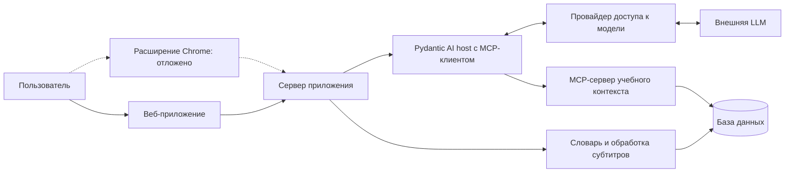

# Изучение английского по видео и текстам — ТЗ MVP

Версия: 0.24 · Дата: 27 октября 2026 года · Статус: принята для разработки самостоятельного веб-приложения; добавлены текстовые материалы (§5.11) и генерация по личному словарю (§9.7). Диагностика словаря переработана в адаптивную самооценку с частотным MCP-словарём (§7). Добавлено ручное завершение подключения подписки через веб-интерфейс (§12.2). Расширение отложено до явного решения пользователя.

20 октября 2026 года — контрольная точка демонстрации. На ней показывается работающий на тот момент сценарий и явно перечисляются непройденные критерии. Завершение полного MVP допускается после этой даты; его готовность определяется действующими веб-критериями раздела 13 с учётом границ раздела 2.1. Итоговая поставка — локальный запуск через Docker Compose. Текущее состояние реализации и фактические результаты проверок записаны в [docs/acceptance.md](docs/acceptance.md).

## 1. Идея и задача

Веб-приложение помогает изучать английский во время просмотра YouTube и чтения текстов. Тексты можно добавить вручную или получить от агента с учётом личного словаря. Оно превращает субтитры в кликабельный текст: пользователь получает перевод слова в контексте, уточняет его знакомость и обсуждает лексику с AI-агентом. Личный словарь позволяет оценить, насколько трудным окажется открытое видео. Веб-приложение работает самостоятельно, без установки расширения. Расширение Chrome остаётся возможным последующим интерфейсом по отдельному решению пользователя.

Основной пользователь первой версии — русскоязычный человек, который смотрит англоязычные видео и хочет понимать их с минимальным количеством переключений между сервисами. Продукт поддерживает подход comprehensible input: помогает выбрать посильный материал и разобраться с отдельными препятствиями пониманию. Эффективность обучения за длительный период предстоит проверить после MVP.

Главная ценность: смотреть видео или читать текст, узнавать слова и выражения в контексте, разбирать непонятное и продолжать занятие в том же окне.

## 2. Принятые продуктовые решения

| Вопрос | Решение |
| --- | --- |
| Площадки | Самостоятельное веб-приложение в браузере на компьютере; расширение Chrome отложено по разделу 2.1 |
| Первый изучаемый язык | Английский |
| Язык интерфейса и объяснений | Русский; примеры — на изучаемом языке. Разговорная практика ведётся на изучаемом языке, русская помощь доступна по просьбе |
| Интерфейсы | Веб-приложение с плеером, субтитрами, словарём и чатом; слой субтитров поверх YouTube и боковая панель Chrome относятся к отложенному расширению |
| Главный сценарий | Просмотр видео и чтение текстов с быстрым разбором слов и выражений |
| Другие обязательные сценарии | Оценка сложности открытого видео, обсуждение лексики и свободная разговорная практика с агентом |
| Начальный словарь | Короткая диагностика с агентом и автоматическая предварительная оценка знакомости |
| Поведение после диагностики | Предположительно знакомые слова сразу отображаются без подсветки; пользователь может исправить оценку |
| Учебный профиль | У каждого пользователя отдельный профиль, словарь, материалы, диагностика, разговоры и прогресс |
| Вход в приложение | Регистрация по имени пользователя и паролю, вход, выход и смена пароля; несколько пользователей одной локальной установки |
| Доступ к AI | Личная подписка Codex/ChatGPT либо временная `gemma4:31b` в Ollama Cloud с общим серверным ключом из `.env`; раздел 12.2 |
| Настройки AI | Одна сохраняемая пара «модель + reasoning» для карточек, диагностики и чата; выбор доступен в веб-приложении |
| Слова видео | Уникальные слова дорожки с учётом автоматического отбора и ручного добавления; фильтры по каждому уровню шкалы, редактирование знакомости и переход к вхождениям |
| Пополнение словаря при просмотре | Необязательный режим собирает прослушанные реплики и клики; оценки сохраняются после редактируемой сводки в конце видео или по кнопке завершения |
| Поставка | Docker Compose с постоянным томом данных |
| Репозиторий | Приватный GitHub-репозиторий; публичная публикация не требуется для MVP |
| Агентские пайплайны | Pydantic AI для диагностики, карточек, чата, генерации текстов и MCP |
| Добавление языков | Язык хранится в профиле, словаре и материалах; обработка текста вынесена в языковой адаптер |

Архитектура, численные пороги, ограничения и способ демонстрации ниже предложены для реализации к указанному сроку. Их можно уточнять по результатам первого прототипа с записью причины изменения в этом документе.

### 2.1. Текущая работа: только web

21 октября 2026 года пользователь определил текущий объём: вся работа относится к самостоятельному веб-приложению. Это включает необходимые ему backend, учебного агента, MCP, данные, тесты, документацию и локальную поставку.

Разработка, исправления, исследования, упаковка и приёмка расширения Chrome (плагина) отложены до явного утверждения пользователя, что начинаем заниматься расширением. Завершение веб-этапа, прежние задачи и описания расширения сами по себе не разрешают такой переход. Открытые задачи расширения сохраняются как отложенные и исключаются из очереди готовых к исполнению задач.

Готовность текущего MVP определяется веб-частью F1–F23 и критериями A2–A10, A12–A14, A16–A81. Подключение подписки через вставку адреса возврата проверяется по A80. A33–A35 относятся к автоматическому отбору по разделу 6.4, A36–A39 — к импорту YouTube по ссылке и улучшению автосубтитров, A40–A43 — к прогрессу обучения, подтверждённым 22 октября 2026 года. A1, A11, A15 и части остальных критериев, требующие расширения, отложены и не блокируют веб-поставку. Они не считаются пройденными. ZIP расширения, его установка и проверки установленного Chrome сейчас не требуются. Веб-приложение получает субтитры по ссылке YouTube, через импорт SRT/VTT или подготовленный пример.

Сохранённые ниже описания расширения задают контекст возможного будущего этапа. Они применяются к работе только после явного решения пользователя; объём и критерии этого этапа уточняются при его открытии.

## 3. Объём первой версии

| ID | Обязательная возможность | Результат для пользователя |
| --- | --- | --- |
| F1 | Начальная диагностика | Стартовый словарный профиль без необходимости вручную отмечать сотни слов |
| F2 | Синхронные субтитры в веб-приложении | Английские реплики синхронизированы со встроенным плеером, каждое слово кликабельно; слой поверх страницы YouTube отложен |
| F3 | Контекстный перевод | Карточка объясняет выбранное слово именно в текущей реплике |
| F4 | Личный словарь | Знакомость можно изменить; изменения сохраняются между просмотрами и перезапусками браузера |
| F5 | Сложность открытого видео | Доля слов, которые профиль считает знакомыми, и понятная предварительная оценка |
| F6 | Учебный AI-агент с MCP | Диалог с доступом к субтитрам, личному словарю, истории знакомости и предыдущим учебным материалам через настоящие MCP-инструменты |
| F7 | Локальная поставка и документация | Воспроизводимый запуск веб-приложения через Docker Compose, приватный репозиторий, README и результаты веб-приёмки |
| F8 | Самостоятельный веб-интерфейс | Без расширения доступны диагностика, добавление материала, просмотр с кликабельными субтитрами, личный словарь и чат |
| F9 | Подключение подписки Codex | Пользователь подключает свою подписку в локальном приложении и получает живые AI-ответы; видит статус подключения и может отключить подписку |
| F10 | Выбор модели и reasoning | В веб-приложении доступен сохранённый выбор модели и reasoning для карточек, диагностики и чата |
| F11 | Слова видео | Уникальные слова текущей дорожки после автоматического отбора и ручного добавления доступны с фильтрами по каждому уровню знакомости и ручным изменением оценок личного словаря |
| F12 | Журнал учебных действий | Сохраняются выбранные слова из видео и сообщений агента, полученные переводы, реальные изменения знакомости и отправка сообщений; агент получает историю через MCP с учётом границ разговоров |
| F13 | Разговорная практика | Отдельный чат с сохраняемыми разговорами, постепенным ответом, остановкой и повтором; беседа на изучаемом языке, употребление слов с учётом их истории, краткие исправления и предложение тем |
| F14 | Слова в сообщениях агента | Нажатие на слово завершённого сообщения открывает панель рядом с перепиской: контекстная карточка и общая знакомость; изменение доступно следующему ответу агента |
| F15 | Пополнение словаря по итогам просмотра | При включённой настройке прослушанные реплики и клики подготавливают оценки непомеченных слов, прошедших автоматический отбор; пользователь проверяет сводку и явно сохраняет её в словарь |
| F16 | Импорт YouTube по ссылке | Английская дорожка и название загружаются без файла; приоритет у авторских субтитров, затем у автоматических |
| F17 | Улучшение автосубтитров агентами | Включённая по умолчанию опция запускает обработку текста в фоне через подписку; исходник и тайминги сохраняются, результат можно сравнить и открыть отдельно |
| F18 | Прогресс обучения | Рост знакомого словаря с учётом автопроставления, дневные изменения, фактическое время просмотра, календарь занятий и распределение знакомости |
| F19 | Авторизация и несколько пользователей | Личные учётные записи, изоляция всех учебных данных и AI, перенос прежнего профиля |
| F20 | Поиск и оценка новых видео | Поиск YouTube по теме и длительности, приоритет по личной лексической сложности, оценка ссылки без поискового ключа, открытие готовой дорожки в плеере |
| F21 | Выражения | Автоматический поиск фразовых глаголов, идиом и устойчивых сочетаний; выделение фразового глагола по нажатию на его часть, отдельная знакомость значений, личные примеры и практика |
| F22 | Текстовые материалы | Добавление текста и TXT, чтение абзацев, общий словарь и выражения, карточки, поиск и сохранение места |
| F23 | Генерация текстов | Четыре настройки, личный словарь, проверка нагрузки и понятности контекста, доработка и автоматическое сохранение успешного текста |

Веб-часть F1–F23 входит в текущий MVP и проверяется в локальной поставке. Требования к расширению отложены по разделу 2.1. Публичное онлайн-демо как отдельный продукт и учёт денежных расходов AI находятся вне объёма MVP. Последовательность этапов в разделе 15 задаёт порядок реализации.

После MVP: доступ к AI по API-ключу, автоматические подборки по интересам и маршруты видео, другие видеоплатформы, поддержка расширением других браузеров, мобильные устройства, голосовой диалог, собственное распознавание речи, Anki/SRS, автоматический учёт забывания и синхронизация между устройствами. Поддержка Shorts, прямых эфиров и полноэкранного режима также относится к следующей версии.

## 4. Основной пользовательский сценарий

### 4.1. Просмотр на YouTube через расширение — отложено

1. Пользователь устанавливает расширение по инструкции и открывает боковую панель на YouTube.
2. Расширение обращается к локальному backend и использует единственный учебный профиль. При первом использовании пользователь проходит диагностику или выбирает «Начать без оценки».
3. Открывает англоязычное видео и включает учебный режим. Расширение получает полную дорожку субтитров, показывает результат анализа словаря и список слов видео в боковой панели.
4. Во время просмотра видит текущую английскую реплику. Слова, которые профиль считает знакомыми, отображаются без подсветки.
5. Нажимает на слово. Видео ставится на паузу, в боковой панели открывается карточка с переводом, объяснением и исходной репликой.
6. При необходимости меняет знакомость слова. Все его вхождения в материале и показатель сложности обновляются.
7. Нажимает «Обсудить с агентом», например: «Почему здесь используется это слово?», «Чем оно отличается от …?» или «Покажи его в моих предыдущих материалах».
8. Агент обращается к инструментам MCP и отвечает с опорой на найденный контекст. Пользователь нажимает «Продолжить просмотр».
9. В следующем видео используются уже сохранённые оценки знакомости.

Если автоматическое получение субтитров недоступно, пользователь загружает SRT/VTT, соответствующий этому видео. Дальнейший сценарий остаётся тем же.

### 4.2. Работа в веб-приложении

1. Пользователь запускает приложение через Docker Compose и открывает локальный веб-интерфейс. Пользователь регистрируется или входит по имени и паролю, после чего открывается его учебный профиль. Для AI пользователь подключает подписку через браузерный OAuth.
2. Проходит диагностику или пропускает её; открывает свою библиотеку материалов.
3. Вставляет ссылку YouTube: приложение получает доступные английские субтитры. Для автосубтитров по умолчанию запускается улучшение по разделу 5.6; опцию можно выключить. Также доступны импорт SRT/VTT и подготовленный пример. Уже добавленные материалы доступны повторно.
4. Смотрит видео во встроенном плеере, нажимает на слова в синхронных субтитрах, получает карточки и меняет знакомость. Во вкладке «Слова» рядом с видео просматривает лексику по уровням знакомости, меняет оценки одним нажатием и переходит к выбранным вхождениям.
5. Обсуждает лексику с агентом, открывает словарь и возвращается к материалу с сохранёнными оценками.
6. Повторно открывает материал в веб-приложении с теми же учебными данными. Переход к расширению относится к отдельному будущему этапу по разделу 2.1.

Для веб-приложения импорт SRT/VTT — обязательный путь добавления собственной дорожки. Автоматическое извлечение в расширении отложено по разделу 2.1. Если владелец запретил встраивание видео, приложение объясняет причину, сохраняет материал для чтения и предлагает открыть ролик на YouTube; синхронный просмотр такого ролика внутри веб-приложения недоступен.

## 5. Интерфейс и получение субтитров

### 5.1. Учебный режим расширения — отложено

Правила выбранного контекста, паузы и защиты от устаревших ответов из этого раздела действуют также в веб-приложении. Слой поверх YouTube, панель Chrome и интеграция с навигацией YouTube относятся к отложенному этапу.

Расширение активируется пользователем на странице `youtube.com/watch`. Поверх области плеера выводятся одна или две текущие реплики. Боковая панель содержит показатель сложности, слова текущего видео, карточку выбранного слова, чат, раздел «Мои слова» с поиском и фильтром по знакомости и настройки модели и reasoning.

Клик по слову фиксирует выбранную реплику и её время. Карточка остаётся привязанной к этому контексту, даже если воспроизведение затем продолжилось. Повторный быстрый клик отменяет предыдущий запрос или исключает показ устаревшего ответа. Если видео уже было на паузе, открытие карточки не запускает его. Закрытие карточки также не запускает видео автоматически.

При переходе между роликами без перезагрузки страницы расширение сбрасывает текущую реплику и загружает материал нового видео. Ответы от предыдущего ролика не появляются в новом. Одновременно активен один учебный материал на вкладку; интерфейс панели всегда указывает, к какому видео относится.

Штатные субтитры визуально скрываются на время работы собственного слоя и восстанавливаются при его выключении. Обычный и театральный режимы проверяются в MVP. Подсветка сопровождается текстовым статусом в карточке; её смысл не зависит только от цвета.

Для панели используется [Chrome Side Panel API](https://developer.chrome.com/docs/extensions/reference/api/sidePanel), для взаимодействия со страницей — [content scripts](https://developer.chrome.com/docs/extensions/develop/concepts/content-scripts). Конкретная интеграция с плеером проверяется первым прототипом.

### 5.2. Источники субтитров

В текущем веб-этапе пользователь вставляет ссылку YouTube; backend получает полную доступную английскую дорожку через закреплённую версию youtube-transcript-api. Импорт SRT/VTT и подготовленный пример также доступны. Приоритет у авторских субтитров, включая английские региональные варианты; затем используются автоматические. Интерфейс сообщает источник дорожки. Автоматически переведённые дорожки не выбираются вместо английского оригинала. Отсутствие английской дорожки, недоступное видео, ограничение YouTube и таймаут дают понятное сообщение с предложением загрузить файл. Название получается автоматически; его можно указать вручную. Извлечение средствами расширения остаётся отложенным по разделу 2.1.

Получение субтитров по ссылке зависит от доступности YouTube. Официальный метод [YouTube captions.download](https://developers.google.com/youtube/data/reference/rest/v3/captions/download) требует права редактирования видео. Доступ к субтитрам произвольного чужого ролика через этот метод закладывать в реализацию нельзя. Проверка дорожек на реальных страницах относится к будущему этапу расширения.

В расширении резервный путь — загрузка SRT/VTT в боковой панели с привязкой к текущему `video_id`; в веб-приложении тот же импорт доступен при добавлении материала по ссылке. Оба интерфейса используют общую серверную обработку. Проверяются формат, размер, порядок временных меток и непустой текст. Пользователь может заменить неверный файл. Полный текст и метаданные дорожки сохраняются как отдельная версия материала.

Адаптер возвращает `video_id`, `language`, `source`, `is_complete`, `transcript_hash` и список реплик `{id, start_ms, end_ms, text}`. Общие границы для первой версии: файл до 2 МБ, до 10 000 реплик и до 200 000 символов текста; превышение показывает понятное сообщение. В приёмочных проверках используются ролики до 30 минут.

Повторяющиеся фрагменты автоматических субтитров нормализуются с учётом временного перекрытия. Одинаковая фраза, произнесённая позднее, сохраняется как новое вхождение. Один только перехват текущей видимой реплики не даёт данных для оценки всего ролика: до получения полной дорожки показатель сложности видео недоступен.

### 5.3. Состояния интерфейса

Обязательные состояния веб-приложения: загрузка, готовность, предложение импорта, неверный файл, отсутствие интернета, ожидание AI, ошибка/лимит AI и повторный запрос. Состояния отсутствия английской дорожки и ошибки автоматического извлечения относятся к отложенному расширению. При недоступности AI субтитры и уже сохранённый словарь продолжают работать после загрузки материала. Несохранённое изменение знакомости отмечается явно и допускает повторную отправку.

### 5.4. Самостоятельный веб-интерфейс

Обязательные разделы: «Библиотека», «Просмотр», «Словарь», «Прогресс», «Практика», «Проверка словаря» и «Настройки». В библиотеке можно добавить материал одной ссылкой YouTube, импортировать SRT/VTT и повторно открыть сохранённый. В просмотре рядом с плеером находятся кликабельные субтитры, показатель сложности, карточка слова и чат. Словарь поддерживает поиск, фильтр по знакомости и изменение score/ignored.

Плеер использует [YouTube IFrame Player API](https://developers.google.com/youtube/iframe_api_reference). В веб-приложении субтитры выводятся отдельным слоем рядом с плеером или под ним; вставка своего содержимого внутрь YouTube iframe не требуется. Пауза, перемотка, выбранное вхождение и защита от устаревших ответов работают по тем же правилам, что в расширении. Нажатие на найденную цитату текущего материала переводит встроенный плеер к её времени.

Настройки включают переключатель пополнения словаря по разделу 6.3, показывают состояние подключения подписки, выбор модели и reasoning и действие удаления данных. Настройка адреса backend для расширения отложена по разделу 2.1. Подготовленный пример доступен внутри этого приложения. Все основные разделы работают без установленного расширения. Подключение подписки требуется для AI-сценариев; библиотека, субтитры и словарь доступны сразу после запуска приложения.

### 5.5. Слова видео

В веб-приложении список «Слова видео» доступен во вкладке «Слова» рабочей области просмотра. Его размещение в боковой панели расширения отложено по разделу 2.1. Список содержит уникальные слова полной дорожки с допустимыми по разделу 6.4 вхождениями либо с ручным добавлением, включая неоценённые слова, прошедшие отбор. Словоформы объединяются по базовой форме и части речи согласно разделу 6.2; число вхождений использует тот же отбор.

Фильтры соответствуют каждому уровню шкалы отдельно: «Пока не оценено», 0, 1, 2 и 3 с подписями из раздела 6.1. Из списка пользователь может изменить знакомость и признак ignored. Изменения сохраняются в личном словаре, действуют на связанные словоформы во всех материалах и пересчитывают подсветку и сложность открытого видео.

По умолчанию весь набор слов после автоматического отбора и ручного добавления показан компактными плитками, сгруппированными в порядке «Пока не оценено», 0, 1, 2, 3. Каждый уровень имеет цвет, графическую отметку и текстовую подпись в заголовке группы; полное название и числовое значение доступны в подсказке плитки. Отдельная повторяющаяся легенда не требуется. Внутри уровня сначала идут слова с наибольшим числом вхождений. Плитка показывает базовую форму, часть речи, число вхождений и графическую отметку знакомости; предварительная оценка помечается явно. Слова с ручным ignored также видны по умолчанию и имеют отдельную пометку. Поиск и фильтры по уровню и ignored помогают сузить список.

Нажатие на слово раскрывает его словоформы, редактор знакомости и вхождения; одновременно раскрыто одно слово. Компактный обзор всех слов доступен сразу, без поискового запроса и переключения страниц.

При раскрытии слова показываются реплики с временными метками. Выбор конкретного вхождения перематывает видео к соответствующей реплике, ставит его на паузу и открывает контекстную карточку с переводом и объяснением. Просмотр списка, поиск, фильтры и изменение знакомости доступны без обращения к AI. Пауза, перемотка и защита от устаревшей карточки следуют правилам раздела 5.1.

### 5.6. Улучшение автоматических субтитров

При импорте по ссылке опция «Автоматически улучшать автосубтитры с AI» включена по умолчанию. Обработка запускается только для дорожки с признаком автоматического распознавания YouTube, после сохранения исходника. Авторские и импортированные из файла дорожки автоматически не обрабатываются. На сохранённой автоматической дорожке есть отдельный запуск и повтор после ошибки.

Pydantic AI запускает консервативного редактора и независимого проверяющего на обычной выбранной модели через подключённую подписку. Специальные речевые модели, аудио и дообучение не используются. Основная задача — пунктуация, регистр и однозначные ошибки; разговорная грамматика, повторы и колебания сохраняются. Название и соседние исходные реплики помогают с контекстом, но не доказывают сказанное. Проверяющий может только принять или отвергнуть предложенную правку. Конкретные промпты, первичные источники и ограничения описаны в [исследовании](docs/research/youtube-auto-caption-improvement-2026-10-22.md).

Модель возвращает только текстовые правки по разрешённым ID. Код проверяет IDs, объём изменений, числа и звуковые метки; время и порядок реплик модель не меняет. Исходный материал неизменен, результат сохраняется отдельной версией со ссылкой на исходник, прежней полнотой и заново рассчитанными вхождениями слов. Доступны сравнение и возврат к исходнику. Интерфейс явно сообщает, что аудио не проверялось и ошибки возможны.

Обработка идёт в фоне по частям до 1600 символов и 12 реплик; отдельная реплика свыше 1600 символов вызывает ошибку улучшения с сохранением исходника. Для каждой части действует существующий предел AI в 30 секунд, включая редактора и проверяющего. Общий срок обработки дорожки может быть больше. Прогресс, выбранная модель, reasoning и версия промпта сохраняются. Ошибка AI не отменяет импорт; не сохраняется частично исправленная версия. После перезапуска прерванную обработку можно запустить снова. Повтор запроса не дублирует активную или завершённую обработку. Удаление данных отменяет задания и исключает сохранение позднего результата.

### 5.7. Управление просмотром по репликам

22 октября пользователь поручил самостоятельно выбрать и реализовать поведение по исследованным примерам конкурентов. [Выбранные правила](docs/plans/playback-controls.md) развивают F2 в самостоятельном веб-приложении.

По умолчанию просмотр непрерывный. Под плеером доступны предыдущая реплика, повтор текущей, воспроизведение/пауза, следующая реплика, цикл текущей реплики, автопауза и выбор поддерживаемой видео скорости. Единица перехода — временной сегмент выбранной дорожки. В промежутке между сегментами повтор относится к последнему начавшемуся; до первой реплики следующий переход и повтор ведут к первой. При перекрытиях текущей для управления считается последняя начавшаяся реплика. Недоступные переходы выключены.

Переходы и разовый повтор запускают выбранную реплику; после неё просмотр продолжается, если автопауза выключена. Цикл начинает текущую реплику сначала и повторяет её до выключения или перехода в другое место. Автопауза останавливает после реплики до явного продолжения и сохраняет её текст перед глазами. Цикл и автопауза взаимоисключаются. Выключение режима само по себе не возобновляет паузу. Клик по слову, закрытие карточки и переход к вхождению сохраняют правила §5.1 и §5.5; цикл не возобновляет ручную паузу. Повтор последней реплики по кругу не открывает сводку окончания видео.

Клавиши A/S/D управляют предыдущей/повтором/следующей репликой; пробел — воспроизведением, L — циклом, Q — автопаузой. Используются физические клавиши независимо от языка раскладки. Ввод текста, выбор из списка, диалоги, системные сочетания и родное управление кнопками пробелом сохраняют своё действие. Горячие клавиши страницы не действуют внутри окна YouTube. Рядом доступна подсказка.

Скорости берутся из возможностей текущего YouTube-плеера; интерфейс показывает фактически установленную скорость и учитывает изменения через родные элементы YouTube. Подтверждённая скорость запоминается в этом браузере и восстанавливается при повторном открытии, если поддерживается видео. Цикл и автопауза при открытии материала выключены. Недоступный плеер выключает команды, но оставляет субтитры для чтения.

До автоматической паузы или перемотки при цикле отправляется исходный образец воспроизведения; каждая перемотка помечает разрыв непрерывности. Полностью прослушанная реплика учитывается по §6.3, пропущенный участок не засчитывается, повторы не дублируют её в сводке. Работа управления не требует AI.

### 5.8. Прогресс обучения

22 октября пользователь подтвердил реализацию раздела «Прогресс» после [исследования конкурентов](docs/research/progress-competitors-2026-10-22.md). Раздел работает без AI и предлагает периоды 7, 30, 90 и 365 дней. Он показывает знакомый словарь (уровни 2 + 3), уверенно известные слова (3), изменение этих количеств за период, время просмотра и дни занятий. Основные графики — размер словаря по дням, дневное изменение, время просмотра и календарь за 365 дней; отдельно доступно распределение по уровням 0–3. Словоформы объединены по базовой форме, языку и части речи, исключённые слова не входят в знакомый словарь.

Сохранённые автоматические оценки, отдельные правки и предварительная знакомость входят в общие показатели. Переход 2 → 3 не увеличивает сумму знакомых слов; повторное сохранение не создаёт прирост. Начальный словарь становится исходной точкой, история его размера начинается с обновления приложения и не восстанавливается из наличия материалов. Изменения после диагностики и добавления предварительных слов помечаются в подсказке дневного графика. Слово «выучено» не используется для автоматического присвоения знакомости.

Время просмотра считается независимо от настройки автопополнения: только непрерывно воспроизводимые участки со звуком. Пауза, буферизация, перемотка и выключенный звук не добавляют минуты. Скорость учитывается по фактически затраченному времени; повторный просмотр добавляет время. Перекрывающиеся интервалы из нескольких вкладок учитываются один раз в общем времени. Учёт начинается с обновления, отправляется периодически и при уходе со страницы; при принудительном завершении браузера последние несохранённые секунды могут потеряться.

Календарные дни определяются часовым поясом браузера. Просмотр или сохранённое учебное действие отмечает день занятий. Нажатие на день открывает материалы с временем просмотра и изменения знакомости, включая автоматическую сводку; материалы можно открыть повторно. При ошибке доступны сообщение и повтор. Данные хранятся в SQLite, переживают перезапуск и очищаются общим сбросом; поздние запросы со старым поколением данных отклоняются.

### 5.9. Поиск и оценка новых видео

22 октября пользователь утвердил MVP подбора новых видео. Раздел «Найти видео» принимает тему или ссылку YouTube. Первый язык — английский. Поиск использует YouTube Data API v3: до 25 результатов, уточнение метаданных одним пакетом, точный диапазон длительности, проверка встраивания и заявленного языка основной дорожки. До десяти кандидатов получают доступные оригинальные английские субтитры через существующий адаптер; одновременно выполняются не более двух сетевых операций на профиль. Проверка ограничена минутой, готовые результаты появляются постепенно, ошибки отдельных видео не уничтожают остальные карточки.

Ключ YouTube сохраняется в приватном файле текущего учащегося с правами 0600 или задаётся оператором через YOUTUBE_API_KEY. Ответы API не раскрывают значение ключа. Ключ, сохранённый в интерфейсе, имеет приоритет над конфигурацией запуска. Ссылка оценивается без поискового ключа. Необязательная формулировка английского запроса использует Pydantic AI, личную подписку и текущие настройки модели; без неё тема отправляется в поиск как введена.

Анализ кандидата использует те же реплики, леммы и отбор лексики, что импорт. Оценка пересчитывается по текущему личному словарю и диагностическим правилам по §8; сохраняются неоценённые и предварительные слова. Выбор нагрузки меняет порядок карточек, сохраняя остальные результаты. Карточка показывает происхождение субтитров и до пяти встречающихся изучаемых слов. Проверка не создаёт учебные материалы, оценки, события просмотра или новые записи словаря.

Текст и анализ кэшируются отдельно от учебной базы: не более 30 дорожек на семь дней с версией анализатора и правил. Поисковые метаданные живут в памяти не более часа, до 20 запросов. При нажатии «Смотреть с субтитрами» готовая дорожка импортируется без повторного получения; её оценка совпадает с предварительной при неизменном профиле. AI-улучшение текста остаётся отдельным действием в плеере. Остановка и сброс предотвращают позднюю запись результатов; сброс удаляет кэш и сохранённый ключ текущего учащегося. Ключ из конфигурации запуска удаляется оператором.

CEFR, распознавание аудио, фоновые подписки на каналы, автоматические подборки по истории и другие языки не входят в F20. Надёжность получения субтитров зависит от источника; недоступная дорожка остаётся без оценки. Живой поиск проверяется после добавления рабочего ключа; заглушка поискового API проверяет контракт, но не подтверждает фактическую квоту или качество реальной выдачи.

### 5.10. Переработка интерфейса от 22 октября 2026 года

Пользователь поручил полностью перепланировать UI с приоритетом удобства просмотра, коротких текстов и визуального выбора знакомости. Библиотека, словарь, практика, прогресс, проверка словаря и настройки используют общие отступы, типографику, кнопки и навигацию. Библиотека поддерживает поиск по названию. Открытый раздел и материал отражаются в адресе: перезагрузка и история браузера возвращают к ним.

На обычном экране ноутбука просмотр занимает высоту окна. Слева находится компактное видео с текущей репликой, справа — вкладки «Субтитры», «Слова» и «Выражения». Список реплик прокручивается независимо от видео; доступны поиск и возврат к текущей реплике. Ручная прокрутка колёсиком, касанием или клавишами отключает автоматическое следование до явного возврата. Увеличение видео — отдельное действие. На широком экране карточка может занимать третью колонку; на обычном экране временно заменяет содержимое справа, сохраняя выбранную вкладку и её состояние. На узком экране карточка открывается снизу и имеет явное закрытие. Клавиша Escape закрывает выбранное слово без запуска видео.

Знакомость слова и выражения выбирается одной из четырёх кнопок: «Не знаю», «Учу», «Узнаю», «Знаю». Цвет дополнен графической отметкой и подписью. Полные смыслы уровней остаются из §6.1. Нажатие сразу сохраняет выбор; во время запроса управление заблокировано, успех и ошибка явно показаны, ошибка допускает повтор. Сброс в null и исключение/возврат доступны через меню «Ещё». Для сводки просмотра та же шкала меняет предложение; окончательная запись в словарь по-прежнему требует подтверждения всей сводки.

Обычный экран не содержит лозунгов, повторного описания очевидных действий и служебных сведений о внутренней реализации. Источник субтитров, сведения об ответе модели, расчёт сложности и статистики доступны по раскрытию. Ошибки, предварительные оценки, ограничения данных и подтверждения необратимых действий сохраняются. В практике отдельно прокручивается переписка, поле сообщения остаётся доступным внизу. Диалоги удерживают фокус, поддерживают Escape и возвращают его к исходному действию.

### 5.11. Текстовые материалы

26 октября пользователь поручил реализовать [спецификацию текстов и генерации](https://github.com/GlebNM/language_tutor/issues/23). Сначала добавляется полноценное чтение текста, затем генерация.

Материал имеет тип video или text. Видео содержит реплики со временем; текст — упорядоченные абзацы без временных меток и YouTube ID. Общие вхождения слов, базовые формы, знакомость, выражения и источники карточек сохраняют свои значения. Миграция сохраняет существующие идентификаторы и связи видео. Изменение текста создаёт новую версию и не переписывает исходные примеры старых карточек.

В библиотеке доступны добавление текста вставкой и UTF-8 TXT, заголовок, поиск и фильтр видео/текстов. Чтение показывает абзацы с кликабельными словами и выражениями, общую знакомость, контекстные карточки, поиск и сохранённое место. Ссылка на источник текста открывает нужный абзац; агент может обсуждать текст через MCP. Создание, открытие и завершение текста не назначают знакомость и не считаются прослушиванием видео. Сохранённое чтение доступно без AI; AI-карточки и разговор требуют подключения.

## 6. Знакомость слов

### 6.1. Шкала

| Значение | Значение для пользователя | Отображение |
| --- | --- | --- |
| `null` | Пока не оценено | Нейтральное подчёркивание |
| `0` | Не знаю | Выраженная подсветка |
| `1` | Учу; обычно нужна подсказка | Мягкая подсветка |
| `2` | Узнаю в контексте | Без подсветки |
| `3` | Уверенно знаю | Без подсветки |

Дополнительно есть признак `ignored`: пользователь может исключить имя или нерелевантное слово из подсветки и расчёта сложности. Его можно вернуть обратно. Это ручное решение; автоматический отбор по разделу 6.4 не записывается как ignored и не меняет знакомость.

Каждая оценка имеет источник: `manual` — выбранная пользователем, `diagnostic` — полученная из ответов диагностики, `prior` — предположение для непроверенного слова. Для двух последних карточка показывает «Предварительная оценка». Это рабочая шкала продукта; она не является вероятностью знания слова.

Открытие перевода и число встреч записываются отдельно от знакомости, если такие события собираются. Сами по себе они не повышают и не понижают score. В MVP изменения после начала просмотра делает пользователь; агент может предложить новую оценку текстом.

Ручная оценка имеет приоритет над диагностикой и стартовыми предположениями. Повторная диагностика обновляет только предварительные оценки. Пользователь может сбросить конкретное слово в «Пока не оценено»; автоматическое правило больше не переопределяет это ручное решение.

### 6.2. Словоформы и значения

Единица словаря — базовая форма слова с языком и частью речи. Например, `watch`, `watched`, `watching` как глаголы используют общую оценку. Исходная форма в реплике сохраняется. При сомнительном разборе используется нормализованная исходная форма с признаком неопределённости; исправление базовой формы доступно в карточке и перепривязывает соответствующее вхождение.

Контекстный перевод хранится для конкретной реплики видео или сохранённого сообщения агента и выбранного вхождения слова. Значение `bank` в одном видео не заменяет перевод во всех других контекстах. Знакомость в MVP общая для слова и части речи: знание отдельных значений отдельно не моделируется. Для такой ситуации пользователь может понизить общую оценку.

Если выбранное слово входит в выражение вроде `give up`, AI объясняет выражение целиком. Самостоятельные значения, знакомость и вхождения выражений описаны в §6.5.

Для английского предлагается [spaCy](https://spacy.io/usage/linguistic-features#lemmatization): токенизация, определение части речи и базовой формы. Версия модели и правила нормализации фиксируются вместе с версией обработки материала.

### 6.3. Пополнение словаря по итогам просмотра

21 октября 2026 года пользователь подтвердил [план настройки](docs/plans/automatic-word-knowledge.md). Общий сохраняемый переключатель «Автоматически пополнять словарь» находится в настройках и изначально выключен. При включении учитываются только последующие действия в самостоятельном веб-приложении.

Непомеченным считается слово без ручного решения, диагностической оценки или предварительного правила. Существующие оценки, ignored и ручной сброс защищены. Реплика считается прослушанной, если плеер целиком воспроизвёл её со звуком без пропуска части при перемотке; паузы, буферизация, ускорение и фон допускаются. Наличие текста в материале и перемотка не подтверждают прослушивание.

Пока видео воспроизводится, оценки от режима не меняются. Полностью прослушанная реплика подготавливает её непомеченным словам с допустимыми по разделу 6.4 вхождениями `2`; клик по допустимому вхождению такого слова в текущих субтитрах у плеера подготавливает `0`, даже если реплику не дослушали или AI недоступен. Такой клик имеет приоритет над другими допустимыми встречами слова. Клик по автоматически отсеянному вхождению сохраняет выбор и открывает карточку, но не создаёт и не меняет предложение в сводке. Полный текст, «Слова видео» и сообщения агента не участвуют в этом правиле. Единица оценки остаётся базовой формой с языком и частью речи.

Конец видео или кнопка «Завершить просмотр» открывают сводку всех предлагаемых слов и оценок. Пользователь может выбрать уровень `0`–`3` или убрать слово из добавления; убранное слово остаётся непомеченным. Закрытие сводки ничего не применяет. Только «Сохранить в словарь» сохраняет набор с приоритетом ручного выбора и обновляет подсветку и сложность. Подтверждённые оценки не перезаписываются новой диагностикой; происхождение предложений сохраняется в событиях без новых видов знакомости.

Незавершённый просмотр и правки сводки сохраняются между запусками для конкретной версии материала. Закрытую сводку можно открыть снова кнопкой завершения. После подтверждения дальнейшее прослушивание начинает новый набор. Выключение настройки сбрасывает все неподтверждённые наборы и сохраняет уже записанные оценки и историю. Явная ручная правка действует немедленно и защищена, включая изменения из другой вкладки. Сохранение проверяет актуальную знакомость, выполняется атомарно и допускает повтор без дубликатов.

### 6.4. Автоматический отбор слов

Пользователь подтвердил [план автоматического отбора](docs/plans/vocabulary-eligibility.md) целиком 22 октября 2026 года. Правила уточняют веб-сценарии; объём отложенного расширения определяется разделом 2.1.

Имена собственные, звуки и заполнители пауз вроде `hmm`, `hmmmm`, `um`, `uh`, а также растянутые формы вроде `wooow` автоматически не попадают в «Слова видео», сводку просмотра и личный словарь. Они не получают учебную подсветку и исключаются из всех учебных расчётов, включая числитель и знаменатель покрытия и счётчики слов. Исходный текст и кликабельные токены сохраняются: можно выбрать вхождение, получить объяснение и явно назначить знакомость. Сам клик и открытие перевода не отменяют отбор.

Обычные `hello`, `ouch` и `wow` остаются словами для изучения. Варианты речевых звуков с разным числом повторяющихся букв также отсеиваются; `wooow` не добавляет автоматически ни себя, ни нормализованное `wow`. Сама часть речи `INTJ` или повтор букв не являются основанием исключать слово: `book` и `school` сохраняются.

Имена людей, места, бренды, месяцы и дни недели определяются в контексте вхождения. Компания `Apple` и фрукт `apple`, месяц `May` и глагол `may` должны различаться. Начальная заглавная буква сама по себе не исключает обычное слово. При недостаточном контексте или неоднозначном разборе слово остаётся доступным для изучения; автоматически исключаются уверенно определённые имена.

Любой явно сохранённый статус, включая `0`–`3`, ручное «Пока не оценено» и ignored, добавляет слово в личный словарь и «Слова видео». Применяются обычные правила подсветки и расчёта; ignored по-прежнему исключает слово из них. Ручной сброс сохраняет запись. Единица знакомости остаётся `language + lemma + part_of_speech`; ручной выбор действует и в других материалах. Автоматический отбор отделён от ручной знакомости по [ADR-0004](docs/adr/0004-automatic-vocabulary-selection.md).

Уже подтверждённые записи словаря сохраняются, включая принятые сводки прежних просмотров. Диагностическая или предварительная оценка сама по себе не обходит автоматический отбор. Правило действует и на существующие материалы без повторного импорта; исходный текст и история действий сохраняются. Чтение и подтверждение незавершённой сводки проверяют актуальную допустимость каждого предложения.

Тот же отбор применяется к кандидатам целевой практики с агентом: клик по отсеянному слову не делает его целью изучения. Исходный контекст и явное объяснение выбранного слова остаются доступны. Отбор, списки и ручные статусы работают без обращения к подписке AI.

### 6.5. Выражения

22 октября пользователь поручил реализовать [план выражений](docs/plans/expressions.md). Автоматически находятся фразовые глаголы, идиомы и устойчивые сочетания, с приоритетом фразовых глаголов. При нажатии на любую составную часть найденного фразового глагола всегда выделяются все части независимо от знакомости слов и выражения. Разрывные формы и соседние реплики поддерживаются. Идиомы и устойчивые сочетания доступны в раскрываемом блоке; отдельное слово остаётся доступным для разбора.

Анализ работает в фоне небольшими частями, сохраняет результаты для версии дорожки и допускает повтор при ошибке. Пока полный анализ не завершён, выбранный контекст разбирается отдельно. Ручной выбор слов доступен в видео и завершённых сообщениях агента. Карточка выражения привязана к исходным словам, содержит контекстный перевод, объяснение, пример и знакомость. Ошибочное вхождение можно отклонить.

Выражение имеет самостоятельное значение: словоформы одного значения объединяются; разные значения одного написания разделяются. Шкала null, 0–3 и ignored независима от знакомости отдельных слов. Обнаружение и прослушивание не назначают оценку. Сохранение или явное назначение статуса добавляют выражение в личный словарь. Список и исходные примеры доступны без AI после анализа. Покрытие словами сохраняет прежний расчёт; выражения имеют отдельные счётчики.

Учебный агент получает сохранённые выражения и изменения знакомости через MCP и уместно употребляет их в беседе; доступ к исходным сообщениям других разговоров закрыт. Данные, подписка и задачи изолированы по пользователям. Миграция сохраняет прежние данные; сброс отменяет анализ и запрещает сохранение запоздавшего результата.

## 7. Начальная диагностика

Цель — быстро создать полезное стартовое предположение о словаре по самооценке учащегося. Пользователь может пропустить диагностику, прервать её без результата или продолжить позднее. Ориентир длительности — 3–5 минут; фактическое время зависит от генерации предложений.

Вместо фиксированных 12 слов и двух фраз агент на Pydantic AI подбирает вопросы по ходу сессии. Он обязательно использует настоящий MCP-инструмент `get_frequency_words`: выбирает частотную группу или диапазон рангов и получает новую выборку из локального словаря. Сервер исключает уже заданные слова и слова трёх последних сессий. Разрешены только базовые формы, реально полученные этим запуском из инструмента; частотную группу и ранг присваивает сервер по данным словаря. Исходная проверенная подборка v1 сохраняется только для совместимости прежнего MCP-инструмента и не используется в новой диагностике.

Один вопрос — короткое естественное английское предложение из 5–20 слов с одним выделенным словом. Контекст задаёт часть речи и конкретное значение, но не раскрывает его определением, переводом, синонимом или очевидной ситуацией. Остальная лексика и грамматика простые. Перед показом сервер проверяет единственное вхождение, словоформу, лемму и часть речи языковым адаптером. Отдельный именованный агент проверяет естественность, неоднозначность и подсказки, в том числе по предложению с замаскированной целью. Отклонение вызывает новую генерацию; после двух неудачных кандидатов показывается ошибка с возможностью повтора. Это проверка качества моделью, а не гарантия отсутствия всех подсказок.

Вопрос интерфейса: «Знаете значение выделенного слова здесь?» Доступны кнопки «Знаю», «Не уверен», «Не знаю» и «Пропустить слово». Ввод определения или перевода не требуется. Значение, сохранённое агентом для проверки вопроса, не передаётся в интерфейс до завершения сессии. Самооценка не называется правильным или неправильным ответом.

Агент сначала охватывает три частотные группы, затем уточняет границу знакомости по предыдущим ответам. Он может завершить сбор после минимум 12 ответов, не считая пропусков, при наличии минимум трёх ответов в каждой группе. Сервер ограничивает сессию 18 вопросами независимо от решения модели; при достижении предела можно сохранить имеющиеся ответы. Сохранённая сессия содержит вопросы, выбор учащегося и использованные настройки AI. После сбоя генерации ответ не теряется; повтор и одновременные вкладки не создают два следующих вопроса. Уже использованный ответ нельзя изменить в другой вкладке.

Сохранение результата назначает предварительный score `2` для «Знаю», `1` для «Не уверен», `0` для «Не знаю», `null` для пропуска; источник — `diagnostic`. Правило частотной группы включается при минимум четырёх ответах «Знаю» и их доле не ниже 80% среди ответов группы без пропусков. Это отдельная эвристика самооценки: прежнее правило трёх верных ответов из четырёх не применяется. Остальные непроверенные слова остаются неоценёнными. Прямая оценка проверенного слова имеет приоритет над предположением группы.

Это эвристика с малым числом примеров. Она не подтверждает знание каждого слова группы и не даёт сертифицированный уровень CEFR. Правила и формат сессии версионируются. Частотные ранги относятся к нормализованному локальному списку: 1–1000, 1001–3000 и 3001–6000. Источник — wordfreq 3.1.1; атрибуция и лицензия CC BY-SA 4.0 находятся в `data/diagnostics/`. Отсутствующее в словаре слово автоматически знакомым не становится; частотность не трактуется как разметка CEFR.

Только явное сохранение завершённой сессии применяет предварительные оценки и пересчитывает подсветку и сложность. В сводке видны самооценки, значения после завершения и предположения по группам. Правила хранятся по версиям; тысячи отдельных записей не создаются заранее. Любое ручное решение, включая сброс и ignored, имеет приоритет. Повторная диагностика заменяет только предварительные оценки. Автоматический отбор по §6.4 сохраняет силу.

Старую незавершённую сессию v1 можно заменить новой без изменения словаря; прежние завершённые результаты читаются до следующей завершённой диагностики. Если диагностика прервана или AI недоступен, пользователь может продолжить работу без применения массовых предположений.

## 8. Оценка сложности видео

Система оценивает лексическую доступность текста по личному профилю. Она не измеряет темп речи, акцент, грамматику, качество звука и понимание темы.

Расчёт выполняется по вхождениям слов полной нормализованной дорожки, прошедшим отбор по разделу 6.4 либо добавленным вручную. Повторы, реально произнесённые в видео, учитываются: часто повторяющееся слово сильнее влияет на просмотр. Пунктуация, числа без слов и служебные метки вроде `[Music]` исключаются; обычные служебные слова языка учитываются. Слова с `ignored=true` и автоматически отсеянные вхождения без ручного добавления исключаются из числителя и знаменателя. Счётчик уникальных незнакомых слов использует тот же отбор и показывается отдельно.

Обозначения: `N` — число учитываемых вхождений; `K` — вхождения со score `2` или `3`; `L` — вхождения со score `0` или `1`; `A` — неоценённые. `N = K + L + A`.

```text
Знакомо по профилю, % = 100 × K / N
Незнакомо по профилю, % = 100 × L / N
Пока не оценено, % = 100 × A / N
```

Предварительные оценки участвуют в расчёте, но их доля показывается отдельно. Пример: «По профилю знакомо 92% слов; 35 процентных пунктов основаны на предположении агента. Ещё 3% пока не оценены». Остальные 5% в этом примере имеют score `0` или `1`.

Когда `A > 0`, система показывает диапазон возможного лексического покрытия: от `K/N` до `(K+A)/N`. Он условен относительно предварительных оценок и не является статистическим доверительным интервалом.

При `N >= 50` и `A/N <= 0.20` можно показать ориентир по нижней границе покрытия: от 95% — «Мало новой лексики», от 90% до 95% — «Понадобятся подсказки», ниже 90% — «Много новой лексики». Эти пороги — настраиваемая продуктовая эвристика. Если более 20% вхождений имеют предварительные оценки, рядом обязательно стоит пометка «Предварительно».

При большой доле неоценённых слов, коротком тексте, пустой или неполной дорожке категоричная метка не показывается. Интерфейс объясняет причину и предлагает диагностику или уточнение словаря. При `N = 0` проценты отсутствуют.

Изменение score и `ignored` немедленно пересчитывает показатели открытого материала. Для оценки достаточно обычного кода: LLM занимается переводом, объяснением, диагностикой и диалогом.

## 9. AI-логика и MCP

### 9.1. Ответственность AI

LLM выполняет основную учебную работу: адаптирует диагностику по самооценке, выбирает контекстное значение слова, объясняет выражения и отвечает на вопросы пользователя с учётом его профиля. Для короткой карточки возвращает структурированные поля `translation`, `explanation`, `expression`, `example`. Языки полей определяются настройками профиля; в MVP перевод и объяснение русские, пример английский. Сервер проверяет схему ответа.

Карточка содержит перевод, объяснение в 1–3 предложениях, исходную реплику и один короткий английский пример. Агент может раскрыть тему подробнее в чате. При недостатке контекста он сообщает о неоднозначности. Предположение о смысле отделяется от найденной цитаты.

### 9.2. Собственный MCP-сервер учебного контекста

Предлагается один собственный MCP-сервер, который открывает агенту личный словарь и учебные материалы. Это самостоятельная полезная интеграция: стандартный клиент может получить те же данные без знания внутренней схемы базы. Роли host, client и server соответствуют [официальной архитектуре MCP](https://modelcontextprotocol.io/docs/learn/architecture).

| Инструмент | Входные данные | Результат |
| --- | --- | --- |
| `get_learning_profile` | `language` | Язык объяснений, сводка диагностики, версия начального профиля |
| `get_word_knowledge` | `language`, список базовых форм и частей речи, до 30 | Знакомость, источник и наличие ручного исправления |
| `get_subtitle_context` | `material_id`, `cue_id`, число соседних реплик | Выбранная реплика, до двух соседних с каждой стороны, временные метки |
| `find_word_occurrences` | `language`, базовая форма, часть речи, `limit <= 5` | Цитаты и время из собственных материалов пользователя |
| `get_recent_activity` | `language`, тип события, `material_id`, `lexeme_id`, время `since` с часовым поясом, `before_id`, `limit <= 20` | Недавние действия с точными полученными карточками и исходными репликами; новые события первыми, продолжение через `next_before_id`, до 6000 символов |
| `get_frequency_words` | `language=en`, `group` или `min_rank`/`max_rank`, `limit <= 20`, `exclude <= 100` | Новая выборка частотных слов с настоящими рангами, группами и источником; применяется агентом диагностики |
| `get_diagnostic_items` | `language`, `kind=word\|sentence`, частотная группа для слов, `limit <= 4` | Прежняя подборка v1 для совместимости; новая диагностика её не использует |

Результаты ограничены по объёму: текстовый контекст одного инструмента — до 6000 символов. Поиск использует точные базовые формы и индексы базы; векторная база для MVP не требуется. В «предыдущих материалах» ищутся ролики, которые пользователь добавил в учебном режиме. Наличие субтитров в базе не считается доказательством фактического просмотра каждой реплики.

Инструменты читают данные. Изменения знакомости поступают через действия пользователя в интерфейсе; результаты диагностики применяет сервер по правилам раздела 7. Произвольный SQL, выполнение кода и загрузка произвольных URL агенту не предоставляются.

### 9.3. Сквозной сценарий через MCP

Пользователь спрашивает: «Объясни это слово в текущей реплике и покажи, где оно встречалось в моих материалах».

1. Веб-приложение передаёт запрос и ID выбранного вхождения серверу.
2. Host на Pydantic AI предоставляет модели описания доступных инструментов, полученные от MCP-сервера.
3. Модель запрашивает контекст, знакомость и предыдущие вхождения. Host проверяет параметры и выполняет реальные вызовы MCP.
4. MCP-сервер получает записи из базы и возвращает структурированные результаты.
5. Host передаёт результаты модели. Она формирует объяснение и ссылки на найденные реплики.
6. Пользователь видит ответ. Ссылки ведут на YouTube с временной меткой; для текущего ролика интерфейс может выполнить переход внутри плеера.

При открытии карточки обязательный контекст можно заранее получить через MCP и передать в первый запрос модели. В чате поддерживается выбор инструментов самой моделью. В диагностике агент получает частотные слова через MCP и сам создаёт предложения. Число последовательных раундов инструментов ограничено тремя; превышение возвращает объяснение о недоступности полного ответа.

Цитаты и ссылки собираются из результатов инструментов и проверяются сервером. Если вхождений нет, агент сообщает об этом. Примеры, созданные моделью, подписываются как учебные и не выдаются за цитаты.

В журнале с единым `request_id` сохраняются названия инструментов, их успешность и длительность. На защите нужно показать реальный вызов MCP. Использование MCP только внутри среды разработки не выполняет требование интеграции в сам продукт.

### 9.4. Реализация пайплайнов на Pydantic AI

Pydantic AI — обязательный фреймворк агентской логики. Диагностика, контекстная карточка и учебный чат реализуются через именованные `pydantic_ai.Agent`; последовательность шагов задаётся обычными async-функциями Python, а `pydantic-graph` используется при необходимости явного графа состояний. Цикл вызовов модели и инструментов выполняет Pydantic AI.

Карточка и результаты диагностики задаются Pydantic-моделями через `output_type`; проверка допустимых ID заданий, связи материала с выбранным вхождением и применения оценок остаётся на сервере. `deps`/`RunContext` передают учебный профиль текущего пользователя, выбранное вхождение, `request_id` и доступ к сервисам. История сообщений принадлежит разговору; материалы и выбранные вхождения — необязательные части его контекста.

Учебный MCP подключается средствами Pydantic AI как capability/toolset через Streamable HTTP. MCP-клиент работает на нашем backend, чтобы внутренний MCP-сервер оставался доступен только ему. Контекст материала, вхождения и разговора передаётся на каждый запуск; параллельные запросы не меняют общий «текущий материал». Таймауты, ограничение числа запросов модели и трёх раундов инструментов применяются ко всему запуску; повторные попытки учитываются в тех же ограничениях.

Версии `pydantic-ai`, MCP-библиотек и провайдера фиксируются в зависимостях. Приёмка проверяет локальную конфигурацию доступа к AI на одном наборе схем и инструментов. Документация: [Pydantic AI](https://pydantic.dev/docs/ai/), [MCP](https://pydantic.dev/docs/ai/capabilities/mcp/) и [провайдер Codex](https://pydantic.dev/docs/ai/models/openai-codex/).

### 9.5. Выбор модели и reasoning

В разделе «Настройки» веб-приложения пользователь выбирает одну пару «модель + reasoning» для контекстных карточек, диагностики и учебного чата. Выбор сохраняется между запусками локальной установки. Общие настройки для возможного расширения относятся к отложенному этапу.

27 октября 2026 года добавлен тумблер «Временная модель»: он сохраняется отдельно для каждого пользователя и переключает новые AI-запросы всех веб-сценариев на `gemma4:31b` в Ollama Cloud. Подключение ChatGPT в этом режиме не требуется. При выключении возвращается сохранённая пара модели подписки и reasoning. Для Ollama используется reasoning по умолчанию. Уже начатые операции сохраняют снимок настроек.

Каталог показывает все доступные модели подключённой подписки, совместимые с карточками, диагностикой и чатом. Для выбранной модели предлагаются поддерживаемые ею уровни reasoning. Совместимость вариантов проверяется на используемой интеграции; общий перечень значений SDK сам по себе не считается подтверждением поддержки конкретной моделью.

Изменение применяется к следующим запросам. Уже выполняющийся запрос завершается с прежними настройками; параллельные запросы сохраняют собственную пару параметров. Сохранённые ответы показывают модель и reasoning, с которыми были получены. Действие «Сгенерировать заново» у карточки запрашивает новый ответ с текущими настройками.

Если выбранная модель недоступна, используется обычное отображение ошибки AI из раздела 5.3. Общий предел ожидания AI с инструментами составляет 30 секунд согласно разделу 12.3.

### 9.6. Разговорная практика

21 октября 2026 года пользователь принял [план разговорной практики](docs/plans/conversation-practice.md), включая F13–F14 и проверки A21–A28. Реализация выполнена 22 октября; фактические проверки и ограничения записаны в [приёмке](docs/acceptance.md). Принятие плана само по себе не означает прохождения проверок.

Беседа ведётся на изучаемом языке профиля; для текущего MVP это английский. Агент формулирует короткие реплики, подстраивает сложность по ответам и прежде всего сам употребляет подходящие слова. Он учитывает текущее состояние, источник и историю знакомости, направления переходов и давность действий. Свежие ручные изменения имеют больший вес; старые слова «Учу» остаются кандидатами. Определения всех уровней, исключения и ручной сброс сохраняют смысл раздела 6. Подбор основан на смысловых ориентирах плана; частота употребления уточняется по качеству диалогов. Реальные изменения статуса сразу доступны для следующих ответов; отдельного подтверждения прежней оценки нет. Клик или снижение оценки не доказывают незнание, забывание или просмотр. Агент кратко исправляет одну наиболее полезную ошибку, показывает естественный вариант и продолжает беседу. Помощь по-русски и подробный разбор доступны по просьбе.

Раздел «Практика» позволяет создавать, продолжать, переименовывать и удалять несколько разговоров. Доступны постепенный вывод ответа, остановка генерации и повтор неудачного запроса. Начало беседы не требует выбора слова или видео. Кнопка «Предложить тему» возвращает 2–3 варианта; свою тему можно задать сразу. Без истории слов предлагаются общие темы. Агент подхватывает материалы из недавних учебных действий; учащийся может явно добавить другие сохранённые видео. Одна беседа может обсуждать несколько материалов и свободные темы. Обсуждение видео опирается на доступные субтитры; нехватка контекста обозначается явно, цитаты проверяются. Из просмотра можно перейти в чат с контекстом материала.

Слова завершённых сообщений агента кликабельны. Справа от переписки открывается панель с исходной репликой, переводом, объяснением, примером и знакомостью. Общая оценка слова действует в видео и чатах. Смена выбора сохраняет переписку и черновик; запоздавшая карточка не заменяет новый выбор. Исходный текст сообщения и конкретное вхождение проверяются сервером; сообщение не получает вымышленных ID видео или временных меток.

История слов общая для всех разговоров, история беседы и её сводка принадлежат своему разговору. Перед ответом читается свежий учебный контекст через MCP; старые результаты инструментов не заменяют текущую знакомость. Общая история слов не раскрывает текст, карточки и цитаты других бесед, в том числе через get_recent_activity. Полная видимая переписка сохраняется отдельно от ограниченной истории модели: сводка ранних частей и последние ходы не изменяют исходные сообщения и источники карточек. Решение закреплено в [ADR 0003](docs/adr/0003-conversation-source-history.md).

Без AI доступны сохранённая переписка и ручная знакомость. Удаление отдельного разговора очищает его текстовые контексты, включая снимки в журнале, сохраняя общие оценки слов. Запоздавшие ответы не восстанавливают удалённые данные. Общие настройки AI и предел 30 секунд применяются к каждому ответу; лимит запуска не становится накопленным пределом разговора. Редактирование отправленных сообщений, ветвление бесед и общая память о содержании разных разговоров остаются последующим расширением.

### 9.7. Генерация текстов по личному словарю

Окно содержит ровно четыре настройки: необязательные тема и стиль, длина и сложность. Длины: 150–200, 250–350 и 450–550 слов. По умолчанию средняя длина и бережная нагрузка. Язык, модель и reasoning берутся из действующих личных настроек. Автор свободно выбирает слова и может менять их при переработке. Выбранных целей, обязательных слов, повторных квот, настройки исходного материала и формата нет.

Для generation-lexical-v1 знакомые K имеют score 2/3, изучаемые L — 1, незнакомые U0 — 0, непроверенные Ua — null/нет оценки. U=U0+Ua; неизвестность не является доказательством незнания. Знаменатель N=K+L+U включает допустимые вхождения заголовка и абзацев с действующими отбором, ручным приоритетом и диагностическими правилами. При N=0 проверка не проходит. Доли сравниваются до округления. Бережный режим ограничивает L/U до 4/1%, обычный — 7/3%, насыщенный — 10/5%. Уникальные единицы — справочный показатель без скрытых ограничений. Выражения сохраняют отдельную знакомость значений и не прибавляются к процентам составляющих слов. Расчёт видео из §8 остаётся отдельной политикой.

Именованный text_writer получает компактную сводку всего знакомого словаря, предварительные правила и примеры знакомой/изучаемой лексики. Инструменты позволяют уточнять знакомость и получать дополнительные страницы. find_texts_with_word находит личные тексты по базовой форме и части речи и возвращает реальные абзацы; get_text позволяет прочитать полный текст по страницам. Наличие текста не доказывает, что он прочитан или понят. Данные и инструменты изолированы по учётным записям.

После черновика код токенизирует текст, определяет леммы и части речи и сверяет со снимком словаря. context_reviewer получает полный черновик и полный автоматически собранный список допустимых слов со score 0/1/null с их вхождениями. Для каждого употребления оценивается поддержка смысла всем контекстом: clear, weak или unclear. Слабый/непонятный контекст возвращается автору с конкретными замечаниями. Отдельный requirements_reviewer проверяет тему, стиль и связность; длина и доли проверяются кодом и не могут быть переопределены моделью.

Все отчёты относятся к одной версии текста и словаря. Автор получает все блокирующие замечания, исправляет текст; каждая редакция проходит проверки заново. Сохранением управляет код при успехе всех обязательных проверок. Генерация идёт фоновым заданием с прогрессом, отменой и повтором. Начальные бюджеты: до трёх версий текста, 180 секунд на задание и 18 ходов модели, до 30 секунд на отдельную AI-операцию. Ошибка или исчерпание бюджета сохраняет черновик с причинами вне готовых материалов; пределы не ослабляются автоматически.

Перед записью проверяются актуальность словаря и поколение данных; повторное завершение задания не дублирует материал. Удаление данных и отмена исключают позднюю запись. Успешный текст добавляется в библиотеку с происхождением generated, настройками и фактическими показателями. Проверенные форматы и техническое описание приведены в [плане](docs/plans/text-materials-and-generation.md).

## 10. Предлагаемая архитектура



| Компонент | Выбор для MVP |
| --- | --- |
| Расширение Chrome — отложено | Ранее предложены TypeScript, React, Manifest V3; работа начинается по разделу 2.1 |
| Самостоятельное веб-приложение | TypeScript, React; библиотека, просмотр, словарь, диагностика и настройки |
| Сервер приложения | Python, FastAPI |
| Обработка английского | spaCy и версионированный частотный список |
| Хранение | SQLite на постоянном диске, один экземпляр приложения, миграции схемы |
| MCP | Официальный Python SDK; отдельный внутренний процесс с Streamable HTTP |
| Агентские пайплайны | Pydantic AI; async Agent, структурированные результаты и MCP capability/toolset |
| Доступ к AI | Личная подписка пользователя через проверенную OAuth-интеграцию с Pydantic AI; модель и reasoning выбираются в интерфейсе и сохраняются для локальной установки |
| Развёртывание | Docker Compose; веб-приложение и API на одном origin; постоянные тома для данных; MCP во внутренней сети Compose |

[FastAPI](https://fastapi.tiangolo.com/) используется для API. [SQLite](https://docs.python.org/3/library/sqlite3.html) позволяет начать с одного серверного экземпляра без отдельной СУБД. MCP реализуется через [официальный SDK](https://modelcontextprotocol.io/docs/sdk); совместимые версии клиента, сервера и протокола фиксируются при первом сквозном запуске.

MCP работает во внутренней сети Docker Compose и не публикует порт на хост. Его инструменты проверяют внутренний credential и читают профиль соответствующего пользователя и проверяют связь переданных ID материала, реплики и вхождения. Модель получает только учебные данные; credentials подписки остаются на backend. Параллельные разговоры и вкладки используют собственный контекст запуска.

Чтобы добавить второй изучаемый язык, потребуется его обработчик текста, частотный список и задания диагностики. Интерфейс языкового адаптера: `tokenize`, `lemmatize`, `get_frequency_band`, `get_diagnostic_items`. Профили и ключи слов всегда содержат `language`; совпадающие написания разных языков не объединяются. Для языков с другим устройством письма потребуется собственная реализация адаптера.

## 11. Данные и минимальные контракты

| Сущность | Основные поля |
| --- | --- |
| `Account` / `Session` | Уникальное имя, хеш пароля, идентификатор владельца; хеш случайной сессии и срок действия |
| `LearningProfile` | Одна запись на учётную запись: target_language, explanation_language, diagnostic_version, правила начальной знакомости |
| `AIConnection` | Одно подключение на учётную запись: provider_account_id, статус, ссылка на защищённое хранилище credentials, expires_at |
| `AISettings` | Личные сохраняемые настройки: выбранная модель и reasoning |
| `LearningSettings` / `ViewingDraft` | Состояние режима и поколение настройки; материал, прослушанные реплики, клики, правки сводки и результат подтверждения |
| `Lexeme` | ID, language, lemma, part_of_speech, версия обработки |
| `WordKnowledge` | lexeme_id, score с поддержкой null, source, ignored, updated_at |
| `Material` | ID, youtube_video_id, language, source, transcript_hash, is_complete |
| `Cue` / `TokenOccurrence` | material_id, время, текст, смещения слова и ссылка на lexeme_id |
| `DiagnosticSession` | Задания, ответы, результаты, статус завершения |
| `Conversation` / `Message` | ID, название, связанные материалы и необязательный исходный выбор; неизменные исходные сообщения, статусы ответов, ограниченная история модели и сводка |
| `MessageWordOccurrence` | ID разговора и сообщения, границы слова в исходном тексте, исходная форма, lexeme_id, версия языковой обработки |
| `LearningActivity` | Порядковый ID, тип и версия события, серверное время UTC, язык, источник видео или сообщения, связанные ID, request_id, снимок слова при его наличии и данные результата; сообщение свободного разговора не требует lexeme_id |

Уникальность базового слова задаётся сочетанием `language + lemma + part_of_speech`, а оценки знакомости — `lexeme_id` в личном словаре текущего учащегося. Версия модели обработки сама по себе не создаёт дубликат базового слова. Запись `WordKnowledge` с `source=manual` и `score=null` означает ручной сброс; она блокирует наследование предварительного score. Исходный текст реплик сохраняется отдельно от нормализованного представления.

Автоматический отбор относится к вхождению и вычисляется отдельно от `WordKnowledge`; ручной статус словарной единицы имеет приоритет. API материала сохраняет все исходные токены и передаёт достаточно сведений для одинакового отбора в списках, подсветке и расчётах. Словарные записи с предварительной оценкой показываются только при допустимости по разделу 6.4; прежние подтверждённые записи сохраняются. Конкретные поля и хранение решения фиксируются при реализации.

Минимальные операции API: зарегистрироваться, войти, выйти, сменить пароль, получить свой учебный профиль; начать/завершить/отменить подключение подписки, получить его статус и отключить; получить каталог доступных моделей и поддерживаемых уровней reasoning, прочитать и сохранить общие настройки AI; добавить/перечислить материалы, импортировать дорожку, получить обработанный материал и его сложность, изменить оценку слова, запустить/завершить диагностику, получить карточку, отправить сообщение агенту. Конкретные маршруты фиксируются в OpenAPI при реализации. Для карточки из видео клиент передаёт `material_id + cue_id + token_id`; для карточки из сообщения — ID разговора, сообщения и вхождения. Сервер различает источники, проверяет связи ID и извлекает исходный текст сам. API также поддерживает список, создание, продолжение, переименование и удаление разговоров, добавление материалов, предложение тем, поток ответа и остановку генерации.

`AIConnection` даёт доступ к модели для текущего учащегося. Credentials не возвращаются клиенту в ответах API и не сохраняются в учебных таблицах или истории сообщений. Отключение и повторное подключение подписки сохраняют учебный профиль, материалы и словарь.

Повторный импорт одинаковой дорожки переиспользует результат по хешу. Замена дорожки создаёт новую версию и не меняет личные оценки слов. Кэш перевода учитывает модель, reasoning, язык объяснения, версию промпта, контекст и выбранное вхождение; кэш персонального ответа дополнительно связан с версией учебного профиля. Действие «Сгенерировать заново» запрашивает свежий ответ для выбранного контекста. Каждый сохранённый AI-ответ содержит использованные модель и reasoning.

### 11.1. Журнал учебных действий

Журнал хранится в той же локальной SQLite и постоянном томе, что профиль. Он собирает действия с момента обновления приложения; прошлые действия из наличия материалов или кэша не восстанавливаются. События добавляются в историю без перезаписи предыдущих снимков.

| Событие | Когда записывается | Данные результата |
| --- | --- | --- |
| `word_selected` | Пользователь выбрал слово в субтитрах, «Словах видео» или завершённом сообщении агента; сервер проверил источник и ID | Снимок исходной формы, базовой формы и части речи, ID контекста |
| `translation_received` | Сервер успешно вернул контекстную карточку | Точная карточка, модель, reasoning, признак кэша; повторное открытие из кэша — новое получение |
| `cue_listened` | Плеер сообщил полное воспроизведение реплики со звуком при включённом режиме | ID просмотра и контекст реплики; повторная доставка не создаёт дубликат |
| `viewing_confirmed` | Пользователь подтвердил сводку просмотра | ID просмотра и число фактически сохранённых оценок |
| `knowledge_changed` | Сохранённое ручное состояние знакомости изменилось | Предыдущее и новое состояние, включая score, ignored и источник |
| `lexeme_corrected` | Пользователь исправил базовую форму выбранного вхождения | Предыдущее слово и новый снимок |
| `message_sent` | Сервер принял новое сообщение агенту, в том числе без выбранного слова | ID разговора и запроса; текст вопроса остаётся в истории разговора |

Клик записывается до обращения к AI и сохраняется при его недоступности. Ошибка AI не создаёт событие полученного перевода. Успешная карточка означает доступный результат запроса, но не доказывает, что пользователь прочитал его. Само наличие клика, перевода или сообщения не меняет знакомость и не доказывает просмотр видео.

Новая операция `POST /api/activity/word-selections` принимает `material_id`, `cue_id`, `token_id`, `request_id`, необязательный `viewing_id` для текущих субтитров и возвращает существующий формат выбранного слова с `activity_id`. Повтор с тем же request_id и теми же ID не создаёт событие; другой выбор с тем же request_id отклоняется с 409. Новый клик получает новый request_id. Чтение материала, старый GET выбора и вызовы MCP не создают клики. Повторная доставка сообщения использует существующую идемпотентность разговора. Повторное сохранение одинаковой ручной оценки не создаёт изменение.

Для выбора из сообщения операция различает источник и принимает ID разговора, сообщения и вхождения. Идемпотентность учитывает источник. Общие сведения об оценках и времени действий доступны всем разговорам; текстовые контексты карточек и сообщений принадлежат своей беседе. Это ограничение действует и в MCP get_recent_activity. При удалении разговора его текстовые снимки очищаются, а общие оценки и история их реальных изменений сохраняются.

`GET /api/activity` и MCP `get_recent_activity` читают события с фильтрами по типу, языку, материалу, слову и нижней границе времени. API возвращает до 100 событий, MCP — до 20 и 6000 символов. Обычно карточки возвращаются целиком; если одно событие превышает бюджет из-за экранирования текста, дополнительные поля сокращаются с явным списком omitted_fields, а сам перевод сохраняется точно. Полная запись остаётся доступна через API. Сортировка — убывание серверного порядкового ID, продолжение — `before_id` из `next_before_id`; `has_more` сообщает о наличии следующей страницы. Пустой результат допустим. Одновременные вкладки сохраняют собственные ID контекста. Агент запрашивает историю по необходимости и может ссылаться на проверенные реплики из результата.

События содержат только учебные данные и не дублируют credentials, полные дорожки, текст диалога и технические трассы. Это отдельная история обучения, к которой применяются правила безопасной обработки внешнего текста. Срок хранения в MVP не ограничен; «Удалить мои данные» атомарно очищает журнал и удаляет принадлежащие приложению резервные копии. Запоздавший ответ AI после сброса не восстанавливает события. Миграция сохраняет прежние данные и резервную копию перед изменением схемы.

Для F15 операции настроек обучения читают и сохраняют включение режима; выключение меняет поколение настройки и сбрасывает неподтверждённое. Операции просмотра возобновляют набор конкретного материала, принимают ID полностью прослушанных реплик, возвращают сводку, сохраняют её правку и явно подтверждают набор. Все связи ID проверяются. Старый набор после выключения или общего сброса не восстанавливается поздним запросом. `knowledge_changed` от сводки хранит прежнее и новое состояние, подготовку из клика или прослушивания, предложенный score и ID просмотра. Само чтение или закрытие сводки не создаёт изменения знакомости.

## 12. Доступ, данные и устойчивость

### 12.1. Учётные записи и личные профили

Веб-приложение показывает страницу входа и регистрации. Имя пользователя уникально без учёта регистра (3–32 латинских буквы, цифры, `_`, `-`, `.`); пароль содержит 12–128 символов. Сервер хранит scrypt-хеш с индивидуальной солью, ограничивает попытки и создаёт случайную сессию на 30 дней в HttpOnly/SameSite=Strict cookie. Выход отзывает текущую сессию; смена пароля с проверкой прежнего отзывает все сессии.

Каждая учётная запись владеет одним учебным профилем, материалами, словарём, диагностикой, историей, разговорами, прогрессом, кэшем, фоновыми задачами, настройками и подключением AI. Принадлежность определяется серверной сессией, для MCP — отдельным внутренним credential. Чужие ID недоступны, сброс и отключение подписки действуют только на текущего учащегося. Смена пользователя очищает интерфейс; запросы прежней сессии отклоняются. «Удалить мои данные» очищает учебные данные и AI, сохраняя учётную запись и возможность входа.

При первом обновлении владелец локальной установки явно подтверждает перенос прежнего профиля и подключения AI в первую учётную запись. Исходные файлы сохраняются для восстановления; следующие пользователи получают собственный профиль. В основной конфигурации порты публикуются на loopback. MCP работает во внутренней сети с проверкой credential. Регистрация доступна пользователям установки; общие материалы и восстановление пароля по email требуют отдельного этапа. Одновременное подключение подписок ограничено одним callback-портом: второй пользователь получает просьбу дождаться завершения подключения; уже подключённые пользователи работают одновременно.

### 12.2. Подключение подписки Codex

Под «подпиской Codex» понимается доступ к AI через учётную запись ChatGPT с доступным планом. Пользователь нажимает кнопку подключения в локальном приложении, проходит браузерный OAuth-вход и возвращается в приложение. Обязательный результат F9 — живые карточка, диагностика и чат через личную подписку без отдельного API-ключа. Пайплайны остаются на Pydantic AI.

Конкретная OAuth-интеграция, совместимые версии библиотеки и доступная модель проверяются до основной разработки. Исходное предложение использовать `OpenAICodexOAuthFlow`, `OpenAICodexProvider` и `OpenAICodexModel` требует проверки: документированный провайдер Pydantic AI и актуальный Sign in with ChatGPT описывают разные контракты подключения. Прототип должен подтвердить выбранный путь, структурированный ответ и настоящий вызов MCP. Источники и выявленные различия фиксируются в [исследовании доступа к модели](docs/research/model-access-feasibility.md); до проверки наличие классов не считается подтверждением работоспособности F9. Документация: [Pydantic AI Codex](https://pydantic.dev/docs/ai/models/openai-codex/), [Sign in with ChatGPT для локальных приложений](https://developers.openai.com/siwc/token-sharing-open-source).

В локальной поставке OAuth проходит в браузере пользователя на том же компьютере, где работает Docker Compose. Доступ к приложению с хоста публикуется только на loopback; разрешённые origin проверяются. При недоступном автоматическом возврате пользователь вставляет полный callback-адрес в настройки; приложение проверяет адрес, state и PKCE и завершает обмен через тот же OAuth-контракт. Callback, его порт и доставка запроса из браузера в контейнер проверяются первым прототипом вместе с выбранным OAuth-контрактом. Проверяются state и PKCE; занятый callback-порт, отказ пользователя и истечение ожидания дают понятный результат.

Приложение хранит credentials отдельно от данных обучения, в защищённом локальном хранилище, и сохраняет обновлённые refresh tokens атомарно. Данные подключения переживают перезапуск контейнеров. Параллельные запросы одного подключения согласуют refresh, чтобы не использовать одноразовый refresh token повторно. Пользователь может отключить подписку; локальные credentials удаляются, последующие AI-запросы через это подключение прекращаются. Интерфейс показывает состояния «Не подключён», «Вход», «Подключён», «Требуется повторный вход» и «Лимит подписки». Ошибки и лимиты провайдера показываются пользователю без собственного учёта денежных расходов.

Основной режим AI использует личную подписку. Временный режим использует Ollama Cloud (`https://ollama.com/v1`, `gemma4:31b`) через Pydantic AI. Один `OLLAMA_API_KEY` задаётся в `.env` владельцем установки и передаётся только серверу приложения через Compose; ключ не возвращается браузеру и не сохраняется в профилях. Без ключа включение временной модели недоступно. Переключение выполняет пользователь вручную. Ошибки Ollama показываются отдельно и не меняют подключение ChatGPT. Приложение требует входа по имени и паролю; учебные данные остаются изолированы между аккаунтами при общем ключе Ollama.

### 12.3. Данные и устойчивость

Учёт денежных расходов AI, денежные бюджеты и их автоматические ограничения находятся вне объёма MVP. Для устойчивости задаются ограничения размера сообщений, времени ожидания и числа раундов инструментов. Размер сообщения — до 4000 символов, общий срок ожидания AI с инструментами — до 30 секунд; число последовательных раундов инструментов ограничено тремя. В режиме подписки действуют лимиты учётной записи пользователя. Разрешения расширения ограничиваются YouTube, выбранным локальным адресом API, локальным хранилищем и необходимыми возможностями панели.

Субтитры, страницы и сообщения считаются внешними данными. Содержащиеся в них команды не меняют инструкции агента. Ответы проходят безопасное отображение; ссылки на видео формируются сервером из проверенных ID. Каждый запрос к материалам и каждому инструменту проверяет существование и связи материала, реплики и выбранного вхождения.

На сервер передаются субтитры только после включения учебного режима в расширении либо явного импорта в веб-приложении. Внешняя LLM получает нужный фрагмент, сведения о выбранных словах и ограниченную историю диалога. Полная дорожка не отправляется при каждом клике. Журналы по умолчанию не содержат токенов, полных субтитров и текста личного диалога; те же ограничения действуют для трассировки Pydantic AI. При улучшении автосубтитров модель получает дорожку небольшими частями с соседним контекстом. Для MVP достаточно локальных журналов с request_id, именами инструментов и длительностью; внешний сервис телеметрии подключается отдельным решением. У пользователя есть действие «Удалить мои данные» для профиля, материалов, чатов и связанных credentials.

База переживает перезапуск и пересоздание контейнеров благодаря постоянному тому Docker Compose. Перед изменением схемы сохраняется резервная копия. Для MCP и провайдера задаются таймауты; повторный запрос не создаёт дубликатов оценок или сообщений.

## 13. Критерии приёмки

Текущая приёмка охватывает веб-приложение по разделу 2.1. A1, A11 и A15 сохранены с прежними ID как отложенные критерии расширения. Их отсутствие и непроверенные части расширения не блокируют готовность веб-приложения; отложенный статус не означает успешную проверку.

| ID | Проверка | Условие прохождения |
| --- | --- | --- |
| A1 / F2 | Получение дорожек — отложено | После явного открытия этапа расширения: автоматический путь проверен минимум на двух роликах с авторскими и двух с автоматическими английскими субтитрами; список и дата проверки записаны |
| A2 / F2, F8 | Импорт дорожки | SRT и VTT работают в веб-приложении; неверный файл даёт понятную ошибку; неполная дорожка не выдаётся за полную |
| A3 / F2, F8 | Синхронизация | Воспроизведение, пауза и перемотка выбирают правильную реплику в веб-приложении; ориентир задержки смены субтитра — не более 0,5 секунды |
| A4 / F3 | Контекстное значение | На наборе из 10 вручную проверенных случаев не менее 8 дают подходящий перевод; набор включает многозначное слово и выражение |
| A5 / F4 | Сохранение словаря | Изменение score переживает перезапуск браузера и сервера, действует на связанные словоформы; ручная оценка сохраняется после диагностики |
| A6 / F1 | Адаптивная диагностика | Агент выбирает слова через настоящий частотный MCP-инструмент, генерирует и проверяет предложения; ответы кнопками сохраняются и влияют на следующие вопросы. Завершение ограничено 12–18 вопросами по §7; самооценка и предположения различаются, ручные оценки защищены, прерывание не применяет массовые правила |
| A7 / F5 | Расчёт сложности | На фиксированной дорожке проценты совпадают с ручным расчётом; проверены повторы, ignored, автоматический отбор, null, пустой текст и пересчёт после ручного добавления и правки |
| A8 / F6 | Настоящий MCP | Диалог вызывает инструменты через MCP; по запросу поиска примеров ответ содержит существующую цитату и время либо сообщает об отсутствии совпадений. Обычная свободная реплика не обязана содержать цитату |
| A9 / F3, F6 | Сбои AI | Ошибка, таймаут и лимит показываются в интерфейсе; доступен повтор; устаревший ответ не заменяет новую карточку |
| A10 / F4, F6, F8 | Локальный доступ | Учебный API требует действующую сессию; приложение публикуется только на loopback, MCP остаётся во внутренней сети; запросы с постороннего origin и несогласованные ID материала, реплики и вхождения отклоняются |
| A11 / F2 | Навигация YouTube — отложено | После явного открытия этапа расширения: переход между двумя роликами без перезагрузки не оставляет старые субтитры, карточку и контекст чата |
| A12 / F7, F8 | Локальный запуск | Пользователь по README запускает `docker compose up --build`, открывает веб-приложение по локальному адресу без расширения, подключает подписку и получает живую карточку через LLM и MCP; данные сохраняются после пересоздания контейнеров |
| A13 / F7 | Комплект поставки | Репозиторий остаётся приватным; README воспроизводит запуск веб-приложения через Docker Compose; записаны результаты действующих веб-критериев и явно отмечены отложенные A1, A11, A15 и проверки расширения; ZIP и установка расширения не требуются |
| A14 / F8 | Самостоятельная работа в вебе | В доступном современном браузере без расширения пользователь проходит диагностику, добавляет свою ссылку с SRT/VTT, смотрит встроенное видео, получает карточку, меняет score, общается с агентом и повторно открывает материал; запрет встраивания объясняется |
| A15 / F4, F8 | Общий профиль с расширением — отложено | После явного открытия этапа расширения: веб-приложение и расширение на одном backend сразу используют один словарь, материалы и результат диагностики; изменение score видно в другом интерфейсе после обновления данных и сохраняется после перезапуска |
| A16 / F9 | Подписка Codex | Подключение подписки из UI в Docker Compose даёт живые карточку, диагностику и чат с MCP; проверены отказ OAuth, занятый callback-порт, refresh, повторное подключение, лимит и отключение; отключение сохраняет учебные данные и прекращает новые обращения к AI |
| A17 / F1, F3, F6 | Пайплайны Pydantic AI | Все три AI-сценария используют Agent; карточка и диагностика проверяются через output_type; реальный MCP вызывается средствами Pydantic AI; параллельные запросы разных вкладок и разговоров сохраняют свой контекст, credentials остаются на backend |
| A18 / F10 | Общий выбор AI | Каталог моделей и поддерживаемых уровней reasoning доступен в веб-приложении; одна сохранённая пара применяется ко всем трём AI-сценариям и переживает перезапуск; параллельные запросы сохраняют свои параметры; сохранённые ответы подписаны; повторная генерация карточки использует текущие настройки; недоступность модели даёт обычную ошибку; предел ожидания — 30 секунд |
| A19 / F11 | Слова текущего видео | В веб-приложении список находится во вкладке «Слова»; охватывает допустимые и вручную добавленные слова полной дорожки и объединяет словоформы с одной базовой формой и частью речи; уровни показаны по порядку и фильтруются отдельно; работают поиск, редактирование знакомости и переход к вхождению; список доступен без AI; проверки подробно описаны в разделе 13.2 |
| A20 / F12 | История учебных действий | Клик сохраняется без AI; успешные карточки из модели и кэша доступны с точным переводом и контекстом; ручные изменения и вопросы записаны; повторы одного клика/сообщения не дублируются; работают фильтры, пагинация, настоящий MCP и запрос истории агентом; перезапуск сохраняет данные, удаление очищает их и блокирует запоздавший ответ |
| A21 / F8, F13 | Разговоры и память | Без выбора слова или видео создаются независимые разговоры; история сохраняется после обновления и пересоздания контейнеров. Общие сведения о словах доступны между разговорами, но MCP не раскрывает текст, карточки и цитаты другой беседы |
| A22 / F6, F13 | Язык и обратная связь | Беседа идёт на изучаемом языке с подходящей сложностью; русская помощь доступна по просьбе. Агент кратко исправляет одну полезную ошибку и продолжает беседу |
| A23 / F6, F12, F13 | История знакомости | Модель получает текущее состояние, источник, направления и время изменений; различает одинаковую оценку с разной историей. Учитываются исключения, ручной сброс, старые слова «Учу» и отсутствие действий |
| A24 / F6, F13 | Лексика, темы и материалы | Агент сам уместно употребляет выбранные слова, предлагает 2–3 темы, принимает свою тему и несколько материалов. Цитаты проверены, нехватка контекста обозначена; импорт или учебное действие не выдаются за просмотр |
| A25 / F3, F4, F12, F14 | Панель слова из сообщения | Слово завершённого сообщения открывает панель рядом с перепиской и правильную контекстную карточку. Клик, перевод и оценка записаны; знакомость общая с видео и доступна следующему ответу. Смена выбора сохраняет переписку и черновик; устаревшая карточка не заменяет новую |
| A26 / F9, F10, F13, F14 | Поток, остановка и ошибки | Постепенный ответ, остановка, ошибка, таймаут, лимит и повтор видны в UI. Обрыв и повтор не дублируют сообщения и события; незавершённый текст не становится источником карточки. Параллельные разговоры сохраняют контекст и настройки AI |
| A27 / F13, F14 | Длинная беседа | Разговор длиннее нынешних шести успешных ходов сохраняет существенный ранний контекст. Сжатие не меняет исходные сообщения и карточки; лимит одного запуска не накапливается на весь разговор, предел ответа — 30 секунд |
| A28 / F4, F7, F12, F13, F14 | Миграция и удаление | Старые данные переживают миграцию и пересоздание контейнеров. Удаление разговора очищает его текстовые контексты без потери общих оценок; общий сброс очищает всё. Запоздавшие ответы не восстанавливают удалённое |
| A29 / F2, F15 | Прослушивание и клики | Учитываются только целиком воспроизведённые со звуком реплики; пауза, ускорение и фон поддержаны; перемотка и выключенный звук не засчитываются. Для непомеченных слов клик по допустимому вхождению в текущих субтитрах подготавливает `0`, остальные допустимые прослушанные вхождения — `2`; отсеянное вхождение не создаёт и не меняет предложение; до подтверждения знакомость прежняя |
| A30 / F4, F8, F15 | Сводка перед сохранением | Конец видео и кнопка открывают сводку всех предложений; уровни `0`–`3` редактируются, слова можно убрать. Закрытие ничего не применяет; отдельное подтверждение обновляет словарь, подсветку и сложность |
| A31 / F4, F7, F15 | Сохранение и приоритет | Настройка и незавершённые результаты переживают перезапуск. Выключение сбрасывает неподтверждённое; оценки, ignored, сброс, диагностика и правки другой вкладки защищены. Миграция сохраняет данные, общий сброс удаляет новые данные |
| A32 / F12, F15 | История и повтор | События различают прослушивание, клик, подтверждение и изменения оценок; отменённые предложения не становятся изменениями знакомости. Повтор сохранения не создаёт дубликатов; сбой не оставляет частично применённый набор |
| A33 / F2, F4, F11 | Категории автоматического отбора | Звуки, заполнители пауз, растянутые формы и уверенно определённые имена исключены из учебных списков; `hello`, `ouch`, `wow`, обычные повторы букв и неоднозначные слова сохраняются. Исходный текст и выбор всех токенов доступны |
| A34 / F4, F7, F11 | Ручное добавление и прежний словарь | Любой явный статус добавляет слово и сохраняется между материалами и перезапусками; ручной null не прячет запись, ignored сохраняет обычный смысл. Прежние подтверждённые оценки, включая сводку, сохранены; предварительная оценка не обходит отбор |
| A35 / F5, F13, F15 | Единое правило отбора | Списки, подсветка, все учебные расчёты, сводка и кандидаты практики используют одинаковый отбор. Проверены клики без статуса, устаревшая сводка, существующие материалы без повторного импорта и работа без подключения AI |
| A36 / F16 | Импорт без файла | Одна ссылка сохраняет английскую дорожку и название, авторская имеет приоритет над автоматической; файл не требуется. Неверный URL, отсутствие английского и ограничение YouTube дают понятную ошибку; SRT/VTT доступен |
| A37 / F17 | Автоматический запуск | Улучшение по умолчанию запускается только для автоматической дорожки; выключенная опция и авторская дорожка не вызывают AI; исходник доступен при отключённой подписке |
| A38 / F17 | Сохранность и проверка | Редактор и проверяющий используют структурированный результат; чужие ID, изменения таймингов, чисел и большие переписывания не применяются. Исходник сохраняется, исправленная версия имеет прежние время/порядок/полноту и рабочие смещения слов; доступны сравнение и возврат |
| A39 / F7, F17 | Фоновая обработка | Видны прогресс и результат; повтор не дублирует активную или готовую работу; ошибки допускают повтор; перезапуск не оставляет вечное ожидание; удаление данных исключает позднее восстановление |
| A40 / F4, F15, F18 | Словарь и автоматические оценки | Счётчики совпадают с личным словарём; сохранённая сводка меняет прогресс, несохранённая — нет; повтор не дублирует слова, 2 → 3 меняет только уверенно известные, ignored исключён |
| A41 / F18 | История и графики | Начальный словарь — исходная точка; графики доступны за 7/30/90/365 дней; дни до начала учёта не заполнены; снижение знакомости и предварительные оценки учитываются |
| A42 / F2, F18 | Время и календарь | Реальное время учитывает скорость и повторы, исключает паузы, перемотку и выключенный звук; повтор доставки и перекрытие вкладок не удваивают время; граница суток соответствует часовому поясу |
| A43 / F7, F18 | Просмотр дня и сохранность | День открывает материалы и изменения оценок; раздел доступен без AI, состояния загрузки/ошибки/пустого профиля понятны; перезапуск сохраняет данные, сброс очищает, поздняя доставка не восстанавливает |

| A44 / F19 | Вход и сессии | Регистрация, дубликат имени, неверный пароль, ограничение попыток, выход и смена пароля; сессия переживает перезапуск, отозванная и просроченная сессии отклоняются |
| A45 / F19 | Изоляция | Два пользователя независимо работают с материалами, словарём, диагностикой, разговорами, историей, просмотром и прогрессом; чужие ID не дают доступа, сброс одного не меняет другого |
| A46 / F6, F9, F19 | AI и MCP | Настройки и credentials раздельны, MCP проверяет принадлежность до чтения; параллельные запросы и фоновые задачи сохраняют владельца |
| A47 / F7, F19 | Перенос | Первый пользователь явно принимает прежний профиль; сохранены слова, материалы и настройки; исходная копия доступна; повторный запуск и последующая регистрация не копируют чужие данные |
| A48 / F8, F19 | Интерфейс | Вход/регистрация, понятные ошибки, текущее имя, выход и смена пароля; смена сессии в соседней вкладке убирает прежние данные и блокирует старые запросы |
| A49 / F20 | Поиск | Тема, ключ, английский язык, диапазон длительности, пакет метаданных, исключение недоступного встраивания; понятная ошибка ключа и квоты |
| A50 / F5, F20 | Личная оценка | Предварительная карточка совпадает с импортом; ручные решения, ignored, диагностика и отсутствие оценок учитываются одинаково; изменение словаря пересчитывает результат |
| A51 / F20 | Частичные результаты | Карточки появляются по готовности, ошибка одной дорожки не мешает остальным; пустая выдача и ограничение времени объяснены |
| A52 / F20 | Кэш и открытие | Повторный подбор использует готовый анализ, выбранный ролик открывается без повторного получения; поиск не меняет учебные таблицы |
| A53 / F7, F19, F20 | Остановка и приватность | Отмена и сброс запрещают позднее сохранение; кэш и ключи раздельны по учащимся, ключ не возвращается API и удаляется при сбросе |
| A54 / F8, F20 | Интерфейс | Тема или ссылка, длительность, порядок по нагрузке, необязательный перевод запроса, состояния ожидания/ошибки, переход к настоящему плееру |
| A55 / F21 | Поиск | Все три вида найдены в исходном контексте; проверены раздельные формы, границы реплик, словоформы и разные значения; чужие якоря отклонены |
| A56 / F2, F14, F21 | Выделение | Нажатие на глагол и частицу всегда выделяет весь найденный фразовый глагол при любой знакомости; идиомы и сочетания скрыты в раскрываемом блоке; выбранное слово остаётся доступным |
| A57 / F4, F21 | Личный словарь | Сохранение, поиск, типы, уровни, ручной null и ignored, независимость от слов и других значений, история изменений и исходные примеры |
| A58 / F6, F13, F21 | Практика | MCP получает свежие оценки выражений и проверенные примеры; агент использует выражения по смыслу, сообщения других разговоров не раскрываются |
| A59 / F7, F21 | Фоновая работа | Частичные результаты, кэш, повторы без дубликатов, ошибки с повтором, отсутствие вечного ожидания после перезапуска; просмотр продолжает работать |
| A60 / F19, F21 | Сохранность | Прежние данные переживают миграцию; два пользователя изолированы; сброс очищает выражения и отменяет поздние сохранения |
| A61 / F8, F14, F21 | Ручной сценарий | Выбор нескольких слов, разбор и сохранение в видео и завершённом сообщении, отклонение ошибочного вхождения, переход к исходному времени |

| A62 / F2, F8, F11 | Компактный просмотр | При 1366×820 страница просмотра не прокручивается целиком; видео по умолчанию не шире 520 px, субтитры и карточка прокручиваются отдельно; вкладки не сбрасывают плеер; доступны поиск реплики и возврат к текущей |
| A63 / F4, F15, F21 | Визуальная знакомость | Одна шкала в видео, словаре, сообщениях, выражениях и сводке; четыре кнопки сохраняют ручную оценку одним нажатием, есть повтор при ошибке, сброс и исключение; сводка не записывает оценки до подтверждения |
| A64 / F8, F13 | Навигация и доступность | Раздел и материал восстанавливаются после перезагрузки и через «Назад»; поиск библиотеки, управление вкладками с клавиатуры, Escape и возврат фокуса; на ширине 390 px нет горизонтальной прокрутки всей страницы, основные действия доступны |
| A65 / F8, F13, F17 | Плотность и тексты | Краткие заголовки и подписи без лозунгов и повторных инструкций; в словаре компактные строки, в практике доступно поле ввода при длинной переписке; подробности расчётов и служебные сведения раскрываются отдельно |

| A66 / F22 | Добавление текста | Вставка и UTF-8 TXT дают читаемый текст с заголовком и абзацами, переживающий перезапуск |
| A67 / F22 | Общие слова и выражения | Карточки, знакомость, ручной null, исключения и значения выражений работают в тексте и общие с видео |
| A68 / F22 | Чтение и навигация | Поиск, место чтения, фильтры библиотеки и источники открывают нужный текст и абзац без фиктивного времени |
| A69 / F22 | Миграция | Существующие видео, ID, карточки и учебные связи сохраняются; текстовые версии не меняют старый источник |
| A70 / F23 | Четыре настройки | В генерации только тема, стиль, длина, сложность; обязательного набора слов и скрытых квот нет |
| A71 / F23 | Лексическая нагрузка | Точные границы L/U 4/1, 7/3, 10/5%, null/0/1/2/3 и предварительные правила проверены на независимых примерах |
| A72 / F23 | Контекст пользователя | Автор получает известную и изучаемую лексику; действительные тексты находятся по словоформам и читаются по страницам через настоящий MCP |
| A73 / F23 | Вход контекстного рецензента | Полный черновик и полный список 0/1/null получены из его токенизации и личного словаря, включая все вхождения |
| A74 / F23 | Раздельные проверки | Понятность контекста и требования проверяются раздельно; слабый контекст и несоответствие настройкам вызывают доработку |
| A75 / F23 | Версии и обратная связь | Все отчёты одной версии, изменения требуют повторных проверок, модель не может отменить численное нарушение |
| A76 / F23 | Фоновое задание | Прогресс, отмена, лимиты, ошибка, прерывание и повтор дают понятное состояние, не публикуют непрошедший текст |
| A77 / F23 | Сохранение | Успешный текст появляется автоматически, повтор завершения не создаёт дубль; смена словаря учитывается до записи |
| A78 / F22,F23 | Изоляция и удаление | Два аккаунта не читают чужие тексты и задания; сброс/отмена исключают позднее сохранение |
| A79 / F22,F23 | Сквозная проверка | API, настоящий MCP, браузер и отдельная живая подписка различаются в протоколе; тексты проходят чтение и генерацию |
| A80 / F9 | Завершение подключения в вебе | Пользователь вставляет полный loopback callback-адрес после входа; сервер проверяет точный URI и одноразовый state, выполняет обмен с исходным PKCE и сохраняет подключение только текущего пользователя; неверный, чужой, истёкший или повторный адрес отклоняется |
| A81 / F9,F10 | Временная модель | Тумблер сохраняется для пользователя, направляет новые AI-запросы в Ollama Cloud `gemma4:31b` без ChatGPT и возвращает прежнюю пару при выключении; общий ключ хранится на сервере; проверяется один обычный живой запрос после добавления ключа. Бенчмарки и сравнение качества не требуются |

Для A4 фиксируются проверяемые ожидаемые смыслы и фактические ответы выбранной модели. Это малая проверка работоспособности, а не общая оценка качества перевода. Для карточки целевой обычный отклик — до 5 секунд, для чата — до 15 секунд; фактическое время измеряется на выбранном провайдере и публикуется с моделью и reasoning.

### 13.1. Согласованные границы проверок

Автоматические проверки обращаются к публичным операциям backend: импорт субтитров, изменение знакомости, применение диагностики, расчёт сложности и проверка связей ID. Проверяются наблюдаемые результаты через API, с ожидаемыми значениями из фиксированных примеров и критериев приёмки. Внутренние методы и устройство таблиц не становятся контрактом тестов.

20 октября 2026 года пользователь подтвердил существующие границы сообщений расширения для регрессионных проверок. Это историческое решение об отложенном этапе: с 21 октября новые проверки и приёмка расширения ожидают явного решения по разделу 2.1. Прежние тесты сообщений и их результаты сохраняются.

Отдельная интеграционная проверка использует настоящий MCP-клиент и MCP-сервер через Streamable HTTP. Она проверяет обнаружение инструментов, вызов и возвращаемые данные. Обработчик, вызванный напрямую внутри процесса вместо MCP, не заменяет эту проверку.

Для агентской логики применяются управляемые TestModel/FunctionModel Pydantic AI; OAuth-сбои и refresh проверяются без реальных credentials. Живые запросы через подписку проверяются отдельно при приёмке и записываются с условиями запуска. Контролируемые ответы модели относятся только к тестам; продуктовые AI-сценарии используют подключённую подписку.

Веб-приложение проходит сквозной сценарий в любом доступном современном браузере, включая встроенный браузер среды. Chrome с установленным расширением для текущей приёмки не требуется. Проверяются воспроизведение, пауза, перемотка, выбор слова, сохранение оценки и переход между роликами; в результатах указываются браузер и окружение проверки. Эти сценарии проверяют поведение браузера, которое тест backend API не покрывает. A16 включает реальную подписку и воспроизводимые проверки ошибок.

### 13.2. Проверка настроек AI и слов видео

Для A18 проверяются доступные пары параметров из каталога, сохранение выбора из веб-приложения и после пересоздания контейнеров, применение выбора в карточке, диагностике и чате. Смена настроек во время запроса сохраняет прежние параметры этого запроса и применяет новые к следующему; ответы и кэш соответствуют своим параметрам. Повторная генерация карточки получает свежий ответ с текущим выбором. Недоступная модель отображается как обычная ошибка AI; запрос с любым reasoning подчиняется пределу 30 секунд. Поддержка уровней конкретной моделью подтверждается отдельно от общего enum SDK.

Для A19 используется фиксированная дорожка с повторами, несколькими словоформами, одинаковым написанием разных частей речи, каждым уровнем шкалы, неоценённым словом, предварительной оценкой, ручным ignored и автоматически отсеянным словом. Проверяются показ всех допустимых и вручную добавленных слов сразу в компактном обзоре, состав и количество плиток, цвета, графические отметки и подписи групп, доступные названия уровней, словоформы при раскрытии, число вхождений, порядок уровней и частот внутри уровня, поиск и каждый фильтр. Изменение оценки или ignored обновляет связанные словоформы, подсветку и сложность, видно в другой вкладке веб-приложения после обновления и сохраняется после перезапуска. Раскрытие слова показывает реальные реплики с временными метками; выбор вхождения перематывает и останавливает соответствующее видео, а карточка относится к выбранному контексту. Без подключения подписки список и ручное редактирование продолжают работать. При переходе к другому видео показываются слова нового материала.

### 13.3. Проверка автоматического отбора

Для A33–A35 используется фиксированная дорожка с `hmm`, `hmmmm`, `um`, `uh`, `wooow` и вариантами длины, а также с обычными `hello`, `ouch`, `wow`, `book`, `school`. Контекстные примеры включают людей, места, бренды, месяцы и дни недели; пары компании `Apple` и фрукта `apple`, месяца `May` и глагола `may`, имени и глагола `Will`. Для каждого вхождения заранее задаётся ожидаемый отбор; при недостаточном контексте слово остаётся доступным для изучения.

Через публичные API проверяются согласованность словаря, материала, сводки и сложности, ручной приоритет для каждого статуса, предварительные оценки, прежние подтверждения и повторное сохранение старой сводки. Ожидаемые проценты и счётчики рассчитываются независимо. Настоящий MCP-контекст практики не предлагает отсеянное слово после одного клика; объяснение явно выбранного слова допускается.

В браузере без подключения AI проверяются сохранение исходного текста, возможность выбрать отсеянный токен, назначить ему знакомость и увидеть обновлённые списки, подсветку и расчёты. Проверка сохраняет ручной выбор после перезапуска и в другом материале, а новое правило действует на ранее импортированную дорожку без повторного импорта. Подробная матрица примеров приведена в [плане отбора](docs/plans/vocabulary-eligibility.md).

### 13.4. Проверка управления просмотром

Для F2 и веб-части A3/A9 проверяются правила §5.7: непрерывный просмотр по умолчанию; переходы и повтор в начале, в промежутке, при перекрытии и в конце дорожки; цикл и автопауза с ручным продолжением; приоритет ручной паузы и карточки слова; отмена цикла при перемотке; скорость и её подтверждение плеером; работа клавиатуры вне полей ввода и отсутствие вмешательства в них. Отдельно проверяются передача конца реплики до автоматического действия, разрыв при перемотке и отсутствие повторного учёта прослушанной реплики. Автоматические проверки решений на границах дополняются браузерным прогоном кнопок с YouTube; фактические результаты записываются в docs/acceptance.md.

## 14. Локальная поставка и защита проекта

Текущая поставка запускается на компьютере пользователя через Docker Compose. После настройки веб-приложение доступно по локальному адресу в современном браузере, включая встроенный браузер среды. Для работы с YouTube и внешней LLM требуется интернет. Установка, упаковка и демонстрация расширения отложены по разделу 2.1.

Пользователь импортирует свои SRT/VTT по ссылке YouTube или выбирает подготовленный ролик с английскими субтитрами. Видео воспроизводится через [YouTube IFrame Player API](https://developers.google.com/youtube/iframe_api_reference), субтитры синхронизируются по его времени. Заранее проверяются возможность встраивания и доступность ролика из окружения демонстрации. Подключение личной подписки и все AI-сценарии показываются в этой же локальной веб-поставке.

Сценарий защиты на 7–10 минут: задача и основной пользователь; запуск Docker Compose; краткая архитектура с Pydantic AI; просмотр в веб-приложении; перевод и исправление знакомости; изменение сложности; диалог с цитатой и показ вызова MCP; подключение подписки; ограничения и дальнейшее развитие. Контрольная точка 20 октября остаётся исторической демонстрацией готовой на тот момент части.

README содержит описание задачи, скриншоты, архитектуру и роль Pydantic AI/MCP, требования к Docker и браузеру, воспроизводимый запуск через Docker Compose, настройку подключения подписки, переменные окружения без секретов, настройки модели и reasoning, расположение постоянных данных, результаты веб-приёмки и известные ограничения. Прежние материалы расширения сохраняются с явной отметкой об отложенном этапе.

Репозиторий остаётся приватным по решению пользователя от 20 октября 2026 года; публичная публикация исходников исключена из F7 и A13. Распространяемые примеры содержат подходящие материалы и сведения об источниках. Разрешения на повторную публикацию проверяются при выборе материалов. Организационные требования курса сверяются отдельно. Посещение обязательного воркшопа и согласование темы с преподавателями остаются организационными условиями допуска из задания курса.

## 15. Порядок реализации и первая демонстрация

С 21 октября текущая работа охватывает только веб-приложение. Базовый сценарий: запустить Docker Compose, подключить подписку, открыть подготовленное видео или импортировать SRT/VTT, нажать слово и получить контекстный перевод, изменить знакомость, перезапустить приложение и проверить сохранение оценки.

Учебный AI-агент F6 остаётся обязательной частью текущего MVP: пользователь ведёт диалог о лексике, а агент вызывает MCP, находит вхождения в материалах и даёт проверяемые цитаты со временем либо сообщает об отсутствии совпадений. Его готовность подтверждается A8, A14 и A17.

| Этап | Работа | Проверяемый выход |
| --- | --- | --- |
| 0. Доступ к модели | Локальная OAuth-интеграция с Pydantic AI в Docker Compose, хранение и refresh | Живой структурированный ответ и вызов MCP через подписку; подтверждены версии и работа callback из браузера хоста |
| 1. Веб-просмотр | Импорт SRT/VTT, подготовленный материал, веб-плеер, синхронные субтитры, карточка и постоянный словарь | Веб-сценарий выполнен; выбранное слово сохраняет оценку после перезапуска; выполнены веб-критерии A2–A5 |
| 2. Персонализация | Диагностика, предварительные оценки, подсветка, расчёт сложности и слова видео | Выполнены A5–A7 и A19; второй материал использует сохранённые оценки первого |
| 3. Учебный агент | Самостоятельный чат, история и персонализация, панель слова из сообщения, поиск цитат | Выполнен A8 на двух материалах, включая отсутствие совпадений, и A21–A28 по принятому плану разговорной практики |
| 4. Доставка | Полный веб-интерфейс, настройки модели и reasoning, Docker Compose, README и результаты приёмки | Воспроизводимая локальная веб-поставка; выполнены A12–A14 и A18 |
| 5. Проверка | Веб-сценарии с несколькими независимыми учебными профилями, подписка, пересоздание контейнеров, параллельные вкладки, ошибки | Записаны результаты A2–A10, A12–A14, A16–A79 и отложенный статус A1, A11, A15 |

Оставшиеся проверки и исправления выбираются по фактическим результатам веб-приёмки. Завершение этих этапов не запускает работу над расширением: для неё требуется явное утверждение пользователя по разделу 2.1. Прежние исследования извлечения и задачи расширения остаются отложенными.

Контрольная точка 20 октября не обязывает объявлять MVP готовым. Для текущей поставки используются одна выбранная пользователем пара «модель + reasoning» для всех AI-сценариев, один экземпляр backend и один язык. F10 и F11 входят в веб-MVP; исходные требования к ним подтверждены пользователем 19 октября 2026 года.

Для итоговой веб-приёмки нужны Docker Compose, современный браузер, доступ к YouTube, подписка пользователя и возможность пройти OAuth из браузера на хосте. Завершение подключения через веб-интерфейс проверяется по A80. Публичное онлайн-демо как отдельный продукт, презентация и учёт расходов AI не входят в поставку. API-ключи и синхронизация между компьютерами относятся к следующей версии.

## 16. Начальная структура репозитория и работа со спецификацией

```text
README.md                 описание и воспроизводимый запуск
SPEC.md                   этот документ
AGENTS.md                 правила проекта и подключение локального скилла
.agents/skills/building-pydantic-ai-agents/  локальный скилл Pydantic AI и справочники
apps/extension/           расширение Chrome
apps/web/                 самостоятельное веб-приложение и демонстрационный материал
packages/ui/              общие компоненты панели, карточки и чата
backend/app/              API, словарь, языковые адаптеры
backend/app/agents/       Pydantic AI: карточка, диагностика и чат
backend/app/ai_connection/ подключение подписки, хранение credentials и refresh
backend/mcp_server/       MCP-инструменты учебного контекста
backend/tests/            проверки правил и интеграций
data/diagnostics/         проверенные задания и описание источников
data/demo/                разрешённые примеры субтитров
docs/adr/                 принятые архитектурные решения и границы объёма
docs/acceptance.md        результаты A1–A35
.env.example              имена настроек без секретов
compose.yaml              итоговый локальный запуск
```

Каждая задача разработки ссылается на F- и A-идентификаторы. Перед реализацией фиксируется ожидаемое поведение; после неё — результат соответствующей проверки. Изменение пользовательского сценария отражается в SPEC.md. Сведения о ходе работы, подсказки агентам и журналы проверок не подменяют критерии готовности.

Локально установлен официальный скилл [building-pydantic-ai-agents](https://github.com/pydantic/skills/tree/98f591c0886eb11df0bdd57804419e11439efc93/skills/building-pydantic-ai-agents) версии 1.1.2 из `pydantic/skills`, commit `98f591c0886eb11df0bdd57804419e11439efc93`, вместе с его справочниками. Скилл находится в `.agents/skills/` данного проекта. Поле compatibility перенесено в metadata для совместимости с валидатором Codex. При разработке используются требования этого ТЗ и API закреплённой версии библиотеки; ограничения журналирования из раздела 12.3 распространяются на рекомендации скилла о телеметрии.

## 17. Источники вдохновения

- [LinguaCafe: обзор](https://simjanos-dev.github.io/LinguaCafeHome/) и [описание возможностей](https://github.com/simjanos-dev/LinguaCafe/wiki/3.-Usage-and-features): подсветка слов, знакомость и оценка сложности материала.
- [Lute v3](https://github.com/LuteOrg/lute-v3) и [введение в руководство](https://luteorg.github.io/lute-manual/intro.html): связь словоформ с базовым термином и работа с выражениями.
- [LingQ](https://www.lingq.com/en/): обучение на собственном интересном контенте и накопление личного словаря.

Референсы помогают выбрать продуктовые решения. Реализация, интерфейс и модель данных описаны для собственного учебного проекта; использование чужого кода требует отдельного решения с учётом его лицензии.
