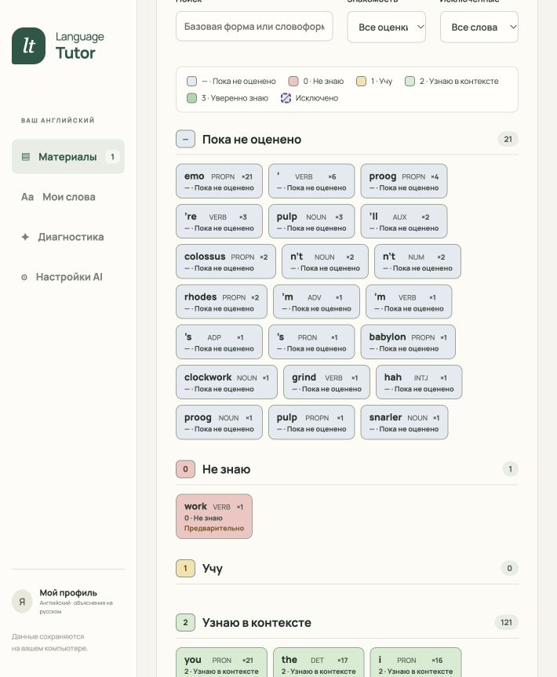
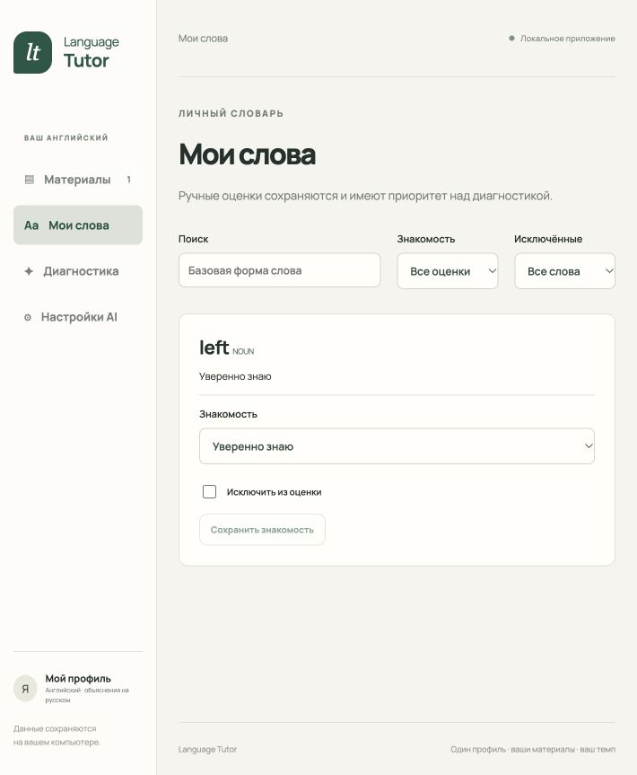
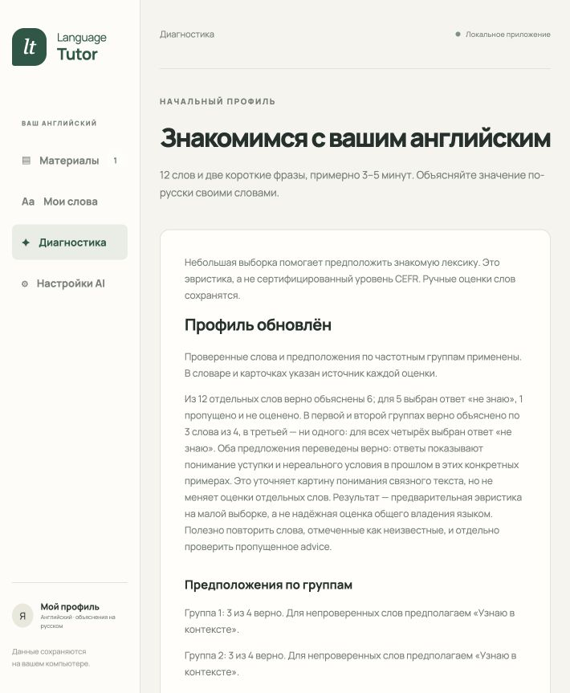
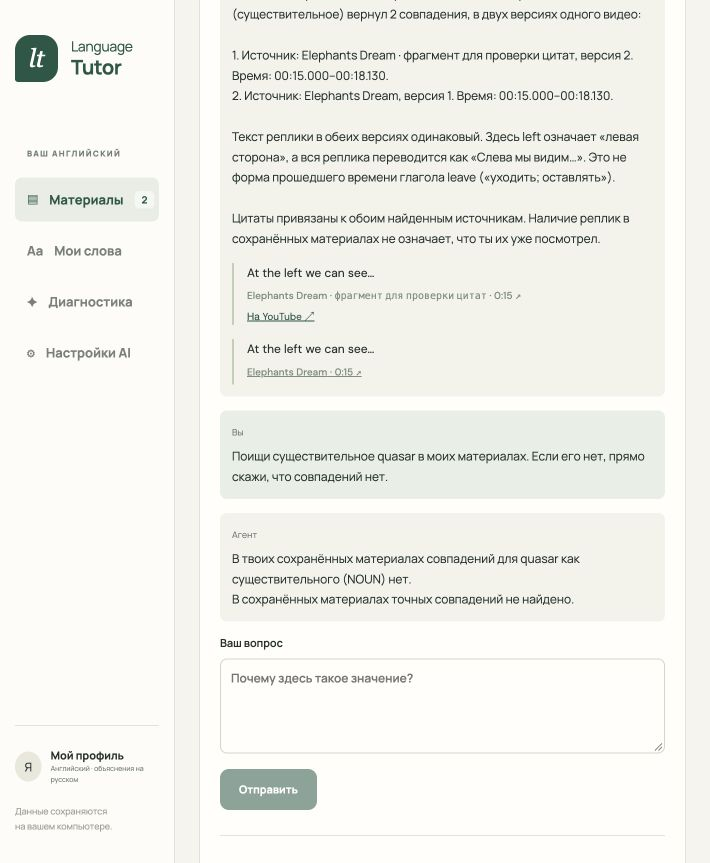

# Приемка MVP — результаты 19–22 октября 2026

27 октября добавлен временный режим Ollama Cloud `gemma4:31b` (A81). В отдельном worktree проверены переключение без подписки, сохранение прежней пары модели и reasoning, снимок настроек запроса, независимые настройки учащихся и обработка ошибок без раскрытия ключа. Прошли 116 backend-тестов, 39 web-тестов, Ruff, Mypy и сборка веба. После добавления владельцем `OLLAMA_API_KEY` в `.env` обычный живой запрос через добавленный провайдер Pydantic AI к `https://ollama.com/v1` успешно прошёл: на «Say hello in one short English sentence.» модель `gemma4:31b` ответила «Hello there!». Проверки качества и бенчмарки не входят в эту задачу.

С 21 октября текущая приемка относится только к веб-приложению по [SPEC §2.1](../SPEC.md#21-текущая-работа-только-web). A1, A11, A15 и части остальных критериев, требующие расширения, отложены до явного решения пользователя заняться расширением. Они не считаются пройденными и не блокируют web; ZIP расширения и его установка сейчас не требуются. Ниже сохранены фактические результаты прежних запусков и добавлены проверки журнала действий от 21 октября и пополнения словаря от 22 октября; пересмотр границ сам по себе не означает повторную приемку остальных сценариев.

21 октября пользователь принял [план разговорной практики](plans/conversation-practice.md), F13–F14 и A21–A28. 22 октября реализованы самостоятельные разговоры, контекст слов и материалов, поток ответа и панель слова из сообщения. Новые проверки выполнены через API, настоящий MCP, встроенный браузер и живую подписку; результаты и оставшиеся ограничения приведены ниже. [Протокол](acceptance/conversation-practice-2026-10-22.json) различает управляемые модели и живые ответы.

22 октября пользователь подтвердил итоговый [план автоматического отбора слов](plans/vocabulary-eligibility.md), SPEC §6.4 и A33–A35. Отбор реализован и проверен через публичные API, настоящий MCP и браузер без подписки; результаты приведены ниже. Уточнения A7, A19 и A29–A32 проверены с новым отбором; прежние результаты этих критериев сохранены как история запусков.

Веб-MVP пока не принят. Приложение собрано через Compose на macOS arm64; для этой установки используется `http://localhost:18765`, а callback подписки — порт 1456. MCP доступен только внутри Compose. Веб-сценарий проверяется через встроенный браузер Codex. Управляемый Chrome в окружении отсутствует, поэтому установленное расширение пока не прошло браузерную приемку.

В этой сессии реализованы словарь, сложность, три AI-сценария, панель расширения и удаление данных. Обязательные пути используют настоящие Pydantic AI Agent и MCP. Контролируемые модели применяются в автоматических тестах; они не заменяют результаты живой подписки.

20 октября пользователь сообщил о пустом выборе модели и сообщении «Сервер вернул непонятный ответ». Сбой воспроизведён: `/api/ai/models` возвращал HTTP 500 с `text/plain`, хотя сохранённые настройки читались. Настроенный host relay не работал; при обновлении истёкшего токена исключение старого HTTPX не попадало в обработчик ошибок каталога, использующего HTTPX2. Регрессия через публичный HTTP API падала с 500 до исправления и проходит с безопасным JSON 503 после него. В браузере при той же недоступной сети теперь видны сохранённые `gpt-6-luna / low`, понятная ошибка и обновление каталога.

Для этой установки проверен и применён прямой HTTPS через `compose.dns.yaml`: DNS `1.1.1.1` / `8.8.8.8`, прежний публичный CA bundle только для чтения, проверка TLS включена. Отдельный процесс relay больше не требуется. Выбор Compose-файлов сохранён в игнорируемом `.env`, чтобы обычный запуск сохранял эти настройки. После переключения каталог вернул семь моделей, форма сохранила выбор; `medium` пережил перезагрузку страницы, затем восстановлен исходный `low`. Кнопка «Проверить подключение» получила живой структурированный разбор через MCP без нового OAuth. После исправления проходят 91 backend-тест, пять web-тестов, Mypy, Ruff и production-сборка веба. Эта проверка устраняет конкретный сбой настроек и не закрывает оставшиеся критерии Chrome.

Повторный обычный запуск `docker-compose up -d --force-recreate app` сохранил SHA-256 публичного учебного состояния, один материал с 85 репликами, подключение и `gpt-6-luna / low`; каталог снова вернул семь моделей, а сохранение через форму прошло. Оба сервиса здоровы, опубликованы только loopback-порты приложения и callback. [Результат проверки](acceptance/ai-settings-recovery-2026-10-20.json), [экран после пересоздания](acceptance/screenshots/ai-settings-recovered-2026-10-20.png).

Независимые ревью изменения `0f601d6...8429701`: Standards — нарушений документированных правил и существенных code smells не найдено; Spec — ошибок реализации, недостающих требований в этом исправлении и расширения объёма не найдено. Обе проверки выполнены моделью Luna с reasoning max.

| Критерий | Состояние | Доказательство и остаток |
| --- | --- | --- |
| A1 | Отложен | Прежнее автоматическое извлечение не прошло четыре проверки Chrome. Работа и приемка расширения ожидают явного решения пользователя; web не блокируется. |
| A2 | Пройден для веба/API | Реальный файловый диалог встроенного браузера проверил SRT, VTT, ошибочные файлы, переиспользование и неполную замену. Импорт в установленном расширении отложен. |
| A3 | Частично для веба | Во встроенном браузере работают воспроизведение, выбор слова с паузой и переход к цитате 0:15. Полнота веб-проверки синхронизации и ориентира 0,5 секунды требует сверки с A3; установленное расширение отложено. |
| A4 | Качество пройдено | 10/10 живых карточек соответствуют заранее записанным смыслам, включая многозначность и выражения. Скорость пока медленнее целевых 5 с: медиана 6,6 с после оптимизации. |
| A5 | Пройден для веба/API | Словоформы, ручной null, диагностика, перезапуск и миграция проверены API. В браузере left сохранено как 3 и найдено в словаре; оно сохранилось после диагностики и пересоздания контейнера. |
| A6 | Пройден для API и браузера; живая генерация v2 не проверена | Адаптивная самооценка от 26 октября заменяет прежние 14 заданий. Реальный частотный MCP, генератор и проверяющий, кнопочные ответы, предел 18 вопросов, ручной приоритет и восстановление проверены с FunctionModel. См. дополнение ниже. |
| A7 | Пройден для веба/API | Независимые примеры покрывают пороги, повторы, null, ignored и N=0. В браузере правка left пересчитала покрытие 0 → 0,3%. |
| A8 | Пройден | Живой чат выбрал find_word_occurrences, дал цитаты двух сохраненных версий и корректные ссылки t=15. Запрос quasar вернул отсутствие совпадений без цитат. |
| A9 | Частично | API проверяет дедлайн, лимиты, отмену, повторы и изоляцию; интерфейс показывает состояния. Полная матрица браузерных сбоев еще не пройдена. |
| A10 | Собраны доказательства для веба/API | Публичный локальный профиль, точные origin/Host и связанные ID проверены API. Порты на loopback, MCP не опубликован. Проверка установленного расширения отложена. |
| A11 | Отложен | Защита навигации расширения реализована, реальный переход YouTube не проверен. Проверка ожидает явного открытия этапа расширения; web не блокируется. |
| A12 | Пройден в этой установке | Compose пересобран и контейнеры пересозданы; материалы, ручное score=3, диагностика и подключение сохранились. После пересоздания новая живая карточка и чат прошли. |
| A13 | Пройден для локального комплекта | README, лицензии и прежние результаты A1–A19 доступны; границы от 21 октября отмечают отложенные критерии. 20 октября подтверждены приватный репозиторий и visibility=PRIVATE. Прежний ZIP сохранен, его сборка и установка для веб-поставки не требуются. |
| A14 | Пройден в доступном браузере | Встроенный браузер без расширения: диагностика, импорт SRT/VTT по ссылке, просмотр, карточка, score, чат и повторное открытие. Реальный запрет встраивания ролика 4xXwFwQmRIM показал объяснение, ссылку YouTube и читаемый текст; доказательство записано в acceptance-materials.md. |
| A15 | Отложен | Обе реализации используют один API и профиль; реальный обмен с установленным расширением не проверен. Проверка ожидает явного открытия этапа расширения; web не блокируется. |
| A16 | Основной путь пройден | Живой OAuth подтвержден ранее в этой Compose-конфигурации; карточка, диагностика и чат работают через сохраненную подписку после пересоздания. Ошибки OAuth, конкурентный refresh, лимит и отключение проверены контролируемо. Живую ревокацию и новый refresh-token намеренно не провоцировали. |
| A17 | Пройден для API; новая диагностика проверена с FunctionModel | Карточка, диагностика и чат используют именованные Agent и output_type. Новый генератор диагностики вызывает настоящий частотный MCP, отдельный Agent проверяет контекст. Прежние живые проверки карточек и чата сохранены; живую генерацию диагностики v2 нужно проверить отдельно. |
| A18 | Пройден для веба/API | В браузере сохранены разные модель и reasoning; получены живые карточки gpt-5.6-luna/low и gpt-6-luna/medium, включая повторную генерацию. Выбор medium пережил пересоздание контейнеров. API проверяет три сценария, кэш и параметры запросов при ожидании. Прежний интерфейс расширения реализован; его приемка отложена. |
| A19 | Пройден для веба/API | Браузер показывает все 143 слова сразу цветными плитками с уровнями, поиском и раскрытием редактора. В отдельной установке без подписки сохранён score=3, пересчитаны подсветка и покрытие; выбор вхождения перемотал к 3:10. Группировка, фильтры и сообщение content script проверены автоматически. Проверка установленного расширения отложена. |
| A20 | Проверен API/MCP и в браузере | Постоянные события кликов, переводов из модели/кэша, ручных изменений и вопросов. Проверены повторы, фильтры, пагинация, миграция с резервной копией, перезапуск и reset. FunctionModel вызвал настоящий MCP и получил сохранённый перевод с проверенной цитатой. Браузерная проверка клика и score выполнена без подписки; новый живой запрос подписки не выполнялся. |
| A21 | Пройден для API/Compose и основного интерфейса | Независимые разговоры создаются без слова и видео, сохраняются и переименовываются. API/MCP проверяют изоляцию переписки, включая подставленный ID чужой беседы. Браузер проверил переключение и обновление, Compose — сохранность прежних разговоров. |
| A22 | Проверен на живых примерах | Живой ответ на английском кратко исправил `Yesterday I go` на `Yesterday I went` и продолжил беседу. По просьбе модель объяснила `painting` и `drawing` по-русски и вернулась к английскому вопросу. Сложность подстройки на разных уровнях требует дальнейшей оценки диалогов. |
| A23 | Пройден для API/MCP | Различимые переходы, даты, источник оценки, исключения и ручной сброс передаются модели. Старые слова 0/1 остаются кандидатами; неизменённая оценка не создаёт событие. Семантическое качество выбора на широкой истории оценивается отдельно. |
| A24 | Основной путь пройден | Живая модель предложила три темы и поддержала свободную тему. API проверяет несколько материалов и контекст через MCP, прежняя проверка цитат сохраняется. Неуместная вставка редкого слова обнаружена и исправлена инструкцией; последний живой ответ сохранил тему музея. |
| A25 | Пройден для API и основного интерфейса | Два значения `bank` проверены в разных сообщениях; общий словарь, кэш, события и правка леммы проверены API. В браузере карточка и знакомость не теряют черновик. Живые карточки `work on your English` и `painting` соответствуют исходным сообщениям. |
| A26 | API и основной поток пройдены | SSE проверен с частичными JSON-строками и разделённым UTF-8, отмена и повтор не дублируют ход. Живой ответ дал 38 обновлений, последний — 14. Ошибки и лимиты проверены API; полная матрица ошибок и обрывов во всех браузерных состояниях не пройдена. |
| A27 | Пройден управляемой моделью/API | Длинная беседа сжимается в отдельную сводку, сохраняет ранний существенный контекст и неизменные исходные сообщения. Сводка входит в бюджет ответа. Длинный прогон живой моделью не выполнялся. |
| A28 | Пройден для API/Compose | Миграция сохранила 7 материалов, 1434 записи словаря и 4 прежних разговора. Удаление, сохранность общих оценок, общий reset и защита от запоздавших ответов проверены в отдельных тестовых базах. Рабочие данные для проверки удаления не стирались. |
| A29 | API/алгоритм и основной браузерный сценарий | Учёт реплик, паузы, скорость, редкие события, mute и перемотка проверены управляемыми событиями; настоящий YouTube проверил прослушивание и клик. Отдельный реальный прогон фона и mute не выполнялся. |
| A30 | Пройден в браузере | Кнопка и естественный конец открывают сводку; правка, исключение, закрытие без применения, восстановление и явное сохранение проверены. |
| A31 | Пройден для API/Compose | Предыдущая схема и данные переживают миграцию; черновик восстанавливается. Выключение, ручной приоритет, сброс и поздние запросы проверены API; рабочие данные совпали после пересоздания контейнеров. |
| A32 | Пройден для API | Прослушивание, клик, подготовка, подтверждение и реальные изменения различимы в событиях; повторы и конкурентное сохранение не дублируют результат; неверный набор реплик откатывается целиком. |

## Разговорная практика — 22 октября

Проходят 119 backend-тестов, включая 13 новых сценариев разговорной практики, и 12 web-тестов. Ruff, Mypy для 29 файлов backend/MCP и production-сборка проходят. Управляемые модели используют настоящий MCP; живые AI-проверки выполнены отдельно на сохранённой паре `gpt-6-luna / medium`, без изменения настроек учащегося.

Перед обновлением сохранены отпечатки публичных данных. После миграции и пересоздания Compose совпали материалы, словарь и прежние разговоры; подписка осталась подключена. Обе службы здоровы, приложение доступно только на loopback-порту 18765, MCP наружу не опубликован.

В отдельной тестовой установке браузер проверил создание двух разговоров, переименование, переключение, сохранённую историю, панель слова, общую знакомость и черновик при выборе слова и предложении тем. В рабочей установке браузер показал настоящий сохранённый ответ и перевод `painting` как «картина»; введённый черновик сохранился. На узком экране панель переносится под беседу. [Экран разговора](acceptance/screenshots/conversation-practice-2026-10-22.png), [контекстная карточка](acceptance/screenshots/conversation-word-2026-10-22.png).

В живом прогоне обнаружена задержка: незавершённая строка JSON не появлялась до конца ответа. После исправления частичного разбора повторный запрос дал 38 текстовых обновлений. Затем уточнена инструкция естественного употребления слов: тема учащегося имеет приоритет, неподходящие слова пропускаются. Последний ответ дал 14 обновлений, первое через 5,9 секунды, полный ответ через 8,6 секунды. Три темы получены за 8,0 секунды. Карточка `work on your English` соответствует контексту, но заняла 9,9 секунды при ориентире пяти секунд. Эти замеры относятся к единичным запросам, не к медиане.

Полная матрица браузерных сбоев, долгий живой диалог со сжатием и оценка качества на разных уровнях учащегося остаются дополнительными проверками. Это не меняет прежние ограничения веб-MVP.

[Проверка подписки](connection-acceptance.md), [предыдущая живая проверка OAuth](subscription-proof.md), [инструкция расширения](extension.md), [источники частотного списка](../data/diagnostics/README.md).

Отложенные действия в установленном Chrome сохранены в [чек-листе приемки](chrome-acceptance.md). Текущая сессия предоставляет встроенный браузер, без доступа к управлению Chrome. Диагностика извлечения в production-панели теперь показывает код ошибки, источник, язык, HTTP-статус, размер ответа и время проверки. Подписанные URL и текст чужих дорожек в эти сведения не входят. Принудительные сокращенные дорожки (`kind=forced`) не выбираются для оценки полного видео.

## Standards

Два независимых направления review сравнили изменения с исходным `29f9c73`, затем исправления `1eca864..fd8e99a`. Жестких нарушений документированных стандартов не найдено. Первичная проверка дала три необязательных замечания: отдельные реализации слов видео и настроек в двух интерфейсах расходятся с предложенной в SPEC §10 общей React-архитектурой; запрос и проверка каталога моделей повторялись; router напрямую обращается к хранилищу настроек сервиса. Повтор каталога устранен: `connected_model` использует `available_models`. Два остальных замечания относятся к границам модулей и предложенной архитектуре; они не признаны обязательными нарушениями. Повторная проверка исправлений не нашла новых нарушений или значимых code smells.

Итого: 0 жестких нарушений, 3 первоначальных замечания, из них 1 устранено и 2 оставлены как необязательные. Наиболее существенное из оставшихся — дублирование интерфейсной логики между вебом и расширением.

## Spec

Первичная проверка нашла две ошибки. Смена backend переподключала только активную вкладку YouTube, а другая могла показывать словарь прежней установки; теперь все вкладки сбрасывают контекст, запросы сохраняют свой origin и ревизию, поздние ответы отклоняются. Список слов веба называл неполный импорт полной дорожкой; теперь он получает `is_complete` и показывает предупреждение о частичной дорожке.

Повторное выполнение production panel/content в изолированной VM подтвердило сброс обеих вкладок, переподключение активной, отсутствие прежнего материала после выбора второй, импорт из выключенного режима и отклонение чужого origin и запоздалого материала после сброса. Это проверка логики сообщений, не приемка установленного Chrome. Браузерный прогон отдельно подтвердил исправленную пометку неполной дорожки. В проверенном diff оставшихся ошибок или расширения объема не найдено.

Итого: 2 ошибки поведения, обе устранены; наиболее существенная была в привязке вкладки к прежнему backend. На момент этого review приемка Chrome и автоматическое извлечение были условиями полной готовности; решением от 21 октября они отложены и больше не блокируют веб-MVP. Решением пользователя от 20 октября репозиторий остается приватным; публичная публикация больше не является условием приемки.

## Дополнение F10 и F11

Выбор модели и reasoning сохраняется на общем backend и применяется к новым запросам. Проверены живой каталог из семи моделей, сохранение выбора из UI, чтение во второй вкладке и сохранение после пересоздания контейнеров Compose. Карточка machine сначала получена с gpt-5.6-luna/low за 11 843 мс, затем действие «Сгенерировать заново» получило её с gpt-6-luna/medium за 9 302 мс. Оба запуска использовали настоящий MCP и по два запроса модели. Исходные настройки gpt-6-luna/low возвращены. Подробности: [результаты проверки](acceptance/ai-settings-and-vocabulary-2026-10-19.json).

После уточнения интерфейса все 143 базовые формы подготовленного видео показаны компактными цветными плитками, без поискового запроса и страниц списка. Уровни сгруппированы по порядку, цвет сопровождается числом, подписью и легендой. По нажатию раскрываются формы, редактор знакомости и реальные вхождения. Поиск и отдельные фильтры сохранены. Основная установка проверена во встроенном браузере, включая узкое окно.

Правки оценок и цветовые примеры дополнительно проверены в отдельной установке без credentials подписки. Изменение machine на 3 увеличило знакомое покрытие с 0 до 0,5% и обновило оба вхождения; переход к реплике показал 3:10 и правильный контекст. Примеры всех уровней на [снимке отдельной установки](acceptance/screenshots/video-vocabulary-levels-qa.png) заданы только в её тестовом профиле. Учебные оценки основной установки для этой проверки не менялись. В расширении тест сообщения проверяет перемотку, паузу, выбранное вхождение и отклонение чужих ID; установленный Chrome этим тестом не заменяется.

Финальный браузерный прогон повторил поиск machine, сохранение score=3 без AI и пересчет покрытия до 0,5% в отдельном временном профиле. Частичный VTT из первых трех разрешенных реплик показал девять слов и явную пометку «НЕПОЛНАЯ ДОРОЖКА»; поиск left сохранил предупреждение. В iframe подтверждены явное продолжение после ранней перемотки и переход к вхождению во время воспроизведения: нативный video остался на 15 с с `paused=true`. Ошибка неподключенной подписки сохранила контекст и кнопку повтора. Этот прогон использовал Uvicorn и production-сборку веба без credentials; основная Compose-установка проверяется отдельно. [Наблюдения](acceptance/final-browser-2026-10-19.json), [снимок частичной дорожки](acceptance/screenshots/partial-vocabulary-final.jpg).

Первый набор живых карточек записан в `acceptance/live-cards-2026-10-19.json`: исходная реплика, ожидаемый смысл, фактическая карточка, MCP trace и задержка. Он содержит только распространяемый подготовленный материал. Проверены многозначные left, ground и close, выражения watch out, get up, pay attention и like clockwork. Все десять ответов подходят контексту; оценка относится только к этой малой выборке.

## Измерения и условия

Модель: каталог подписки выбрал `gpt-6.1-sol`; provider не сообщил неизменяемый snapshot. Pydantic AI 2.57.0, MCP SDK 1.30.0, OpenAI SDK 3.35.1; macOS arm64, Compose, существующий проверяющий TLS host relay. Для карточек одновременно выполнялись два запроса. Начальная медиана — 10 717,5 мс. После обязательного MCP-prefetch и low reasoning — 6 585,5 мс, диапазон 4 916–17 389 мс. Восемь ответов использовали один запрос модели, два — по два. Порог качества 8/10 выполнен; ориентир обычного отклика 5 с пока не выполнен.

Повторная живая диагностика заняла 22 954 мс. Живой поиск двух материалов — 14 699 мс, запрос без совпадений — 7 490 мс. Первый развернутый чат с четырьмя инструментами занял 16 832 мс. Ориентир чата — 15 с; результаты зависят от выбранной модели и сети.

Дополнительная проверка текущей модели `gpt-6-luna/low` на тех же десяти заранее заданных смыслах дала 10 подходящих ответов из 10. Это сверка Codex с ожидаемыми значениями, без оценки знаний учащегося. Все ответы новые, с настоящим MCP; одновременно выполнялись два запроса. Медиана — 8 919,5 мс, диапазон 7 752–11 131 мс. Более легкая модель в этом запуске не выполнила ориентир пяти секунд. [Исходные ответы и условия проверки](acceptance/live-cards-luna-2026-10-19.json).

Два материала в проверке цитат — полная подготовленная дорожка Elephants Dream и импортированный VTT-фрагмент первых трех реплик того же видео. Это две версии, а не два разных ролика. Исходная версия и ее время остались неизменными после импорта. В браузере проверены пауза по клику, воспроизведение, синхронные реплики, переход к 0:15 и корректный href цитаты предыдущей версии.

Ответы диагностики и вопросы были написаны агентом для приемки и не описывают знания учащегося. После фиксации результатов удалены только созданные в этой сессии тестовые оценки, диагностики, разговоры и VTT-фрагмент. Исходный подготовленный материал и подключенная подписка сохранены. Рабочий профиль готов к собственным ответам учащегося.

## Автоматические проверки и поставка

Полный backend-набор после F10/F11: **90 passed in 43.04s**. Mypy: 22 источника без ошибок. Ruff для backend и scripts, сборка TypeScript/Vite, пять web-тестов и синтаксис расширения прошли. После подтверждения границ проверок 20 октября полный набор расширения содержит **10 проходящих тестов**. Пять новых регрессий проверяют импорт из выключенного режима, отклонение чужого origin, смену профиля во время импорта, сброс вкладки при закрытой панели и поздний ответ загрузки. Эти пять тестов падают на изолированной копии исходников `1eca864` и проходят на текущей реализации. Backend-тесты поднимают настоящий отдельный MCP-сервер; управляемые ответы проверяют SDK→SIWC→MCP→output_type, ложные цитаты, дедлайны, повтор без дубликатов, конкурентные разговоры, параметры ожидающего сообщения и поздние записи после reset.

Для выбранной пользователем ручной приемки подготовлен [чек-лист Chrome](chrome-acceptance.md) и генератор `scripts/prepare-chrome-acceptance.py`. Набор в `dist/chrome-acceptance/` и ZIP содержат полные SRT/VTT, частичный VTT из трех реплик, неверный и пустой SRT и сведения об источнике. Проверка через публичный API подтвердила 85 реплик и один хеш полного SRT/VTT, три реплики неполного VTT и HTTP 422 без изменения библиотеки для обоих неверных файлов. Mypy и Ruff для генератора, целостность ZIP и `git diff --check` прошли. Эти результаты не заменяют ручную проверку Chrome.

Изменения от `03e24a7` независимо проверены по Standards и Spec. Standards не нашел нарушений; Spec выявил недостающие ручные проверки смены AI-параметров во время запроса и подписей сохраненных ответов. Они добавлены в A18 чек-листа и форму отчета в `e248f43`; повторная проверка не нашла новых замечаний.

Финальная проверка интерфейса исправила потерю перемотки при загрузке iframe, устаревшее обновление материала и словаря, гонку загрузки истории чата и дублирование разговора при быстрой отправке. Словарь получил явное обновление общего профиля. После сборки Compose оба сервиса здоровы, подключение подписки сохранено. Проверка известных форматов credentials в 132 текущих файлах, 251 историческом blob и текущих журналах контейнеров не нашла совпадений; это проверка шаблонов, а не полный аудит безопасности.

После последних исправлений повторно прошли 31 тест подключения и настоящего MCP, strict mypy для 22 источников, Ruff для backend/scripts, lock check и сборка веба. Финальное пересоздание Compose сохранило одинаковый SHA-256 публичных данных профиля, словаря, всех 85 реплик и настроек `gpt-6-luna/low`. Новая карточка left после пересоздания получила ответ за 8 655 мс с успешными `get_subtitle_context` и `get_word_knowledge`; кэш не использовался. [Результат пересоздания и живой ответ](acceptance/final-compose-2026-10-19.json).

`dist/language-tutor-extension.zip` содержит одиннадцать файлов приложения без credentials, тестовых данных и node_modules. SHA-256: `4b4fc70cb74e5f8d8d47828b76080d212b2fee2d273e76b73f5738aef2b10fac`. Повторная упаковка дает тот же архив. Репозиторий остается приватным; публикация не выполнялась.

Удаление проверено через публичный API отдельной установки `http://localhost:18865`, `DATA_DIR=/private/tmp/language-tutor-reset-20261019`. В браузере проверены текст предупреждения, отдельное подтверждение и пустое состояние после reset и перезагрузки. Рабочая подписка основной установки не отключалась. Автоматические тесты также подтверждают сохранение пустого состояния после перезапуска, недействительность старых ID, очистку собственных migration backups и сохранение чужих файлов.

Два параллельных code-review проверили изменения от `943b637` до `a28f265`. Standards: документированных нарушений нет; одна необязательная рекомендация по разделению LearningService. Spec: исправлены две ошибки — отсутствовавший INFO handler для trace и потеря времени основной ссылкой на предыдущий материал. Повторная проверка исправлений не нашла замечаний.

Артефакты: [оптимизированные карточки](acceptance/live-cards-optimized-2026-10-19.json), [диагностика](acceptance/live-diagnosis-2026-10-19.json), [повторная диагностика](acceptance/live-diagnosis-repeat-2026-10-19.json), [чат](acceptance/live-chat-2026-10-19.json), [production MCP trace](acceptance/live-mcp-traces.txt).

## Журнал учебных действий — 21 октября 2026

План и контракты F12/A20 описаны в SPEC §11.1 и [задаче #17](https://github.com/GlebNM/language_tutor/issues/17). Миграция v5 добавляет журнал в существующую SQLite; прежние материалы и оценки сохраняются, перед обновлением создаётся резервная копия. История начинается после обновления.

Автоматические проверки публичных операций подтверждают: клик без AI, сохранение после повторного открытия базы, отсутствие записи клика при GET, проверку связей ID, единственное событие при конкурентной доставке одного request_id, отдельные события новых кликов, неизменность снимков после исправления слова, ручные изменения без дублей, фильтры и устойчивую пагинацию. Ошибка подключения AI оставляет клик без события перевода. Сброс очищает историю и не позволяет позднему ответу AI восстановить её. Существующая проверка обновления старой базы подтверждает сохранность и восстановление резервной копии.

Интеграционная проверка запускает отдельный настоящий Streamable HTTP MCP-сервер. Управляемая FunctionModel получает карточку, повторно читает её из кэша, затем в чате сама вызывает get_recent_activity и отвечает с проверенной цитатой. MCP соблюдает лимит 6000 символов и возвращает продолжение без потери событий; отдельно проверено сокращение слишком длинного JSON с сохранением точного перевода. Полные карточки остаются в API.

Встроенный браузер, отдельная локальная установка на 127.0.0.1:8876 без подписки: открыт Elephants Dream, нажато clockwork в реплике Like clockwork!, сохранён score=1. API подтвердил word_selected и knowledge_changed без translation_received; обновление данных после сохранения score не создало второй клик. [Данные проверки](acceptance/user-activity-2026-10-21.json), [скриншот](acceptance/screenshots/activity-word-2026-10-21.png).

Итоговые проверки: 98 backend-тестов и 5 web-тестов, Ruff, Mypy и production-сборка web прошли. Обновлена существующая Compose-установка на http://localhost:18765: схема v5, резервная копия до миграции и настоящий внутренний MCP подтверждены. Сравнение публичных данных до/после совпало: 7 материалов, 1434 записи словаря и весь профиль; подписка осталась подключена. Новый журнал пуст после обновления, исторические действия не выдуманы. Новый живой запрос к подписке в этой проверке не выполнялся.

## Пополнение словаря по итогам просмотра — 22 октября 2026

Реализованы F15 и A29–A32 из [подтверждённого плана](plans/automatic-word-knowledge.md), [задача #18](https://github.com/GlebNM/language_tutor/issues/18). Настройка изначально выключена. При включении сохраняются прослушанные реплики и клики только по текущим субтитрам; словарь меняет отдельное подтверждение редактируемой сводки. Закрытие сводки ничего не применяет.

Автоматические проверки публичных API подтверждают подготовку `2` и `0` без изменения словаря, объединение словоформ, приоритет клика, правку и исключение слов, восстановление черновика после повторного открытия приложения, сохранение и повтор без дубликатов, конкурентное подтверждение, защиту ручной оценки и сброса, выключение режима и отклонение запоздавших запросов, чужие ID и общий сброс. Проверка миграции создаёт предыдущую схему и наполняет её через API: профиль, словарь и события после обновления совпадают, резервная копия создана.

Пять проверок учёта воспроизведения покрывают паузы и буферизацию, двойную скорость с редкими обновлениями фоновой вкладки, перемотку вперёд и назад, выключение звука на части реплики и открытие с середины. Интервалы оцениваются по позиции и времени с учётом скорости, а не по числу срабатываний таймера. Контроль звука использует состояние mute и громкость самого YouTube-плеера; состояние системного звука не определяется.

Браузерная проверка: Codex in-app browser, отдельная локальная установка `http://127.0.0.1:18872`, подготовленный Elephants Dream, настоящий YouTube IFrame Player. Включён режим, воспроизведены реплики со звуком, в текущих субтитрах выбрано left. Сводка предложила 30 слов: left — `0`, остальные — `2`. В сводке left изменено на `1`, at исключено. Закрытие оставило словарь пустым. После перезагрузки сводка восстановила обе правки; подтверждение добавило 29 слов, at остался непомеченным. Далее выбран режим 2×: естественное окончание видео открыло новую сводку и сохранило прежний словарь из 29 записей до подтверждения. [Наблюдения и события](acceptance/viewing-2026-10-22.json), [сводка перед сохранением](acceptance/screenshots/viewing-summary-2026-10-22.png). Состояние фактически фоновой вкладки и mute отдельно проверены управляемыми событиями, а не этим браузерным прогоном.

Итоговая проверка исходников: **117 backend-тестов**, **12 web-тестов**, Mypy для 27 источников, Ruff и production-сборка web прошли. Установка Compose обновлена с прежними конфигурациями OAuth и DNS/CA; app и настоящий внутренний MCP здоровы. Публичные профиль, материалы, словарь и настройка до и после пересоздания контейнеров совпали: 7 материалов, 1439 записей словаря; подключение подписки сохранено. [Сравнение установки](acceptance/viewing-compose-2026-10-22.json). В рабочем профиле режим оставлен выключенным; тестовые оценки создавались только в отдельной установке. При финальном повторном пересоздании все исходные записи сохранены; одновременно в словаре появились девять новых предварительных записей без изменения прежних. Итог сравнения фиксирует добавления отдельно.

## Автоматический отбор слов — 22 октября 2026

Реализован подтверждённый [план](plans/vocabulary-eligibility.md), SPEC §6.4 и [задача #19](https://github.com/GlebNM/language_tutor/issues/19). Контекстный отбор использует локальные spaCy 3.8.11 / en_core_web_sm 3.8.0 с NER и правила семейств звуков. Результат каждого вхождения хранится отдельно от знакомости и проверяется одной политикой для словаря, материала, сводки и контекста практики. Ручной статус имеет приоритет; исходные токены остаются кликабельными.

| Критерий | Результат | Доказательство |
| --- | --- | --- |
| A33 | Пройден на фиксированных примерах | Проверены имена людей, места, бренд, день недели и месяц; Apple/apple, May/may, неоднозначное Will; варианты hmm/um/uh/wooow, обычные hello/ouch/wow/book/school; исходные смещения и текст сохранены |
| A34 | Пройден для API и браузера | Каждый статус 0–3, null и ignored добавляет слово; сброс сохраняет запись, другой материал и перезапуск сохраняют ручной выбор. Прежняя запись переживает миграцию; предварительная диагностика не отменяет отбор |
| A35 | Пройден для API, MCP и браузера | Клик по отсеянному употреблению не создаёт и не меняет предложение, даже при общей словарной единице с допустимым употреблением. Старый просмотр использует актуальный отбор; настоящий MCP не предлагает отсеянные слова для практики. Сообщения агента также сохраняют кликабельные токены и ручное добавление |

Полный backend-набор: **131 passed in 43.91s**. Web: **13 passing tests**; Mypy для 30 источников, Ruff для backend/scripts и production-сборка web прошли. Проверки обращаются к публичным API и настоящему отдельному Streamable HTTP MCP-серверу. Для ответа агента и диагностики использована управляемая FunctionModel; живые запросы через подписку в этой проверке не выполнялись. Независимый расчёт на контрольной реплике дал N=5, K=3, L=1, A=1 и 60/20/20%; ручное добавление John=3 дало N=6 и покрытие 66,67%.

Браузер: Codex in-app browser, отдельная установка http://127.0.0.1:18873 без подключённой подписки. В исходной реплике «Hmmm, hello John. Ouch, wow! Um, wooow, book, school.» сохранены все девять токенов; «Слова видео» первоначально содержат пять слов. Выбор Hmmm открывает панель с доступным ручным добавлением при недоступной AI-карточке. «Добавить в словарь» с исходным «Пока не оценено» добавляет шестое слово; после перезагрузки Hmmm остаётся в «Моих словах» с source=manual и score=null. [Скриншот](acceptance/screenshots/vocabulary-selection-2026-10-22.png), [протокол](acceptance/vocabulary-selection-2026-10-22.json).

Локальная Compose-установка http://localhost:18765 пересобрана с прежними настройками OAuth и сети; app и внутренний MCP здоровы. Миграция v12 → v13 создала резервную копию. Полное сравнение строк до/после подтвердило сохранность профиля, 7 материалов, 1540 реплик, 1891 словарной единицы, 12272 вхождений, 15 записей оценок, 9 событий, 6 разговоров, 11 сообщений и 138 вхождений сообщений. Все три ручные словарные записи, настройки обучения и подключённая подписка сохранены. Отображаемый словарь уменьшился с 1451 до 1392 записей за счёт отбора предварительных слов; исходные оценки и токены не удалялись.

Ограничение распознавания соответствует согласованному поведению: при противоречии контекстного и сохранённого разбора слово остаётся допустимым; короткое имя Will может быть пропущено. Проверка фиксированных примеров не означает безошибочного распознавания всех имён.

## YouTube по ссылке и улучшение автосубтитров — 22 октября

F16–F17 реализованы в веб-приложении. По умолчанию достаточно ссылки; название и английская дорожка загружаются автоматически. Приоритет у авторских субтитров. Для автоматических включена фоновая обработка выбранной моделью из подписки; опцию можно выключить. При недоступном AI исходник доступен для просмотра и есть повтор улучшения. Сравнение и возврат к исходной версии проверены в браузере.

Полная backend-проверка: 162 теста, включая 31 сценарий получения и улучшения субтитров. После уточнения контекста и промпта повторно прошёл набор из 31 сценария. Web: 13 тестов, production-сборка, Ruff и Mypy для 33 файлов проходят. Проверены приоритет авторской дорожки, английские региональные варианты, отсутствие английского, forced-дорожки, ограничения YouTube, неверные ссылки, выключенная обработка, чужие ID, разрушительные правки, исходный контекст между частями, ошибка в середине обработки, повтор, перезапуск и удаление данных.

Реальное получение и браузерный импорт без файла прошли на `TLkA0RELQ1g` (Elephants Dream, автоматические английские субтитры) и `jNQXAC9IVRw` (Me at the zoo, авторская английская дорожка, AI не запускался). В отдельной установке без credentials импорт автосубтитров сохранил материал и показал предложение подключить подписку. Резервная форма SRT/VTT также проверена.

Живой запуск через сохранённые настройки `gpt-6-luna / medium` на полной автоматической дорожке Elephants Dream обработал 91 реплику в восьми частях за 152,77 секунды. Редактор и проверяющий приняли изменения в 55 репликах. Исходный материал, порядок, все временные границы и смещения кликабельных слов проверены программно. Это прогон с `caption-edit-1`; затем в `caption-edit-2` уточнены непрерывность предложения и отдельный контекст до/после части. Отдельный живой прогон `caption-edit-2` на 12 реальных репликах завершился за 16,15 секунды, принял две правки и сохранил строчную букву в продолжении предложения. Первоначальная часть из 40 реплик превысила 30 секунд; текущий предел — 12 реплик / 1600 символов, общий лимит AI на часть остался 30 секунд.

Docker Compose пересобран и обновлён. В образе отключён сохраняемый установочный кэш пакетов: это позволило собрать его при ограниченном свободном месте Docker. Удалены только старые записи сборки этого проекта и артефакты неудачной сборки. После миграции совпали отпечатки профиля, материалов, словаря, журнала действий, разговоров и настроек AI; подключение подписки сохранилось. Обе службы здоровы.

| Критерий | Результат | Свидетельство |
| --- | --- | --- |
| A36 | Пройден для API и браузера | Два реальных видео, получение названия, приоритет источника, резервный импорт и управляемые ошибки |
| A37 | Пройден | Авторская дорожка и выключенная опция не вызывают AI; автоматическая запускает задание, отсутствие подписки сохраняет импорт |
| A38 | Пройден для структурной сохранности | Два агента, проверки правок и ID, новая версия, неизменные времена, рабочие смещения, сравнение и возврат |
| A39 | Пройден для API и сохранённого результата в браузере | Прогресс, идемпотентность, ошибка в середине, повтор, перезапуск, отмена при сбросе и защита поколения данных |

Точность произнесённых слов не оценивалась по эталонной расшифровке или WER; одного ролика недостаточно для вывода о качестве на разных жанрах. Проверяющий не подтверждает соответствие аудио. YouTube может ограничить получение дорожки; в этом случае доступен SRT/VTT. [Исследование и промпты](research/youtube-auto-caption-improvement-2026-10-22.md), [протокол](acceptance/youtube-captions-2026-10-22.json), [форма импорта](acceptance/screenshots/youtube-link-import-2026-10-22.png).

## Управление просмотром по репликам — 22 октября 2026

Реализованы кнопки соседних реплик и разового повтора, цикл, автопауза с ручным продолжением, скорости YouTube и клавиши A/S/D, Space, L, Q. Требования относятся к F2/A3/A9 и записаны в SPEC §5.7 и §13.4; выбранное поведение — в [плане](plans/playback-controls.md). Работа: [#21](https://github.com/GlebNM/language_tutor/issues/21).

27 web-тестов, включая 11 новых сценариев управления и учёт прослушанной реплики до автоматического действия, проходят. Production-сборка с проверкой TypeScript и все 166 backend-тестов проходят. Браузер проверил настоящий YouTube в отдельной установке: автопаузу и ручное продолжение, цикл и остановку при выборе слова, скорость 0,75× с восстановлением после повторного открытия, переход D и отсутствие перехвата S в поисковом поле. Живые AI-запросы для этой проверки не выполнялись. Конец видео с циклом проверен управляемыми образцами, без полного живого просмотра до последнего кадра.

Compose пересобран; app и mcp здоровы. После пересоздания совпали контрольные суммы списка материалов и словаря: 7 материалов и 1392 записи. В основной установке проверены новая панель, клавиатурная подсказка и переход на 0:15 с сохранением паузы. [Протокол](acceptance/playback-controls-2026-10-22.json), [снимок панели](acceptance/screenshots/playback-controls-2026-10-22.png).

## Прогресс обучения — F18, A40–A43, 22 октября 2026

Реализован раздел «Прогресс» с периодами 7/30/90/365 дней, текущими количествами знакомых и уверенно известных слов, изменением за период, графиком размера словаря, дневными изменениями, минутами просмотра, календарём и распределением по уровням. Сохранённые оценки из автоматической сводки участвуют в тех же показателях. Повторное сохранение не увеличивает словарь; переход 2 → 3 меняет только уверенно известные, ignored исключён. Предварительные оценки включены и подписаны, начальный словарь служит исходной точкой.

166 backend-тестов и 27 веб-тестов прошли; сборка, Ruff и mypy прошли. Автоматически проверены несохранённая и подтверждённая сводка, повтор, повышение и понижение оценки, исключение, диагностическая и предварительная знакомость, прежний словарь при обновлении, перезапуск, общий сброс и отклонение поздней доставки. Учёт времени проверен на скорости 2×, повторе, паузе, буферизации, выключенном звуке, перемотке и разреженных фоновых образцах. Перекрытие вкладок объединяется; дни определяются выбранным часовым поясом, включая пересечение полуночи.

В браузере на отдельном временном профиле проверены графики с историческими тестовыми данными, недельный и месячный периоды, открытие дня с конкретными изменениями и материалом, переход обратно к видео. Настоящий YouTube воспроизвёл 25,054 секунды при выключенном автопополнении; после паузы и перехода в прогресс в сегодняшнем дне появились «25 сек» и нужный материал. Исторические тестовые данные не переносились в профиль учащегося. Состояние ошибки с кнопкой повтора проверено в ходе браузерного прогона; обнаруженная обработка числового query-параметра периода исправлена и закреплена проверкой всех четырёх значений.

Docker Compose пересобран и перезапущен, app и mcp healthy. Основной профиль сохранил 1392 записи словаря, из которых 1387 знакомых и 0 уверенно известных; прирост после обновления равен нулю. Этот исходный уровень подтверждён в интерфейсе. История размера словаря и минуты собираются с обновления; последние неотправленные секунды могут потеряться при принудительном завершении браузера. Полный адаптивный прогон мобильного интерфейса в эту приёмку не входил.

[Протокол проверки](acceptance/progress-2026-10-22.json), [снимок основного профиля](acceptance/screenshots/progress-compose-2026-10-22.png), [графики тестового профиля](acceptance/screenshots/progress-qa-2026-10-22.png).

## Поиск видео — F20, A49–A54, 22 октября 2026

Добавлен раздел «Найти видео»: тема или ссылка YouTube, длительность, приоритет по личной лексической сложности, необязательная формулировка английского запроса через подписку, постепенные результаты, отмена и открытие в существующем плеере. Поиск использует официальный API, ключ можно сохранить в интерфейсе. Оценка ссылки работает без поискового ключа и AI. Готовые дорожки и анализ хранятся в отдельном ограниченном кэше; поиск не изменяет словарь, материалы или учебные события.

Десять тестов нового модуля прошли: изоляция пользователей, приватность ключа, соответствие личной оценки импорту с ручными решениями/ignored/диагностическими правилами, пересчёт по изменённому словарю, частичные ошибки, отмена, таймаут, кэш и сброс. Перевод запроса проверен через Pydantic AI FunctionModel. 27 web-тестов, production-сборка, Ruff изменённых Python-модулей и mypy четырёх новых модулей прошли. Итог общего backend-прогона записан в протоколе.

В браузере на изолированном тестовом профиле настоящий TED-ролик LWULB9Aoopc получил авторскую английскую дорожку и предварительную оценку за 1,9 с. У пустого профиля сохранены 100% неоценённых слов и объяснено отсутствие категории сложности. Проверены переход к настоящему YouTube-плееру и возврат к результатам. В Docker на временной базе тот же путь занял 6,3 с; повтор использовал кэш и отобразил 0,0 с при округлении до десятых. Импортированы 453 реплики; предварительная и итоговая оценки совпали.

Compose собран и обновлён; app и mcp healthy. До и после обновления совпали контрольные суммы материалов, лексем и явных оценок прежнего учебного профиля: 7 материалов, 1891 лексема, 15 записей word_knowledge. Тестовый профиль и импорт не переносились в данные учащегося.

Рабочий ключ YouTube Data API не настроен, поэтому реальный поиск по теме, квота и качество его выдачи не подтверждены живым вызовом. Эта часть проверена управляемым ответом API. Живой перевод запроса подпиской, CEFR, распознавание аудио, платные поставщики и отдельный мобильный прогон не входили в проверку.

[Протокол](acceptance/video-discovery-2026-10-22.json), [снимок результата](acceptance/screenshots/discovery-2026-10-22.png).

В последнем общем прогоне backend: 183 passed, 1 failed. Тест test_accounts.py::test_learning_data_settings_reset_and_stale_tab_are_private ожидает 404 при обращении к чужому просмотру, получает 409. Он находится за пределами проверок F20; все десять проверок подбора видео прошли. Полностью зелёный общий прогон не заявляется.

## Авторизация и несколько пользователей — F19, A44–A48, 22 октября 2026

Реализованы локальная регистрация по имени и паролю, вход, выход и смена пароля. Каждый пользователь получает отдельные материалы, словарь, диагностику, разговоры, просмотры, прогресс и подключение AI. Сервер выбирает владельца по сессии, а внутренний MCP проверяет отдельный credential пользователя перед обращением к данным. При первой регистрации прежний профиль и подключение AI переносятся только с явным подтверждением; исходные файлы сохраняются.

Итоговый полный прогон: **184 backend-теста прошли за 60,79 с**, включая восемь проверок учётных записей. **30 web-тестов**, production-сборка, Ruff и Mypy для 41 источника прошли. Проверены срок действия и отзыв сессий, повторный запуск, ограничение попыток, гонки регистрации и смены пароля, чужие ID, независимый сброс, перенос и отказ старым запросам после смены пользователя. Параллельная работа двух владельцев проверена через настоящий Streamable HTTP MCP и Pydantic AI FunctionModel. Предыдущий результат 183 passed / 1 failed в разделе F20 относится к промежуточному состоянию: ожидание для чужого просмотра исправлено с 404 на предусмотренный существующим API ответ 409; итоговый общий прогон зелёный.

В браузере на отдельной Compose-установке проверены два пользователя и две вкладки: выход очищает обе вкладки, новый вход переключает обе на нового владельца, личный материал первого пользователя отсутствует у второго. Окно смены пароля использует нативный модальный диалог; его отображение проверено после исправления наложения содержимого. Основная установка http://127.0.0.1:18765 доступна и показывает первую регистрацию с подтверждением переноса. Рабочий прежний профиль остаётся до регистрации владельца; тестовые данные в него не переносились. Временные контейнеры проверки остановлены и удалены.

Живое подключение двух подписок и одновременные ответы реальной модели не проверялись. Подключения OAuth устанавливаются по очереди из-за общего callback-порта; уже подключённые учётные записи могут работать одновременно. Развёртывание остаётся локальным; восстановление забытого пароля через email и общие материалы не входят в этот этап. Полный мобильный браузерный прогон не проводился.

[План](plans/multi-user.md), [решение](adr/0005-multiple-local-users.md), [протокол](acceptance/multi-user-2026-10-22.json), [страница входа](acceptance/screenshots/auth-login-2026-10-22.png), [первая регистрация](acceptance/screenshots/auth-registration-2026-10-22.png).

## Выражения — F21, A55–A61, 22 октября 2026

Реализован [план выражений](plans/expressions.md), [задача #22](https://github.com/GlebNM/language_tutor/issues/22). Веб-приложение автоматически ищет фразовые глаголы, идиомы и устойчивые сочетания в субтитрах и завершённых сообщениях агента. Нажатие на любую часть найденного фразового глагола выделяет все его части независимо от знакомости и исключения из практики. Идиомы и сочетания находятся в свёрнутом блоке. Есть ручной выбор слов, контекстная карточка, личные оценки значений, исходные примеры и словарь с фильтрами.

Полный итоговый прогон: **196 backend-тестов за 85,54 с**, включая 12 сценариев выражений; **37 web-тестов**, включая пять проверок выбора выражений. Production-сборка, Ruff для backend и Mypy для 44 производственных Python-источников прошли. Проверены три вида выражений, разделённые части и границы реплик, словоформы, независимость значений и слов, история реальных изменений, ошибочные якоря и повтор, кэш без AI, миграция с резервной копией, два пользователя, отмена и защита от позднего сохранения после сброса. Отдельный настоящий Streamable HTTP MCP получает свежие оценки, историю и проверенные источники; сведения из других разговоров закрыты. Удаление разговора удаляет его исходные примеры, сохраняя личную знакомость значения.

Браузерная проверка проведена в отдельной установке с тестовым аккаунтом и управляемой Pydantic AI FunctionModel. Нажатия на turned и off в «He turned it off» выделили обе части при оценке 3 и ignored=true; it остался вне выделения. В итоговом интерфейсе эти же части выделяются в цитате карточки. Блок идиом и сочетаний первоначально свёрнут. Проверены ручное выделение make/a/decision, сохранение в словарь, исходные примеры, выбор выражения в сообщении агента и сохранность черновика сообщения. Тестовый профиль не переносился в рабочую установку.

Живые обращения через сохранённую подписку проверены отдельно на десяти синтетических репликах с gpt-6-luna / medium. Одиночный разбор нашёл восемь ожидаемых вхождений за 26,16 с. Итоговый фоновый разбор двух частей занял 33,66 с и сохранил восемь вхождений: gave up и giving up используют одно значение, два значения take off разделены, look forward to проходит через границу реплик, обычное put the book on the table не стало put on. На промежуточном прогоне обнаружены неполные якоря look forward to на границе частей; после расширения соседнего контекста и проверки всех составных частей повторный живой прогон не содержит этой ошибки. Десять примеров не подтверждают точность распознавания на произвольных видео.

Compose пересобран и обновлён: app и внутренний mcp healthy, http://localhost:18765/api/health возвращает ok. В прежнем профиле сохранены семь материалов, 15 явных оценок слов и файл подключения подписки. Прежний профиль остаётся до регистрации владельца; аккаунт для него в ходе этой проверки не создавался. Временный сервер браузерной проверки остановлен. Первичный поиск новых выражений требует подключения AI; готовые результаты и личные оценки доступны без него.

[Протокол](acceptance/expressions-2026-10-22.json), [живой фоновый результат](acceptance/expressions-live-background-2026-10-22.json), [карточка с выделенными частями](acceptance/screenshots/expression-card-2026-10-22.png), [список выражений](acceptance/screenshots/expressions-selected-2026-10-22.png), [разбор в практике](acceptance/screenshots/expression-chat-2026-10-22.png).

## Переработка UI — 22 октября 2026 года

По запросу пользователя переработаны основной каркас приложения, библиотека, просмотр, словарь, практика, прогресс, диагностика, настройки и вход. Новое поведение описано в SPEC §5.10 и A62–A65. Видео по умолчанию компактное; субтитры, слова и выражения находятся во вкладках. Карточка не уводит плеер за пределы экрана. Знакомость слова и выражения сохраняется одним нажатием на общую визуальную шкалу, а сводка по-прежнему требует отдельного подтверждения. Убраны повторные инструкции, лозунги и постоянно видимые служебные подробности.

Проверка во встроенном браузере выполнена на отдельном локальном профиле с настоящими API и YouTube. При 1366×820 область видео занимает 498×280 px; документ не превышает высоту окна, список реплик прокручивается отдельно. При 390×844 ширина документа равна 390 px; карточка доступна как нижняя панель. Проверены поиск в библиотеке и субтитрах, вкладки и клавиатура, сохранение знакомости, ignored, ручной null, сводка без подтверждения, переходы и перезагрузка адреса материала, импорт с Escape и возвратом фокуса. Искусственный однократный HTTP 503 в отдельном тестовом сервере подтвердил сохранение прежней оценки и успешный повтор. В практике поле ввода остаётся в окне. Структура длинной переписки и карточка выражения используют те же компоненты; новая живая генерация AI и поиск YouTube по ключу в этом прогоне не выполнялись.

Прошли production-сборка, TypeScript, 37 web-тестов (включая восстановление адресов) и 36 backend-тестов знакомости, выражений и просмотра. Скриншоты: [просмотр](acceptance/screenshots/ui-watch-2026-10-22.jpg), [словарь](acceptance/screenshots/ui-dictionary-2026-10-22.jpg), [узкий экран](acceptance/screenshots/ui-mobile-2026-10-22.jpg). Локальная Compose-поставка обновлена; app и mcp healthy, `/api/health` возвращает `ok`. Число строк в 28 таблицах двух баз совпадает до и после обновления. Подробности проверки записаны в [протоколе](acceptance/ui-redesign-2026-10-22.json).

## Адаптивная диагностика — 26 октября 2026 года

По запросу пользователя реализована задача [#30](https://github.com/GlebNM/language_tutor/issues/30). Фиксированная подборка и ввод определения заменены предложениями с выделенным словом и кнопками «Знаю», «Не уверен», «Не знаю», «Пропустить слово». Агент выбирает слова через настоящий MCP `get_frequency_words` с частотными рангами, диапазонами и исключениями. Сервер проверяет словоформу, лемму и часть речи; отдельный агент проверяет контекст, в том числе с замаскированной целью. Отклонённый кандидат не показывается и перегенерируется.

Самооценки сохраняются до подготовки следующего вопроса. Проверены перезапуск, повтор доставки, две вкладки, прерывание во время генерации, недопустимое слово, отсутствие обращения к словарю, неверная часть речи, отклонение обоих кандидатов и повтор после недоступности AI. Завершение агентом требует 12 ответов без пропусков и охвата трёх групп; сервер останавливает сбор на 18 вопросах. При сохранении known/unsure/unknown/skip дают 2/1/0/null. Предположение группы требует минимум четырёх «Знаю» и доли минимум 80%. Ручные оценки защищены; старая сессия v1 заменяется без применения её ответов.

Полный backend-прогон: **230 passed in 87.87s**. После последних уточнений добавлены ещё две проверки отказов; итоговый прогон диагностики: **14 passed in 17.77s**. **39 веб-тестов**, production-сборка, Ruff для backend и mypy для 43 источников прошли. Интеграционные проверки используют отдельный настоящий Streamable HTTP MCP и Pydantic AI FunctionModel. Живые запросы новой диагностики через подписку не выполнялись; прежняя живая проверка 14 заданий относится к формату v1.

В браузере на отдельном тестовом профиле проверены отсутствие поля ввода, выделение цели, выбор «Не уверен», следующий вопрос, перезагрузка с сохранением прогресса, завершение после 12 ответов и явное сохранение результата. На ширине 390 px ширина страницы и scrollWidth равны 390 px; все кнопки доступны. Скриншоты: [вопрос](acceptance/screenshots/placement-2026-10-26.png), [узкий экран](acceptance/screenshots/placement-mobile-2026-10-26.png), [результат](acceptance/screenshots/placement-result-2026-10-26.png).

Оба образа Docker пересобраны и локальные сервисы обновлены с существующей конфигурацией Compose и томом. Оба сервиса healthy; `http://localhost:18765/api/health` возвращает 200. Отдаваемая сборка содержит новый вопрос и кнопки; прежнее приглашение вводить определение отсутствует. Проверка схем инструментов внутри обновлённого MCP подтверждает наличие `get_frequency_words`.

## Завершение подключения подписки через веб-интерфейс — 27 октября 2026 года

Добавлено поле для полного адреса возврата после входа в ChatGPT. Операция использует исходные state, PKCE и проверку личности; точный loopback URI проверяется перед обменом. Повторный, чужой, отменённый или некорректный адрес не завершает подключение. Поле доступно и после перезагрузки страницы во время ожидания. Автоматический callback сохранён.

Проверены успешное завершение без запроса браузера к callback, сохранение credentials после перезапуска, повтор доставки, неверный state, отказ, отмена, другой аккаунт, подмена URI и дублирование параметров. OAuth-обмен контролируется тестовой реализацией; пользовательский вход для этой проверки не выполнялся. Прошли **252 backend-теста**, **39 веб-тестов**, production-сборка, Ruff и mypy для 47 источников.

## Формат ответов временной модели — 27 октября 2026 года

При диагностике словаря `gemma4:31b` возвращала текст с неверной структурой вместо ожидаемого результата: вопрос строкой, поля `pos`/`sentence`, значения частей речи вроде `adjective`. Исправления формата и повторная генерация после проверки контекста исчерпывали общий бюджет восьми ходов. Регрессионный тест через публичный API, настоящий MCP и контролируемый HTTP-транспорт Ollama воспроизвёл HTTP 422 с сообщением «AI достиг ограничения числа раундов».

Профиль Ollama теперь использует `prompted` для структурированных ответов: JSON Schema передаётся в инструкциях вместе с запросом JSON. Модели явно указано вернуть заполненные поля результата, а не саму схему. Pydantic AI продолжает проверять результат, а MCP, лимиты и проверка качества контекста сохраняются. В регрессии отклонение первого кандидата и подготовка второго проходят за шесть ходов. Отдельный живой запуск `gemma4:31b` получил вопрос через настоящий MCP и проверил контекст за четыре хода. Проверка использует закреплённую Pydantic AI 2.57.0. Прошли **253 backend-теста**, Ruff и mypy для 47 источников.
